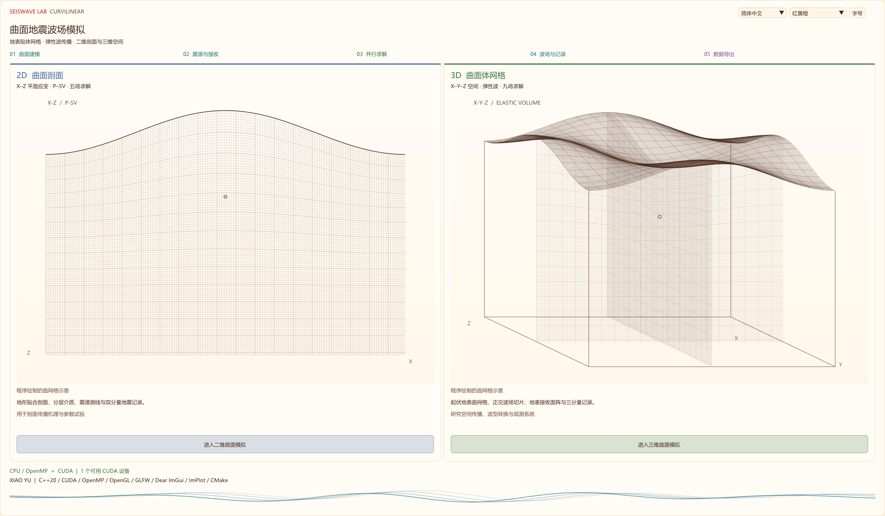
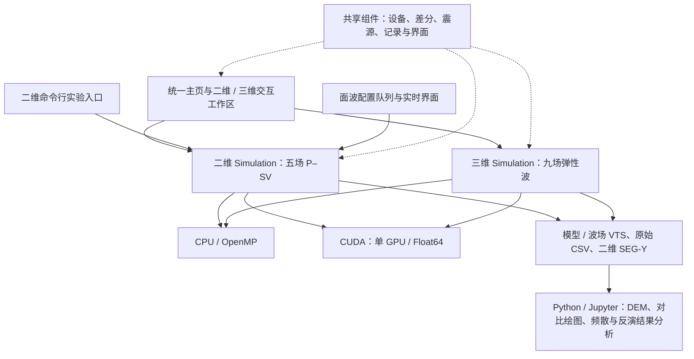
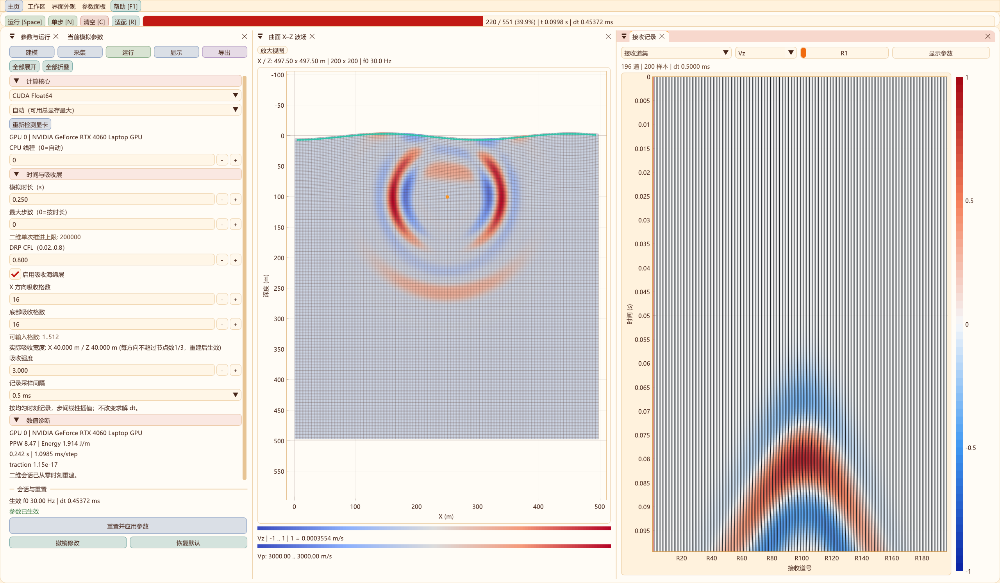
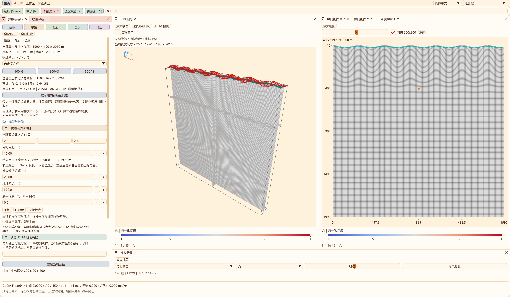
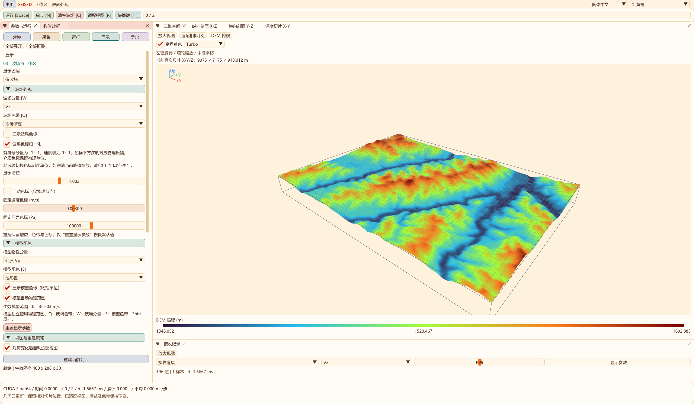
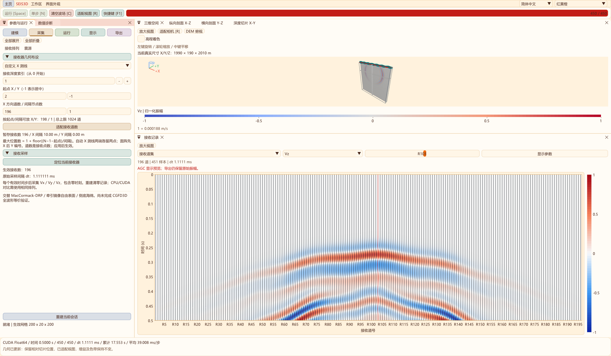

<p align="center"></p>

# SeisWave Lab · Curvilinear

**面向起伏地表与近地表结构研究的二维 / 三维曲网格弹性波模拟工作台。**

本项目将地形贴体网格、弹性波正演、CPU / CUDA 计算与交互显示组织在同一工作流中，支持从模型与采集参数设置，到波场观察、地震记录导出和实验重绘。二维用于剖面机理分析与参数筛选，三维用于局部空间传播与观测几何研究。

技术栈：**C++20 · CUDA Float64 · OpenMP · OpenGL 4.3 · Dear ImGui Docking · ImPlot · CMake · Python / Jupyter**。

[项目背景](#项目背景) · [方法原理](#方法原理) · [项目架构](#项目架构) · [实现与实验流程](#实现与实验流程) · [界面效果](#界面效果) · [应用场景](#应用场景) · [构建与运行](#构建与运行) · [验证与升级方向](#验证与升级方向) · [参考文献](#参考文献)



*统一主页分别进入二维和三维工作区；主页网格为界面示意。全部界面截图于2026-10-27重新采集，统一红黄橙主题，原生完整窗口2560×1494；记录页扩大显示区域。详见[完整界面图集](docs/SCREENSHOT_GALLERY.md)。*

## 项目背景

黄土塬及沟壑山地区域的地震采集同时面对地形起伏、近地表低速层、强速度反差和复杂激发接收条件。沟缘、坡面及塬面会改变传播路径，产生散射、绕射与模式转换；浅层低速结构又会影响面波频散、能量分布及反射波识别。仅观察一张道集，往往难以区分这些因素的贡献。

规则直角网格具有实现与并行访问方便的特点；当起伏自由表面采用阶梯近似时，还需要控制几何误差和边界误差。曲网格通过坐标映射使浅部网格贴合地形，在深部逐渐恢复水平，同时保留结构化邻点访问。本项目据此构建可交互的数值实验环境，支持在相同震源与观测条件下逐项改变地形、介质、主频和网格尺度。

项目主要服务三个问题：

- **机理分析**：区分地表高程与近地表低速结构对波场、到时和记录形态的影响。
- **方案比较**：对比震源主频、埋深、道距、偏移距及模型尺度，辅助安排后续现场试验。
- **方法开发**：在共用的数值接口下开展 CPU / CUDA 一致性、网格与边界敏感性、二维 / 三维性能测试。

地形起伏本身不改变介质输入的真实速度；它通过传播路径、边界及激发接收高程影响观测记录。有关黄土塬采集的解释与适用范围见[采集生产应用分析](docs/ACQUISITION_PRODUCTION_VALUE.md)。

## 方法原理

### 控制方程与二维 / 三维关系

求解各向同性线弹性介质的速度—应力方程，重复指标求和：

$$
\rho\,\partial_t v_i=\partial_{x_j}\sigma_{ij}+f_i,
\qquad
\partial_t\sigma_{ij}=\lambda\delta_{ij}\partial_{x_k}v_k+
\mu(\partial_{x_j}v_i+\partial_{x_i}v_j).
$$

输入为纵波速度、横波速度和密度，由此计算弹性参数：

$$
\mu=\rho V_s^2,\qquad \lambda=\rho(V_p^2-2V_s^2).
$$

| 项目 | 二维曲面剖面 | 三维曲面体网格 |
| --- | --- | --- |
| 物理假设 | X–Z 平面应变、沿 Y 不变，P–SV 系统 | 三维各向同性弹性波 |
| 独立状态 | Vx、Vz、σxx、σzz、σxz，共五场 | 三速度、六应力，共九场 |
| 震源几何 | 沿 Y 延伸的线源 | 三维局部源 |
| 接收观测 | 测线，Vx / Vz | X / Y 测线或 X–Y 面阵，Vx / Vy / Vz |
| 主要用途 | 长剖面、浅层精细实验、参数扫描 | 空间散射、侧向传播、面阵观测 |

二维独立分配五场数组，不通过三维薄层近似实现。二维与三维的源单位和几何扩散不同，比较绝对振幅时需要相应的物理标定。二维当前不求解 SH 分量。

### 从规则计算网格到贴体曲网格

以三维为例，计算坐标 $(\xi,\eta,\zeta)$ 映射到物理坐标：

$$
x=\xi,\qquad y=\eta,\qquad
z=\zeta+H(\xi,\eta)F(\zeta/D).
$$

其中 z 向下为正，H 为相对基准面的地表深度，D 为展平深度；F 使用九次平滑过渡，在地表保持地形，在深部衰减为零。二维支持导入实际 X–高程剖面；三维支持米制规则高程数组 VTI/VTS，默认使用靖边南沟谷 400×288、25 m 数据，并按资源预算分配实际求解网格。原始 DEM 可随模型 VTS 完整保存，见[三维 DEM 说明](docs/EXTERNAL_DEM_3D.md)。

物理导数通过逆度量变换到规则计算坐标，建模时检查 Jacobian 为正。界面所填 h 是计算网格间距；曲面拉伸和压缩后，实际物理节点间距还受映射影响。节点数表示物理节点，不含每侧三层虚节点，计算域跨度按 $(N-1)h$ 计算。

### 离散、边界与时间步

| 环节 | 当前实现 |
| --- | --- |
| 空间离散 | 同位网格，交替前 / 后向 MacCormack-DRP 传播差分 |
| 时间推进 | 四阶段加权组合，在阶段内及完整步间调度差分方向 |
| 曲面几何 | 坐标差分计算度量与 Jacobian，再构造物理导数 |
| 自由表面 | 局部零牵引闭合、度量加权牵引镜像及近表面处理 |
| 外边界 | 侧面、底部可调海绵吸收；顶面保持自由表面 |
| 震源 | Ricker 子波，定向体力或各向同性爆炸矩源 |
| 时间步 | 根据几何、波速、CFL、阻尼及源采样约束确定 |
| 数值精度 | CPU 与 CUDA 求解状态采用 Float64 |

传播差分、几何差分和边界闭合各有误差来源，项目不将整套实现笼统标为全局四阶。侧底海绵吸收的厚度与强度共同影响边界表现，增宽不能直接等同于吸收率提高。

网格设计应结合目标有效频带上限 $f_{max}$ 与最慢相关波速评估空间采样；Ricker 主频并非频带上限。低速层和曲面压缩区需要重点检查，面波实验还应进行网格加密、参考域及自由表面精度对照。

公式推导、系数、边界与采样约定见[曲网格波场理论](docs/CURVILINEAR_WAVE_THEORY.md)、[数值原理](docs/NUMERICAL_METHOD.md)、[二维五场工作流](docs/TWO_D_WORKFLOW.md)和[震源机制](docs/SOURCE_MECHANISMS.md)。方法来源对应文末文献 [1–4]。

## 项目架构

工程按“入口与交互—模拟会话—维度求解器—计算后端—数据与分析”组织。二维和三维分别维护模型、波场及接收记录，共用设备服务、差分定义、震源约定和记录显示组件。



### 源码职责与阅读入口

| 模块 | 职责 | 入口 |
| --- | --- | --- |
| 应用与界面运行时 | 主页、工作区切换、窗口、主题及语言 | [Application.cpp](src/common/ui/Application.cpp)、[AppRuntime.cpp](src/common/ui/AppRuntime.cpp) |
| 二维工作台 | 参数编辑、采集、运行、波场与记录显示 | [Workbench2D.cpp](src/two_d/ui/Workbench2D.cpp) |
| 二维数值核心 | 参数检查、曲网格、介质、时间推进与采样 | [CurvilinearSolver2D.cpp](src/two_d/CurvilinearSolver2D.cpp)、[公共接口](include/Seis2D/CurvilinearSolver2D.hpp) |
| 三维数值核心 | 三维网格、九场状态与求解会话 | [CurvilinearSolver.cpp](src/three_d/CurvilinearSolver.cpp) |
| CUDA 后端 | 维度专用设备数组与计算内核 | [二维 CUDA](src/two_d/CudaEngine2D.cu)、[三维 CUDA](src/three_d/CudaEngine3D.cu) |
| 共用计算定义 | 设备枚举、差分系数、源机制及数据约定 | [FiniteDifference.hpp](include/SeisCommon/FiniteDifference.hpp)、[SourceMechanism.hpp](include/SeisCommon/SourceMechanism.hpp) |
| 模型与记录 I/O | 模型 VTS、波场及 CSV、SEG-Y 数据交换 | [ModelIo2D.cpp](src/two_d/ModelIo2D.cpp)、[SegyIo.cpp](src/common/SegyIo.cpp) |
| 自动实验入口 | 四组对比、面波队列、进度与结果校验 | [Experiment2D.cpp](src/two_d/Experiment2D.cpp)、[MaswLive2D.cpp](src/two_d/ui/MaswLive2D.cpp) |
| 分析与复现工具 | DEM 提取、Notebook 重绘、性能与文档工具 | [tools](tools/README.md)、[实验绘图](tools/seismic_plotting/README.md)、[benchmarks](benchmarks/README.md) |
| 构建与验证组织 | 目标依赖、CPU / CUDA 选项与 CTest | [Targets.cmake](cmake/Targets.cmake)、[CMakePresets.json](CMakePresets.json) |

### 仓库与生成文件边界

```text
SeisWaveLab_Curvilinear_Workspace/
├─ SeisWaveLab_Curvilinear/          独立 Git 仓库
│  ├─ CMakeLists.txt / CMakePresets.json
│  ├─ cmake/                        目标、构建规则与外部输出布局
│  ├─ include/                      SeisCommon / Seis2D / Seis3D 接口
│  ├─ src/common/                   共享设备、数据与 UI
│  ├─ src/two_d/                    二维核心、CUDA、验证与 UI
│  ├─ src/three_d/                  三维核心、CUDA、验证与 UI
│  ├─ tools/                        DEM、实验绘图与文档工具
│  ├─ benchmarks/                   性能测试源码与报告工具
│  ├─ docs/                         方法、指南、图集与发表基准数据
│  ├─ resources/                    图标与示例高程
│  ├─ shaders/ / third_party/       渲染资源与第三方源码
│  └─ LICENSE / THIRD_PARTY_NOTICES.md
└─ out/                             本地生成内容，不属于 Git 仓库
   ├─ build/x64-Release/             Release 构建树
   ├─ build/x64-Debug/               Debug 构建树
   ├─ bin/Release/、bin/Debug/       EXE、DLL 与运行资源
   ├─ lib/                          静态库
   ├─ validation/、benchmarks/       验证与性能运行输出
   ├─ jingbian_15Hz_2m/              已有 15 Hz 四组原始实验
   ├─ jingbian_30Hz_2m/              已有 30 Hz 四组原始实验
   ├─ surface_wave_masw/             面波配置、队列与运行结果
   └─ documentation/、blog/          离线说明与发布包
```

构建缓存、模拟数据、临时截图、Python 字节码和发布包统一放在外层 `out`。`docs/images` 的发表图片、`docs/data` 的基准证据和 `resources` 的原始资源随仓库版本管理。实验目录是本地运行产物，新克隆仓库需要自行准备输入并生成结果；目录规则见[仓库组织](docs/REPOSITORY_LAYOUT.md)。

## 实现与实验流程

### 交互式模拟

1. **建模**：选择二维 / 三维、节点数、间距、地形与展平深度，设置均匀或分层 Vp / Vs / 密度。二维可通过 [DEM Notebook](tools/dem_profiles/README.md)准备高程剖面并导入。
2. **采集**：设置源类型、主频、幅值与位置，布置接收测线或三维面阵。
3. **应用与预检**：检查物性、网格、Jacobian、设备与资源需求；初始化计算会话并确定实际时间步。
4. **运行与观察**：选择 CPU / CUDA，运行、暂停或单步，查看传播、接收记录、进度和诊断。
5. **导出与复核**：保存模型、指定分量波场及原始记录，保留实际坐标、时刻、采样间隔和参数。
6. **分析与重绘**：通过 Notebook 进行同一时刻波场、道集、频谱、频散及已有反演结果的对比。

更改物理模型或计算设备后需要重建，从零时刻开始。返回主页会结束当前维度会话；模型 VTS 用于重建模型，波场快照不包含续算所需的完整状态。

### 自动化对比实验

批量计算入口与交互工作台复用相同的二维核心，C++ / CUDA 负责正演，Python 可负责组织实验、启动进程、监控和后处理。

| 入口 | 参数组织与执行 | 当前适用范围 |
| --- | --- | --- |
| `seis2d_experiment` | `--group` 选择四组，`--frequency` 设置主频，`--terrain` 指定高程，`--output` 指定结果目录 | 靖边 10 km × 4 km、2 m 网格专项对比；其余主要模型参数保存在 C++ 入口中 |
| `SeisWaveLab_MASW` | 读取外层 `out/surface_wave_masw/live_session.cfg`，依次初始化队列算例，并显示运行过程 | 平地分层面波实验；专用配置格式支持网格、介质、采集和吸收参数 |

四组采用地形与低速层的二因素设计：M00 平地无低速层、M10 起伏无低速层、M01 平地有低速层、M11 起伏有低速层。每组使用独立输出目录；已有实验分别采用 15 Hz 与 30 Hz，便于比较频率变化。

自动入口保存状态、模型、指定时刻快照与原始记录，并进行有限值、样本数和 SEG-Y 回读等检查。`COMPLETE.txt` 表示相应运行与导出检查通过，传播精度仍由收敛和参考解比较评估。面波队列关闭后没有断点续算功能。

历史批次的 Python 调度脚本位于本地外层 `out/tools`，不随源码仓库分发；上述两个 C++ 入口已纳入 [CMake 目标](cmake/Targets.cmake)。面波启动前需准备专用配置，直接运行新构建的 EXE 不会自动生成实验队列。

### 数据格式与可重复绘图

| 数据 / 工具 | 内容与用途 |
| --- | --- |
| 模型 VTS | 本程序对应维度的模型、坐标及参数，支持导入后从零重建 |
| 波场 VTS | 所选物理分量、显式坐标与时刻，用于快照和空间对比 |
| 接收 CSV | 原始记录；自动实验入口同时保存接收几何等信息 |
| 二维 SEG-Y | Vx / Vz 分量交换；界面与自动实验入口的具体导出配置分别记录 |
| [01 不同主频四组模型对比](tools/seismic_plotting/01_不同主频四组模型对比.ipynb) | 模型、原始 / RMS / AGC 道集、同一时刻波场与频率对比 |
| [02 面波波场与频散对比](tools/seismic_plotting/02_面波波场与频散对比.ipynb) | 面波记录、裁切快照、网格 / 边界残差与频散谱 |
| [03 频散反演恢复对比](tools/seismic_plotting/03_频散反演恢复对比.ipynb) | 读取已有反演结果，比较反演模型、起始模型与正演真值 |

Notebook 通过参数单元格指定输入和输出路径，共享 `seisplot` 模块，也提供 JSON 配置命令行入口。显示增益、AGC、归一化和图像平滑仅作用于显示或分析副本，原始正演记录保持保留。频散反演由外部工具（如 Qt_Seis_MASW）完成；第三个 Notebook 负责已有结果的恢复分析，不执行反演。详见[绘图工具说明](tools/seismic_plotting/README.md)与[模型和波场交换约定](docs/MODEL_AND_WAVEFIELD_IO.md)。

## 界面效果

### 二维：参数、曲面波场与接收记录联动



左侧按建模、采集、运行、显示和导出组织参数；主视图区叠加模型、曲网格、震源与波场，下方显示 Vx / Vz 接收记录。模型、波场和道集分别配置色带及显示范围，顶部显示实际步数与模拟时刻。

### 三维：体网格与正交剖面





*默认靖边南沟谷高程数据，turbo颜色代表地表高程；此图为几何显示，不作为波场精度证明。*

三维空间显示与 X–Z、Y–Z、X–Y 切片配合，用于检查几何、源位置及传播。上图为建模状态，记录窗口尚未形成完整道集；运行过程见[三维操作图集](docs/USER_GUIDE.md)。

### 地震记录：原始数据与 AGC 显示



共用记录模块提供道集、单道、分量与显示增益等控制。图中 AGC 用于观察弱事件；定量振幅比较应回到统一尺度的原始记录。完整选项见[地震记录与 SEG-Y](docs/SEGY_AND_RECORDS.md)。

## 应用场景

| 场景 | 可开展的实验 | 主要分析量 |
| --- | --- | --- |
| 黄土塬、沟壑与山地采集 | 平地 / 起伏与有 / 无低速层的四组对照 | 走时、散射、模式转换、反射识别与晚时能量 |
| 主频与激发条件筛选 | 改变主频、源机制、埋深及接收高程 | 频谱、有效信号、干扰波及激发接收敏感性 |
| 浅层面波与 MASW 数据准备 | 干黄土覆盖、分层 Vs、偏移距窗口及不同网格 | 频散谱、相速度曲线与反演恢复对比 |
| 二维到三维的局部研究 | 将剖面问题扩展为空间地形与面阵观测 | 侧向传播、离面散射与空间观测差异 |
| 数值算法与软件开发 | CPU / CUDA 对照、网格加密、扩域与边界测试 | 波形误差、相位、振幅、内存和推进耗时 |
| 教学与技术交流 | 交互修改地形、介质和采集参数 | 波型识别、参数影响和可复现实验展示 |

二维适合先筛选方案，三维再检查局部空间效应。涉及生产部署时，需结合现场试验炮与近地表调查校准模型；当前没有内置生产静校正、叠前偏移或完整采集照明模块。

### 已有性能数据

仓库保留 2026-10-19 的二维 / 三维 CPU–CUDA 基准：i9-13900HX、OpenMP 32 线程、RTX 4060 Laptop GPU、Release / Float64，每个尺寸与后端重复五次。

| 维度 | 已测模型 | CUDA 相对 CPU 加速比 |
| --- | --- | --- |
| 二维五场 | 256²、1024²、2048² | 3.56–4.82× |
| 三维九场 | 48³、96³、160³ | 4.09–4.64× |

计时针对生产路径 `advance(1)`，不含初始化、渲染和文件导出。这是指定硬件与模型下的结果；规则网格参考项目在精度、推进与边界配置上存在差异，不能直接用绝对耗时判定两类方法优劣。原始 CSV、测试方法与曲线见[性能报告](docs/PERFORMANCE_BENCHMARK.md)。

## 构建与运行

### 环境与主程序

需要 CMake 3.25+、C++20 编译器；Windows 主要使用 MSVC x64 与 Ninja。GUI 依赖 GLFW、GLEW 和 OpenGL 4.3。默认预设启用 CUDA；预设中的完整架构列表要求 CUDA Toolkit 12.8 或兼容后续版本，较早 Toolkit 可按目标设备调整架构。

以下命令在 **Git 仓库根目录** 的 MSVC x64 开发者终端执行：

```powershell
cmake --preset x64-Release
cmake --build --preset x64-Release --parallel
ctest --preset x64-Release
..\out\bin\Release\SeisWaveLab_Curvilinear.exe
```

主程序支持 `--2d`、`--3d` 直接进入工作区。Debug 对应 `x64-Debug` 预设。在 Visual Studio 中打开本仓库，选择相应预设，以 `SeisWaveLab_Curvilinear` 为启动目标。

其他计算机需通过 `SEIS3D_GLFW_ROOT` 和 `SEIS3D_GLEW_ROOT` 指定本机 SDK，原开发机默认路径需要按实际环境调整。没有 CUDA Toolkit 时，可按以下方式构建 CPU 版本：

```powershell
cmake --preset x64-Release -DSEIS3D_ENABLE_CUDA=OFF
cmake --build --preset x64-Release --parallel
```

再加 `-DSEIS3D_BUILD_GUI=OFF` 可仅构建核心、命令行和验证目标。当前两个专项自动实验入口默认使用 CUDA；构建 CPU 版本不等于它们会自动切换 CPU，使用 CPU 正演可从主工作台或相应核心接口配置。

### 资源与容量

- 二维每方向允许 8–16384 个物理节点；步数输入范围为 0–200000，0 表示按时长运行，实际总步数仍受 200000 步保护限制。
- 二维吸收宽度输入为 1–512 格，各方向有效宽度还限制为对应节点数的三分之一；三维输入宽度为 1–64 格。
- 三维每物理轴允许 8–300 个节点。两维的实际可用模型均受 RAM / VRAM、暂存数组及记录容量约束，维度上限不是容量承诺。
- 每次模拟使用一块 GPU；求解设备可选，显示设备与求解设备可以不同。切换设备后需重建会话。
- 分发时保留 EXE 同级 DLL、`shaders`、`licenses` 及示例资源；目标机需要兼容的运行库、图形环境和 NVIDIA 驱动。默认输出位置含编译时配置，跨机器部署需检查路径。

设备检测、内存预检、SDK 路径、CUDA 架构及分发细节见[构建说明](docs/BUILDING.md)。

## 验证与升级方向

2026-10-25 工作区更新：二维 / 三维后台推进、视图放大与布局保存、磨砂质量档与缓存、原始记录 SVG / 波窗评价，以及内嵌 DEM 的三维模型复现已接入。具体实现、回归和剩余工作见[优化进展](docs/OPTIMIZATION_PROGRESS.md)。

已有验证覆盖几何与参数检查、选定算例的物理传播、CPU / CUDA 一致性、模型交换和记录回读。验证入口通过 CTest 组织，证据及限制见[数值验证状态](docs/NUMERICS_AND_VALIDATION.md)。稳定运行、后端一致和物理精度分别评估。

当前建模对象是均匀或分层、各向同性固体；二维新增可选的 [Qp/Qs GSLS 黏弹性模块](docs/QP_QS_VISCOELASTIC_2D.md)，三维仍为无显式 Q 的弹性模拟。支持实际地表 VTI/VTS 与自包含模型 VTS 重建。任意外部体物性模型、各向异性、三维黏弹性、局部加密、多 GPU 与断点续算仍待实现。当前侧底为海绵吸收，上游完整 CFS-PML / MPI 尚未整体移植。

后续升级可围绕以下顺序推进：

1. **补齐精度证据**：标准 P / S 与 Rayleigh 波参考解、反射转换系数、网格收敛和边界反射率。
2. **统一实验配置**：将专项入口的模型与采集参数抽出，形成 GUI / 命令行共用的配置格式、队列和日志。
3. **改善大模型运行**：降低重建峰值内存、控制导出开销，完善运行时路径配置与断点保存。
4. **扩展物理与几何**：在验证基础上研究 CPML / CFS-PML、Q 衰减、三维地形与复杂体模型。
5. **完善分析衔接**：统一观测几何、频散曲线与反演结果的交换约定，形成正演—处理—恢复评价流程。

## 文档与开发入口

| 阅读目的 | 文档 |
| --- | --- |
| 完整背景、理论与实现说明 | [项目手册](docs/PROJECT_MANUAL.md) |
| 坐标映射、同位 / 交错网格及差分理论 | [曲网格波场理论](docs/CURVILINEAR_WAVE_THEORY.md)、[数值原理](docs/NUMERICAL_METHOD.md) |
| 操作、采集与导出 | [用户指南](docs/USER_GUIDE.md)、[二维工作流](docs/TWO_D_WORKFLOW.md)、[模型与波场交换](docs/MODEL_AND_WAVEFIELD_IO.md) |
| 高程、模型容量与源机制 | [地表剖面](docs/SURFACE_PROFILES.md)、[震源机制](docs/SOURCE_MECHANISMS.md) |
| 生产应用与性能证据 | [采集应用](docs/ACQUISITION_PRODUCTION_VALUE.md)、[性能报告](docs/PERFORMANCE_BENCHMARK.md) |
| 重新绘制已有实验 | [实验 Notebook](tools/seismic_plotting/README.md) |
| 其他主题 | [文档总导航](docs/README.md) |

从仓库根目录运行 `python -B tools/check_repository.py`，可检查文档本地链接、构建路径与仓库中的生成文件。按 `tools/requirements.txt` 安装依赖后，运行 `python -B tools/package_documentation.py` 可生成离线说明与 GitHub Pages / Hexo 包，输出到外层 `out/documentation` 与 `out/blog`。打包工具不自动推送网站。

## 参考文献

以下文献分别对应速度—应力有限差分、曲面自由表面、同位曲网格、DRP 和面波分析。文献中的原始算法能力与精度结论须结合本项目实际实现及验证理解。

1. Virieux, J. (1986). **P-SV wave propagation in heterogeneous media: Velocity-stress finite-difference method.** *Geophysics*, 51(4), 889–901. [DOI: 10.1190/1.1442147](https://doi.org/10.1190/1.1442147)。速度—应力有限差分经典背景；本文采用交错网格，本项目采用同位网格。
2. Zhang, W., & Chen, X. (2006). **Traction image method for irregular free surface boundaries in finite difference seismic wave simulation.** *Geophysical Journal International*, 167(1), 337–353. [DOI: 10.1111/j.1365-246X.2006.03113.x](https://doi.org/10.1111/j.1365-246X.2006.03113.x)。起伏自由表面的牵引镜像方法。
3. Zhang, W., Zhang, Z., & Chen, X. (2012). **Three-dimensional elastic wave numerical modelling in the presence of surface topography by a collocated-grid finite-difference method on curvilinear grids.** *Geophysical Journal International*, 190(1), 358–378. [DOI: 10.1111/j.1365-246X.2012.05472.x](https://doi.org/10.1111/j.1365-246X.2012.05472.x)。同位曲网格弹性波方法的主要参考。
4. Tam, C. K. W., & Webb, J. C. (1993). **Dispersion-Relation-Preserving Finite Difference Schemes for Computational Acoustics.** *Journal of Computational Physics*, 107(2), 262–281. [DOI: 10.1006/jcph.1993.1142](https://doi.org/10.1006/jcph.1993.1142)。DRP 差分的设计思想；具体传播系数与调度来源见本项目数值文档及 CGFD3D 对照。
5. Park, C. B., Miller, R. D., & Xia, J. (1999). **Multichannel analysis of surface waves.** *Geophysics*, 64(3), 800–808. [DOI: 10.1190/1.1444590](https://doi.org/10.1190/1.1444590)。多道面波频散分析背景；另见[作者机构文献记录](https://pubs.usgs.gov/publication/70021640)。
6. Bohlen, T., & Saenger, E. H. (2005). **Accuracy of heterogeneous staggered-grid finite-difference modeling of Rayleigh waves.** *WIT Annual Report 2005*. [作者机构报告 PDF](https://www.wit.uni-hamburg.de/import/documents/reports/2005/wit2005-bohlen.pdf)。面波自由表面离散与精度评价参考，此处引用的是机构报告版本。

### 上游软件与许可

数值方法及部分实现参考 [CGFD3D：Curvilinear-Grid Finite-Difference 3D Code for Seismic Wave Simulation with Surface Topography](https://github.com/zw-sustech/CGFD3D)。保留的参考源码、来源及验证范围见[上游参考说明](third_party/cgfd3d_reference/README.md)。

项目许可证见 [LICENSE](LICENSE)；上游授权说明、Dear ImGui / ImPlot 及其他第三方来源见 [THIRD_PARTY_NOTICES.md](THIRD_PARTY_NOTICES.md)。
