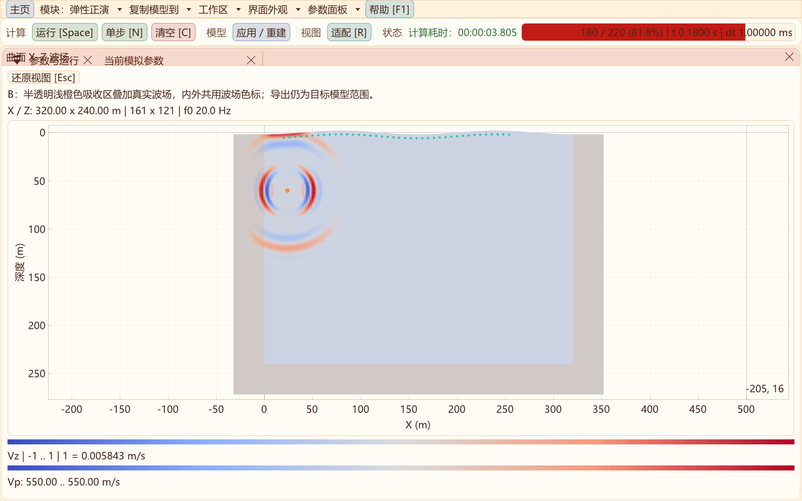
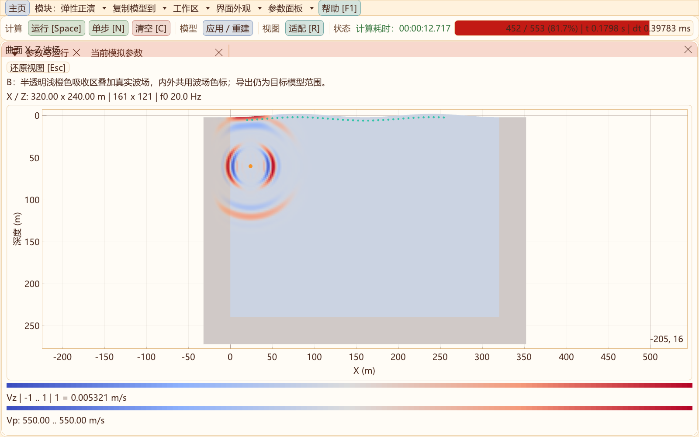

# 二维吸收区：真实波场与半透明边界配色

更新：2026-10-31。适用于二维弹性、黏弹性与声学正演，未修改三维或RTM渲染。

按B或启用“显示 → 吸收区显示/吸收区波场”，可同时查看目标模型和左右、底部、角区的实际计算波场。外扩吸收区保留原浅橙色RGB(237,139,35)，默认以14%不透明度叠加在波场与模型上；显示面板的“边界着色不透明度”可调0–0.50。0表示完全去除填色，数值越大边界颜色越明显。弹性原内部吸收模式保留既有暖色提示。

## 显示效果






弹性支持Vz、Vx、速度模和压力，黏弹性压力沿用真实Syy状态；声学支持压力独显、模型独显和模型＋波场。波场和材料色带保持原设置，浅橙色只是独立显示叠层。参数、接收记录与窗口布局沿用已有设置，图中使用软件已有的“放大视图”，Esc可还原。

## 幅度与数据

目标区和吸收区使用同一个波场幅度范围，不在吸收区单独归一化或乘显示衰减因子。按B、调整边界不透明度不会改变数值波场、GSLS/PML记忆或原始记录。自动色标仍随目标区每帧峰值变化，跨时刻比较绝对衰减应读取物理刻度；观察纯波场颜色时可将边界不透明度设为0。

弹性读取接口`Simulation::readFrame(component, out, error, true)`返回不含虚点的完整计算域，X最快，目标域从X索引`grid().modelOffsetX`、Z索引0开始。默认false仍返回原Nx×Nz目标域。CPU和CUDA都在原计算场中取值，CUDA复用已有完整计算域显示缓冲，不增加一套求解场。后台缓存同时识别分量、步号和完整域/目标域，避免切换后复用尺寸不符的旧图。

声学完整域接口见[声学CPML说明](ACOUSTIC_CPML_2D.md)。默认VTS、CSV与SEG-Y导出范围不变；本次不改变求解算法、吸收参数或历史模型配置。

## 验证与复核

- [8项CTest回归](data/absorber-display-2026-10-31/regression.txt)全部通过：完整域显示、外扩边界、弹性/声学界面、精度界面、声学CPML、模块隔离与RTM界面。
- [原生显示验收](data/absorber-display-2026-10-31/native-validation.txt)：FP32/FP64 × 海绵/CFS-PML × 弹性/GSLS八组，CPU与CUDA均覆盖；四种分量的目标裁切逐点一致，吸收区非零且有限，后端全域数值一致性通过。
- 同一验收检查后台运行中切换分量及完整域/目标域缓存，原始场、Syy、GSLS和PML记忆与独立同步推进一致。
- [弹性界面](data/absorber-display-2026-10-31/elastic-ui.txt)和[声学界面](data/absorber-display-2026-10-31/acoustic-ui.txt)确认B切换、完整范围、共用幅度、不透明度不改变物理数据；[放大视图复核](data/absorber-display-2026-10-31/capture-regression.txt)通过。

在源码目录的开发者终端执行，输出仍位于外层out：

```powershell
cmake --build ../out/build/x64-Release --target seis2d_absorber_display_validation SeisWaveLab_Curvilinear
ctest --test-dir ../out/build/x64-Release -R '^curvilinear_2d_(absorber_display|cfs_pml_ui|acoustic_ui)$' --output-on-failure
```

这是一轮数据显示及读取验证，没有重新测量新反射率或性能倍速。吸收物理及原有数值验收分别见[弹性CFS-PML](CFS_PML_2D.md)与[声学CPML](ACOUSTIC_CPML_2D.md)。
