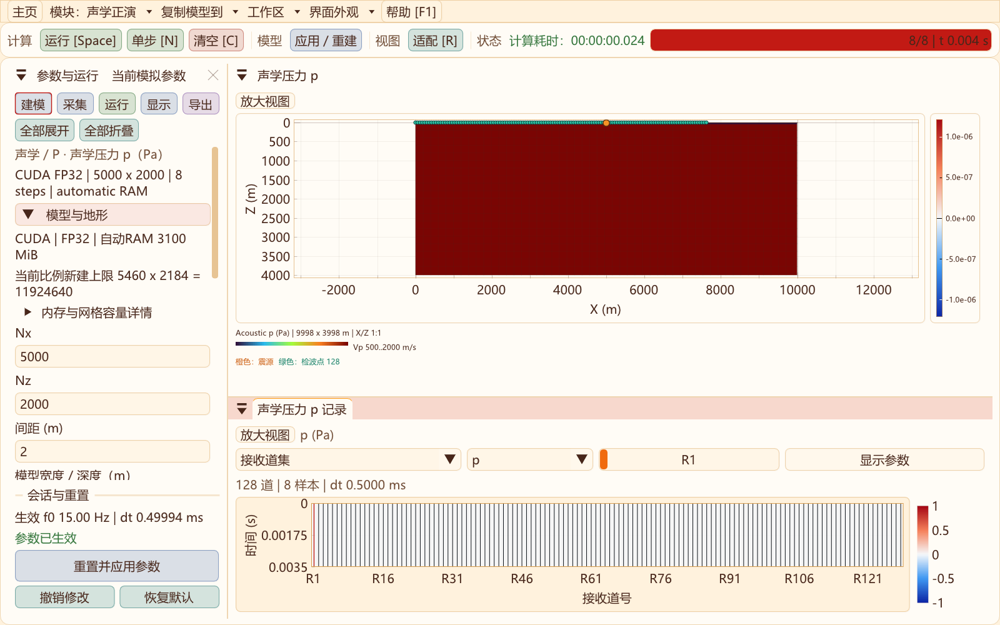
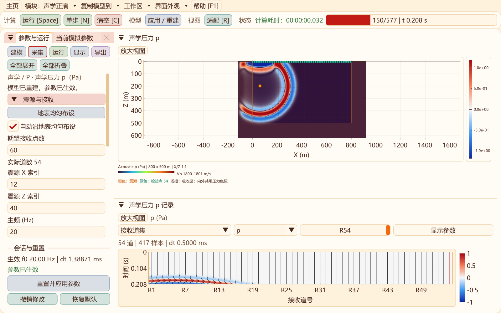

# 声学自动容量、CUDA刷新及有限元核说明

后续更新：正演现支持自动跟随模型的地表采集线，见[自动布设与保存](FORWARD_SURFACE_RECEIVERS_2D.md)；本页下述快捷按钮为较早实现。

2026-10-31高阶声学升级：新增独立CPU/CUDA、FP32/FP64曲网格DRP7–RK4试验核，含零压力自由面、外扩ADE-CPML、震源正则化及选择性数值耗散。解析/界面/吸收与八项回归通过；15/30 Hz局部对照未通过5%等误差门槛，P1继续默认，RTM保持P1。[实现、实测与下一阶段门槛](ACOUSTIC_DRP_2D.md)。

更新：2026-10-31。声学正演默认改为自动RAM预算；保留手动上限、CPU/CUDA和FP32/FP64选择。

## 原因与修复

此前声学默认只有1536 MiB手动RAM预算，即使显卡有空闲显存，也会先被该上限限制。另有一次重建检查在几何数组已经分配后，按剩余内存再次判断完整构建峰值，重复计算了候选模型的部分内存。本轮修复这两处，未通过删除安全余量来放大显示数字。

- 默认`memoryMiB=0`表示自动预算：取构建前空闲RAM的70%，目前最大32768 MiB；无法查询RAM时回退1536 MiB。正值仍表示显式手动上限。
- 模型初始化保存构建前的资源快照，整体峰值与此快照比较，避免重复扣除已分配的候选几何。GPU分配前仍重新检查空闲显存。
- CPU/CUDA、FP32/FP64、设备编号、网格、记录和吸收配置改变时立即刷新容量；仅硬件空闲资源的定时查询使用0.75秒间隔。
- 运行面板和模型面板都显示所选计算核心、精度、实际RAM预算和上限；分别提示手动RAM上限、系统空闲RAM、CUDA显存或设备不可用。
- 相同参数重置/运行可以复用已生效数组。若当前会话保留后只够构建更小的新模型，主界面显示“当前可复用网格”，详情仍说明新建预算，不把已在运行的大网格错误标成无法使用。

CUDA不能绕过主机RAM需求：当前有限元矩阵和几何仍在主机组装。因此当RAM是瓶颈时，切换CUDA后网格上限可能与CPU接近；显存不足时则可能更小。界面会刷新真实资源，不能保证CUDA必然显示更多点。

## 5000×2000真实界面验证

采用CUDA、FP32、h=2 m、24格外扩CPML、15 Hz、表层Vp=500 m/s；目标5000×2000，计算5048×2024。从已有小模型CPU会话经工作区的“应用/重建”流程切换至GPU，自动预算下成功完成8步，压力有限且非零。

| 项目 | 本机实测 |
| --- | ---: |
| 构建前空闲RAM | 7185.55 MiB |
| 构建前空闲显存 | 7042.09 MiB |
| 保守构建与记录RAM估算 | 2614.56 MiB |
| 本次实际解析的自动RAM预算 | 4954.89 MiB |
| 主机持久数组 | 751,302,468 B |
| 设备数组 | 686,129,652 B，约654.34 MiB |



原始[界面容量记录](data/acoustic-capacity-auto-2026-10-31/ui-capacity.txt)及[启动验收](data/acoustic-capacity-auto-2026-10-31/large-ui.txt)。数值表示该次测试资源快照，会随其他程序和现有模型占用变化。**这是短步容量与界面验收，不是完整时长稳定性、精度或速度基准。**

新建声学会话默认自动预算。载入旧schema 1/2文件仍保留文件中的手动上限；如需按当前机器放开容量，勾选“运行 → 自动RAM预算（推荐）”，再应用。自动预算文件使用声学schema 3，`Runtime`中的RAM值0及版本均参与校验；显式手动预算仍写schema 2。原schema 1/2继续兼容，物理参数和源规范不变。

## P1默认核为什么采用有限元

| 项目 | 当前声学正演/RTM基础核 | 当前弹性/黏弹性正演 |
| --- | --- | --- |
| 空间离散 | 贴体格剖分为P1线性三角形，变密度压力弱形式，集总质量 | 曲网格MacCormack-DRP空间导数 |
| 时间推进 | 二阶显式递推；声学CPML增加卷积滤波状态 | RK4；GSLS/PML状态随阶段推进 |
| 主传播变量 | 标量压力的三个时间层 | 速度—应力系统及阶段缓冲 |
| 当前工程用途 | 独立、可验证的声学与离散伴随RTM基准 | 已有弹性/衰减正演及采集实验 |

这里有限元/有限差分是空间离散方式，RK4是时间积分方式，两者不是互斥概念；有限元也可以使用其他时间积分方法。

采用P1核是此前先建立独立RTM基准时的工程选择：组装对称刚度矩阵与集总质量，便于明确离散传播算子、其转置及检查点回放，再用伴随点积验证；新增声学正演复用了这个核。**这不代表有限元必然比高阶差分更适合大规模正演，也不代表它是高阶谱元。**当前软件仍使用贴体结构网格，不能因内部使用三角形有限元而宣称支持任意非结构网格。

声学完全可以采用DRP；Tam与Webb的经典论文研究的正是计算声学中的色散关系保持差分：[NASA原文条目](https://ntrs.nasa.gov/citations/19930067183)。声学弱形式CPML的实现背景可参见[变分CPML论文](https://specfem.org/komatitsch.free.fr/published_papers/CMES_CPML_2008_typos_fixed.pdf)，其谱元结果不能直接当作本P1实现的精度结果。

面向大规模正演，可在声学工作区增加独立的曲网格一阶`p, vx, vz`高阶差分核，复用已有DRP/RK4基础设施。应分别验收曲面零压力条件、材料界面、CPML、压力源归一化、色散与精度/性能；RK4需要阶段存储，同点数下不保证更省显存，应按同等误差比较总成本。RTM若切换到该新核，还必须推导包含时间阶段与边界状态的离散伴随，并重新做点积和检查点验证。

本页所记容量修复批次保留原P1算法；后续已新增独立试验DRP核，当前状态、实测与门槛见页首链接，默认仍为P1。

## 采集：地表均匀布设快捷设置

二维“采集”页增加**地表均匀布设**按钮，声学、弹性/黏弹性及RTM均可使用。设置先写入待应用参数，重置/应用或下一次运行后生效；不会直接改动当前模拟的原始记录或震源。

- 弹性/黏弹性：检波器位于地表节点（深度索引0）。外扩吸收模式覆盖完整目标地表；原内部吸收模式避开两侧吸收区。
- 声学：检波器沿地表下首层节点（深度索引1）布设，避免自由面p=0造成恒零压力记录。
- 正演以当前道数为目标，自动换算整数节点间距并居中铺满可用范围；实际道数可能就近调整。弹性最多1024道、声学最多4096道。单道时放在可用范围中心。
- RTM现可设置起点、道数、间隔和深度；界面默认按期望道数自动沿地表下首层均匀布设，模型修改后重新对齐，重建或运行后生效。详见[RTM重建与采集](RTM_2D.md)。

这里均匀指**水平X间距均匀并跟随起伏地表**，不是按坡面弧长等距，也不自动证明采集空间采样充分。源和时间采样设置保持不变。



共享布设逻辑见[SurfaceSurvey2D.hpp](../include/Seis2D/SurfaceSurvey2D.hpp)，已验收地表行、内部吸收区避让、道数限制、单道居中及应用后的真实地形坐标。

## 验证与复核

- [六项回归](data/acoustic-capacity-auto-2026-10-31/regression-first.txt)覆盖声学正演、CPML、RTM、模块隔离、界面与容量/SEG-Y/预览专用验证。
- [实际下拉菜单检查](data/acoustic-capacity-auto-2026-10-31/dropdown-refresh.txt)通过CPU/CUDA、FP32/FP64切换后立即刷新，以及自动/手动RAM切换；[交互日志](data/acoustic-capacity-auto-2026-10-31/ui-interactions.txt)包含完整项目。
- CPML往返检查兼容自动schema 3及旧schema 1/2，旧手动RAM上限保留；[原生CPML日志](data/acoustic-capacity-auto-2026-10-31/cpml-validation.txt)。
- 新增快捷采集后[七项回归](data/acoustic-capacity-auto-2026-10-31/surface-regression.txt)全部通过，含声学/弹性真实按钮、应用后坐标、RTM界面及[原生布设验收](data/acoustic-capacity-auto-2026-10-31/workflow-validation.txt)。

```powershell
# 开发者终端，源码目录；输出位于外层out
cmake --build ../out/build/x64-Release --target SeisWaveLab_Curvilinear seis2d_acoustic_validation seis2d_acoustic_cpml_validation
../out/bin/Release/SeisWaveLab_Curvilinear.exe --smoke-acoustic-capacity
../out/bin/Release/seis2d_acoustic_validation.exe --capacity-auto
ctest --test-dir ../out/build/x64-Release -R '^curvilinear_2d_(acoustic_ui|acoustic_cpml|workflow_upgrade)$' --output-on-failure
```
