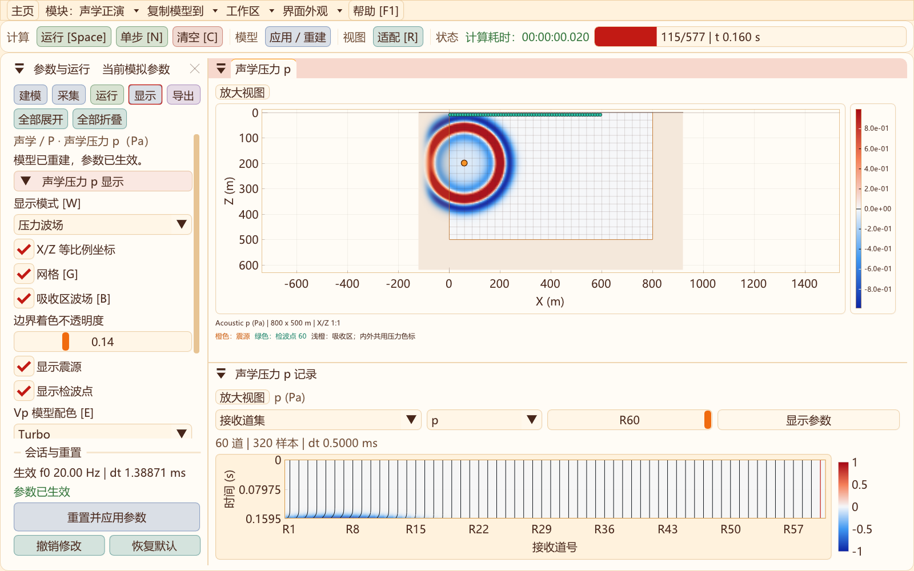
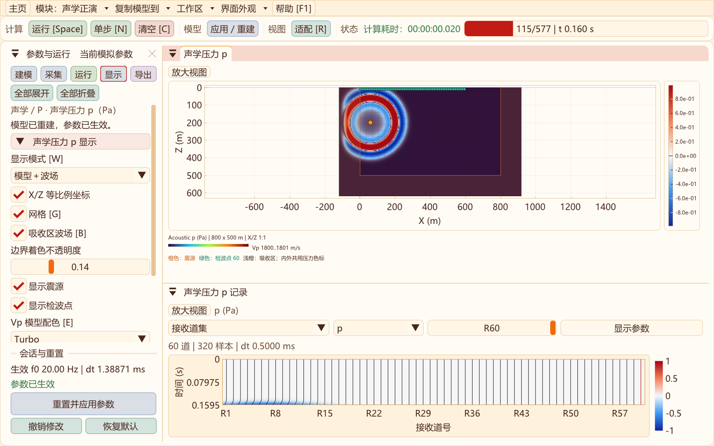
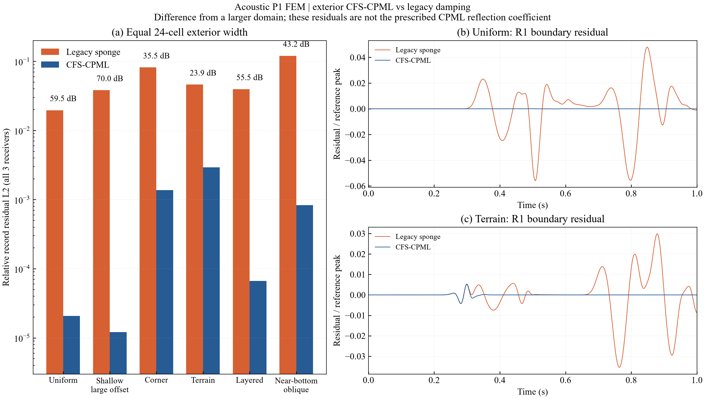

# 二维声学：模型波场叠加与CFS-CPML验证

2026-10-31：二维弹性/黏弹性及声学吸收区都可叠加真实波场，保留原浅橙色，新增“边界着色不透明度”（默认0.14）。[操作、截图与验证](ABSORBER_DISPLAY_2D.md)。

更新日期：2026-10-30。作用范围为二维声学正演，保留原P1三角形有限元、集总质量与二阶时间递推。弹性/黏弹性核及RTM伴随没有改为本实现。

## 使用与显示

声学工作区默认“模型＋波场”：Vp默认turbo，压力使用原有双极配色，弱压力处显示模型，强压力处显示波场。W循环压力、模型、叠加；保留X/Z等比例、网格及真实震源/检波点。波场放大后可用Esc还原。


下方记录复用弹性波的RecordView，单位Pa、分量p，支持道集/单道、密度/波形、增益和AGC预览。完整采样保留在独立UI缓存，后台只发布新增采样，避免每帧复制完整炮集。显示增益、AGC和限幅不改变原始波场及CSV。小窗口为记录区保留必要高度，仍可放大记录视图。


在“运行 → 计算与吸收边界”选择CFS-CPML，默认24格、目标R=1e-5、κ最大值1、参考频率0（跟随主频）。左、右、底部向目标模型外扩；顶面仍为起伏零压力自由表面，不设顶PML。B或“显示 → 吸收区波场”显示左右、底部及角区的真实压力，与目标域共用色标；细橙线标出物理目标域，恢复原浅橙色半透明叠加，并可调着色不透明度；不按边界距离人为减弱数值波场。显示切换不改变计算设置。旧海绵可选，加载旧声学模型时保留原方式。

## 观察吸收区波场

按B或勾选“显示 → 吸收区波场”，即可把计算域左、右、底部和角区纳入显示。压力独显与“模型＋波场”都支持；模型独显仍只看材料。细橙线圈出目标模型，线外是额外计算的吸收区。波场值来自求解器实际计算结果，经质量归一化恢复为Pa，没有补零、复制边缘或乘显示衰减因子。





开启B不会改变同一帧的压力限幅值；外侧没有独立归一化，因此可以横向比较同一时刻、边界内外的振幅。当前色标仍按目标域每帧峰值和“压力限幅/峰值”设置自动调整，跨时刻比较绝对衰减应同时读取Pa刻度，不能只凭颜色深浅判断。

显示快照可通过`pressureSnapshot(true)`或`readPressure(out, error, true)`读取完整`computeNx×computeNz`压力，X最快，目标域从X索引`absorberCells`、Z索引0开始。默认调用、VTS/CSV导出仍保留原目标域范围。没有增加第二套持久模型坐标或求解场；后台显示缓存仅多保留吸收区的Float32压力。

本轮[5项回归](data/acoustic-cpml-2026-10-30/absorber-display-regression.txt)通过。新增检查覆盖CPU/CUDA的FP32/FP64：完整场中目标域逐点等于原裁切快照、吸收区压力非零且有限、外边界仍为零、Float32显示值等于真实压力转换值。界面验证实际B键切换、外侧网格单元绘制、全域可见与等比例、共享色标和显示不改变求解状态。

## 算法及内存

采用复频移坐标拉伸 $S_i(s)=\kappa_i+d_i/(s+\alpha_i)$。声学压力弱形式中，X、Z方向刚度分别乘 $S_z/S_x$、$S_x/S_z$，质量项乘 $S_xS_z$。程序在外扩三角形对压力梯度施加串联有理滤波，并在外扩节点对组装加速度施加逆质量滤波；未使用简单“每步乘衰减因子”替代CPML。

卷积通过梯形/双线性离散的递归滤波计算；串联形式避免角点两方向极点重合时的除零。d和κ采用三次剖面，α沿条带变化。目标R用于生成阻尼剖面，是设计参数，不是实测反射率。CPU与CUDA使用同样的稀疏几何与确定顺序归并，避免原子累加顺序差异。

仅在外扩区分配卷积状态：每个PML三角形4个历史量与2个通量临时量，每个PML节点2个历史量，另有几何、滤波系数和邻接索引。目标区仍保存三个时间层压力，不分配弹性应力、GSLS、RK4阶段或RTM检查点。清空与重建同时重置卷积历史；失败构建保留旧会话。

大网格短步容量：5001×2001目标点、h=2 m、24格外扩，实际计算5049×2025；FP32、Vp最低500 m/s、15 Hz、128接收点。设备数组686,581,961 B（654.78 MiB），主机持久数组751,805,865 B，保守RAM预算2616.27 MiB。完成8步，压力有限且非零；[容量日志](data/acoustic-cpml-2026-10-30/capacity-cpml.txt)。这不是完整时长性能测试，也不代表大工区长时精度通过。

## 吸收对照方法

受控目标域161×121点，h=5 m，即800×600 m；记录1 s，每组3个接收点。主频通常20 Hz，浅源组15 Hz，近底部组30 Hz。海绵与CPML均在左右/底部外扩24格，保持相同内部离散、源和接收几何。

参考模型左右各增加240格、底部增加240格，源检同步平移，以延迟物理外边界回波至观察窗外。地形组固定展平深度，避免参考域变大同时改变目标几何。原始节点位置、频率及配置见[reflection.csv](data/acoustic-cpml-2026-10-30/reflection.csv)，各组三道时间序列与日志位于同一数据目录。

指标为全部三道、0–1 s的相对残差 $E=\sqrt{\sum(d-d_{ref})^2/\sum d_{ref}^2}$；改善为 $20\log_{10}(E_{sponge}/E_{CPML})$。比较的是旧/新默认吸收方案：旧海绵二次阻尼，新CPML三次剖面、R=1e-5、κ=1；不是相同R和剖面的纯方法对照。

| 模型 | 海绵残差E | CPML残差E | 改善dB |
| --- | ---: | ---: | ---: |
| 均匀介质 | 0.0196347 | 2.07196e-05 | 59.53 |
| 浅源大偏移距 | 0.0382188 | 1.21042e-05 | 69.99 |
| 靠近边角 | 0.0814902 | 0.00136732 | 35.50 |
| 起伏地表 | 0.0460774 | 0.00293401 | 23.92 |
| 分层介质 | 0.0395704 | 6.6715e-05 | 55.46 |
| 近底部斜向传播 | 0.120141 | 0.000833256 | 43.18 |



浅源组是浅震源大偏移距测试，不是单一入射角反射率。近底部组的几何估计入射角约68–74°，但残差含多条传播路径，也不是隔离的角度反射系数。地形组残差仍约0.00293，不应宣称任意地形“零反射”。吸收带宽度、频带、材料反差与变形网格仍需按实际模型检查。

## 一致性与复现

| 检查 | 本机结果 |
| --- | --- |
| CPU/CUDA全场，对FP64及FP32分别比较 | 相对L2均为0；只代表本测试配置与本机编译 |
| 干黄土Vp=500 m/s，h=2 m，15 Hz，0.5 s | FP32/FP64全场相对L2=6.7885e-5 |
| FP32，κ=3，5 s尾波 | 末时刻/早期全场峰值=2.9575e-7，末时刻尾波已衰减 |
| 清空、失败重建、检查点状态 | 卷积历史正确清零/保留/回放 |
| 声学模型schema 2 | 边界类型、R、κ、参考频率参与校验，往返复现一致 |
| 旧声学schema 1 | 明确按旧海绵读取，与旧配置重放一致 |

原始[验收日志](data/acoustic-cpml-2026-10-30/validation.txt)及[指标定义](data/acoustic-cpml-2026-10-30/summary.json)。压力快照不含完整卷积历史，不能当作重启文件。RTM继续采用原海绵的离散伴随与检查点；本轮CPML不支持RTM伴随，后续接入需推导全状态转置并重新点积验证。

最终[8项CTest回归](data/acoustic-cpml-2026-10-30/final-regression.txt)全部通过，覆盖声学、CPML、RTM、模块隔离及四项界面检查；另通过[原二维工作区交互](data/acoustic-cpml-2026-10-30/elastic-ui-regression.txt)、[首页路由](data/acoustic-cpml-2026-10-30/router-regression.txt)与[参考道集时间轴一致性](data/acoustic-cpml-2026-10-30/reference-time-axis-check.txt)检查。截图均为红黄橙主题原生完整窗口，发布清单现共23张，包含2026-10-31吸收区、共享建模与RTM过程预览更新。未声称全部39项CTest本轮重跑。

构建命令在源码目录执行，验证EXE按需重建，生成文件均在外层out：

```powershell
cmake --build ../out/build/x64-Release --target seis2d_acoustic_cpml_validation seis2d_acoustic_validation seis2d_imaging_validation seis2d_module_isolation_validation SeisWaveLab_Curvilinear
ctest --test-dir ../out/build/x64-Release -R '^curvilinear_2d_(module_isolation|acoustic_forward|acoustic_cpml|rtm_imaging|rtm_ui|acoustic_ui|cfs_pml_ui|precision_ui)$' --output-on-failure
../out/bin/Release/seis2d_acoustic_validation.exe --capacity
python -B tools/report_acoustic_cpml.py --publish
python -B tools/publish_module_ui.py
```

仍需开展独立软件/解析解交叉验证、系统网格收敛、更复杂地形与材料、多频带、长时大模型和等误差性能测试；本次结果不替代生产模型验收。

## 方法参考与实现

- Martin、Komatitsch、Gedney，2008，变分CPML与非结构网格应用：[论文PDF](https://specfem.org/komatitsch.free.fr/published_papers/CMES_CPML_2008_typos_fixed.pdf)、[DOI](https://doi.org/10.3970/cmes.2008.037.274)。
- Komatitsch、Martin，2007，改进掠入射吸收的非分裂CPML：[DOI](https://doi.org/10.1190/1.2757586)。

本程序依据复拉伸与压力弱形式自行实现递归滤波，没有移植上述软件源码。实现入口：[滤波与外扩状态](../src/two_d/acoustic/AcousticCpml2D.hpp)、[模型组装](../src/two_d/acoustic/AcousticModel2D.hpp)、[CPU递推](../src/two_d/acoustic/AcousticKernel2D.hpp)、[CUDA递推](../src/two_d/acoustic/AcousticCuda2D.cu)、[原生验收](../src/two_d/acoustic/AcousticCpmlValidation2D.cpp)、[报告脚本](../tools/report_acoustic_cpml.py)。
