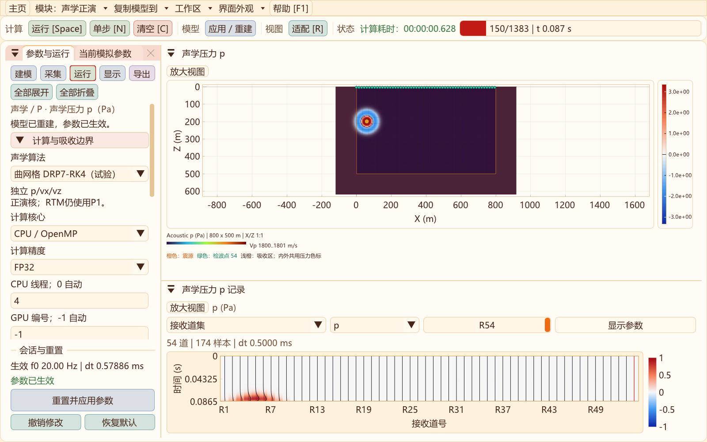
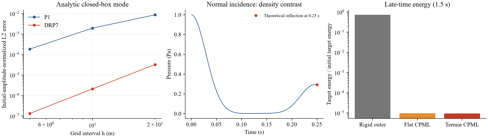
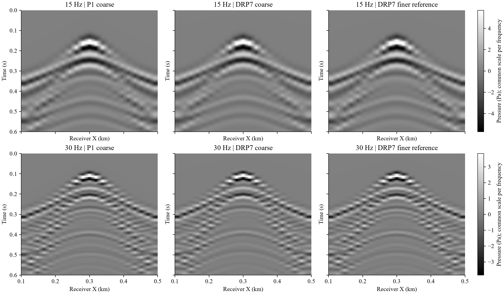
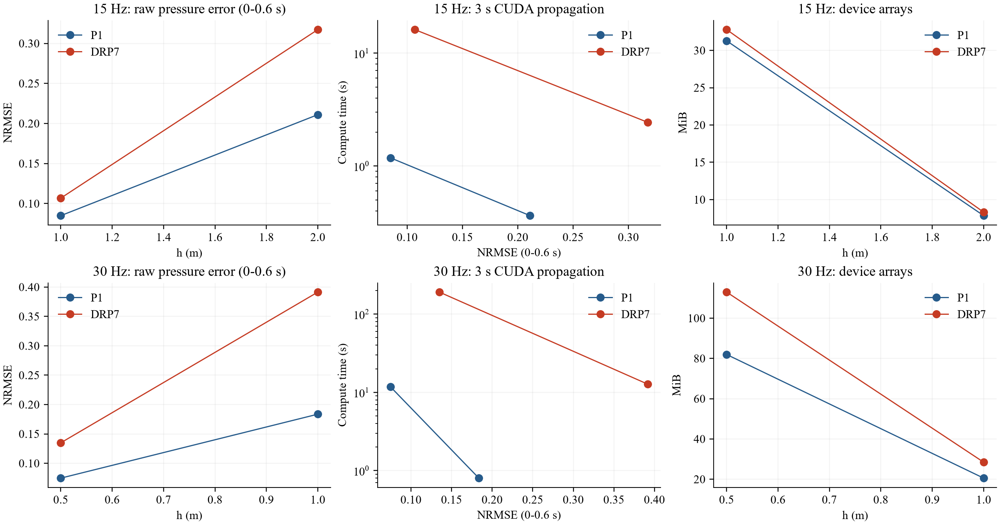

# 二维曲网格高阶声学核：实现、验证与升级门槛

更新：2026-10-31。**新增可选的试验性曲网格 DRP7–RK4 声学正演核，P1仍为默认，RTM保持原P1。** 已完成独立CPU/CUDA、FP32/FP64路径、界面选择、模型复现、基准验收和局部15/30 Hz对照。复杂模型的等误差效率目标尚未通过，因此没有推进RTM核替换。

## 使用与隔离

声学正演 → **运行 → 声学算法 → 曲网格 DRP7-RK4（试验）**，再“重置并应用参数”。可选CPU/CUDA、FP32/FP64；容量随算法和设备立即刷新。默认模型/地形、采集、压力面板、原始Pa SEG-Y/CSV导出沿用原工作区；源、接收点须在零压力顶面下方。内部求解p、vx、vz，当前界面与公共导出仍显示压力p，不能将其当作弹性Vz/Vx记录。



新核不分配弹性应力、Vs、GSLS或RTM检查点，不通过“Vs=0”调用弹性自由面矩阵。P1与DRP拥有独立会话实现；共用只读几何/材料生成及既有输入输出接口。失败重建保留旧会话，同参数重置清空波场和PML历史。普通模块导航不复制可变状态。

## 方程与空间离散

令x=ξ、z=η+S(ξ)F(η)，J=∂z/∂η，s=∂z/∂ξ，K=ρVp²。新核采用变密度一阶声学系统：

\[
\begin{aligned}
\partial_t v_x&=-\rho^{-1}(\partial_\xi p-sJ^{-1}\partial_\eta p),\\
\partial_t v_z&=-\rho^{-1}J^{-1}\partial_\eta p,\\
\partial_t p&=-KJ^{-1}[\partial_\xi(Jv_x)+\partial_\eta(v_z-sv_x)]+q.
\end{aligned}
\]

地形沿用PCHIP/预设剖面和既有展平多项式，度量由该映射解析求导，要求J>0.05。当前是结构化贴体网格，不是任意非结构网格。材料按既有计算深度分层；突变界面使用逐节点Vp、ρ，没有宣称界面处也具有高阶收敛。

传播导数使用七点中心DRP：

\[
D f_i=\frac1h\sum_{k=1}^{3}c_k(f_{i+k}-f_{i-k}),\quad
c=(0.770882380518,-0.166705904415,0.020843142770).
\]

系数按一阶矩作极小舍入修正。参考[NASA DRP报告](https://ntrs.nasa.gov/api/citations/19950023712/downloads/19950023712.pdf)。它与现有弹性核的五点偏置模板、RK子阶段方向交替**不同**，不能混称为直接移植的MacCormack核。

顶面p=0；外侧截断面也为零压力，左右/底部位于外扩吸收层之外。压力以奇延拓构造梯度矩阵，压力散度使用其精确转置及节点梯形权重，避免凭经验反射速度。无源、无吸收、关闭数值耗散时，半离散能量

\[
E=\frac12\sum_q w_qJ_q\left[p_q^2/K_q+\rho_q(v_{x,q}^2+v_{z,q}^2)\right]
\]

满足离散能量恒等式。**该空间恒等式不等于RK推进后的能量严格守恒，也不是任意地形/参数的全局稳定性证明。**

## 震源、寄生波与数值耗散

纯中心同位差分在Nyquist处导数为零。直接使用节点震源的初稿在细网格对照中出现寄生分支，因此没有发布该版本。当前采用：

1. 5×5二项式压力源，单轴权重为(1,4,6,4,1)/16；靠近零压力边界时裁剪并重新归一化，并逐点按Jh²归一化。
2. 选择性六阶差分压力耗散。令M=J/K、B=(2−E−E⁻¹)³，增加

\[
Q_p=-\epsilon\frac{V_{p,\max}}h\frac{M_{\min}}{64M_q}(B_\xi+B_\eta)p.
\]

在上述离散压力能量中该项非正，抑制高波数而在光滑低波数区随加密减小。ε默认0.2，界面可设0..1。**这是数值耗散，不是介质Q或黏声学；关闭它不代表算法自动变得更准确。**

连续源规范仍是p_tt方程的Aδ二维Ricker源，A单位Pa·m²/s²。一阶p方程注入Ricker从0到当前阶段时刻的解析积分，四个RK阶段分别计算。源核物理面积积分验收为1。P1保持原节点源不变，两者连续规范一致，但有限网格源足迹不同；下述原始压力误差包含这一差异，不能全部归因于传播色散。

## 时间推进与CPML

使用固定空间算子的经典四阶段RK权重，压力、速度及四个ADE历史在各阶段一起推进。CFS-CPML在左右/底部外扩，含σ、κ和α；dt同时考虑最大Vp、曲面度量、PML衰减及数值耗散。当前入口仍要求主频P波至少12点/波长；高频尾部和强地形变形须另行检查，未放宽默认分辨率约束。

CPML历史对应压力梯度两方向和速度通量散度两方向。它们是边界状态，不能在未来RTM回放时忽略，也不能用改变dt符号代替离散伴随。当前RTM仍为原海绵/P1伴随路径。

## 基础验证结果

| 检查 | 本轮结果 |
| --- | --- |
| 起伏地表、变密度无耗散空间能量恒等式相对残差 | 3.80×10⁻²⁰ |
| 选择性耗散能量做功 | 负值，未注入能量 |
| 靠近自由面、裁剪源核的面积积分 | 1 |
| 解析闭箱模态h=20/10/5 m，初始振幅归一化L2误差 | 3.26×10⁻⁵ / 2.09×10⁻⁶ / 1.32×10⁻⁷ |
| 两次间距减半误差比 | 15.60、15.91；本算例观察到约四阶 |
| 正入射变密度界面压力反射系数 | 理论0.294118，测量0.291608 |
| 1.5 s目标区残余能量/初始能量 | 刚性外边界0.726；平地CPML9.60×10⁻⁶；起伏CPML9.40×10⁻⁶ |
| 自由面压力 | 测试中保持0 |
| 小模型CPU/CUDA FP64压力L2差异 | 0（本机、禁用CUDA FMA的构建） |
| 同算例FP32/FP64压力L2差异 | 8.86×10⁻⁷ |

残余能量不是单一入射角的反射振幅系数，不能据其宣称边界反射小于−100 dB。模态误差按初始空间形状归一化，不是除以接近零的最终解析场。当前模态只有0.09 s，不代表3秒复杂模型的整体四阶。



原始[验收日志](data/acoustic-drp-2026-10-31/validation.txt)、[解析数据](data/acoustic-drp-2026-10-31/analytic_modes.csv)、[反射时序](data/acoustic-drp-2026-10-31/normal_reflection.csv)和[八项回归](data/acoustic-drp-2026-10-31/regression.txt)。包含P1、DRP、CPML、RTM、模块隔离、实际界面算法选择/应用/返回P1及容量刷新。本轮未重跑全部CTest。

## 15/30 Hz低速干黄土局部对照

这不是原5/10 km工区重算。局部模型为600×300 m，余弦地表振幅12 m、波长300 m、展平深度120 m。三层为24 m干黄土Vp500/ρ1400、56 m低速层Vp1000/ρ1700、下伏Vp2000/ρ2100，速度和密度单位分别m/s、kg/m³。震源(300 m,计算埋深40 m)；21道、X=100..500 m、间距20 m、计算埋深4 m；记录采样0.5 ms。

两种频率均作P1/DRP、两档网格的**3秒FP32 CUDA**模拟，共8组；同频率吸收层物理宽度固定：15 Hz为48 m，30 Hz为24 m。另作15 Hz h=0.5 m、30 Hz h=0.25 m的DRP细网格参考，**参考仅覆盖0..0.6 s**，不冒充解析真值或完整3秒参考。

21道用于固定坐标处的压力时序比较。20 m道距不足以满足低速层最短P波的主频空间Nyquist采样，尤其是30 Hz；图件不能用于面波频散分析或生产道距推荐。图像显示使用双线性插值，误差始终使用原始节点记录。

| 频率 | 方法 | h / m | 目标网格 | 前0.6 s压力NRMSE | 3 s计算耗时/s | 设备数组/MiB |
| --- | --- | ---: | --- | ---: | ---: | ---: |
| 15 Hz | P1 | 2 | 301×151 | 21.10% | 0.363 | 7.85 |
| 15 Hz | P1 | 1 | 601×301 | 8.49% | 1.181 | 31.29 |
| 15 Hz | DRP7 | 2 | 301×151 | 31.73% | 2.441 | 8.31 |
| 15 Hz | DRP7 | 1 | 601×301 | 10.68% | 16.174 | 32.79 |
| 30 Hz | P1 | 1 | 601×301 | 18.36% | 0.801 | 20.55 |
| 30 Hz | P1 | 0.5 | 1201×601 | 7.47% | 11.764 | 81.97 |
| 30 Hz | DRP7 | 1 | 601×301 | 39.15% | 12.757 | 28.46 |
| 30 Hz | DRP7 | 0.5 | 1201×601 | 13.49% | 191.359 | 112.97 |

误差为全21道原始压力的未对齐NRMSE，无AGC、增益匹配或平移。另记录振幅范数比、中央道相关时差和相对3秒较细DRP的差异；后者不称作真实误差。**所测候选均未达到预设5%原始压力误差门槛，当前结果不构成新核的等误差加速证据，也不支持其默认替代P1。**





每个成本样本为独立进程、顺序运行一次，本机RTX4060 Laptop；不作锁频/热稳态的通用倍速结论。新核四阶段、多次访存、全域ADE阶段存储及更小dt是当前成本来源。设备数组不含CUDA上下文；[汇总CSV](data/acoustic-drp-2026-10-31/pilot_summary.csv)另列进程峰值工作集，它包含构建、运行库和导出，不能等同为求解器数组峰值或显卡总占用。

## 存储、文件及复现

当前试验实现保存7个状态（p/vx/vz及4个CPML历史）、四份状态/阶段缓冲共28个标量，另有2个通量和5个几何/滤波系数，合计**35个Real/计算节点**，加轴向模板、吸收系数、接收数组。FP32主设备部分约140 B/计算节点；FP64约280 B。CPU保留系数、模型与完整记录；不是只存3个声学场。稀疏PML与低存储RK尚待优化。

DRP模型使用声学schema 4，`AcousticPropagator`保存算法和数值耗散强度并参与校验；旧schema 1/2/3仍按P1读取，原边界与手动/自动RAM策略保留。模型VTS仅复现t=0，压力VTS不是续算文件。原始Pa记录可导出SEG-Y rev2 IEEE32/64，显示色标不进入数据。

```powershell
# 源码目录，在VS开发者终端构建；生成文件均在外层out
cmake --build ../out/build/x64-Release --target SeisWaveLab_Curvilinear seis2d_acoustic_drp_validation
ctest --test-dir ../out/build/x64-Release -R '^curvilinear_2d_(acoustic_drp|acoustic_forward|acoustic_cpml|acoustic_ui|rtm_imaging|rtm_ui|module_isolation|workflow_upgrade)$' --output-on-failure
conda activate geo_ai
python -B tools/run_acoustic_drp_suite.py --run --references
python -B tools/report_acoustic_drp.py
```

完整本地模型、压力波场、SEG-Y/CSV、10组实验输入与成本日志位于外层`out/validation/acoustic-drp-2026-10-31`，不纳入源码Git；文档保留图件、汇总和基准证据。已完成的实验默认跳过，防止重复昂贵计算。

## 后续门槛与RTM接入顺序

1. **P1保留完成；独立DRP正演实现完成。** 基础解析、界面、CPML及CPU/CUDA/精度/界面检查通过。
2. **等误差生产资格未通过。** 优先统一两核的固定物理源核，分离源足迹、材料界面/几何误差与传播误差；增加斜入射、宽角及更陡地形、外部DEM独立参考，细化数值参考和完整3秒波形误差，达到预定阈值后再比较成本。不要用单个解析模态替代这些门槛。
3. 优化内点模板直接寻址、稀疏CPML阶段、低存储RK、设备端接收批量采样及CUDA调度；重新作小/中/大模型、同误差的CPU32线程/设备成本实测，再决定默认算法。
4. **RTM替换尚未实施。** 达到前述门槛后推导包含源/接收、数值滤波、四阶段和全部CPML历史的离散伴随；通过点积、Born/梯度及检查点完整回放验证后才接入成像，不能直接倒放新核。

源码：[接口](../include/Seis2D/AcousticSolver2D.hpp)、[独立会话](../src/two_d/acoustic/AcousticDrpForward2D.cpp)、[梯度/转置/阶段](../src/two_d/acoustic/AcousticDrp2D.hpp)、[几何与CPML](../src/two_d/acoustic/AcousticDrpModel2D.hpp)、[CUDA](../src/two_d/acoustic/AcousticDrpCuda2D.cu)、[独立验收](../src/two_d/acoustic/AcousticDrpValidation2D.cpp)、[实验队列](../tools/run_acoustic_drp_suite.py)、[分析绘图](../tools/report_acoustic_drp.py)。

ADE-CFS-PML与多阶段时间推进的实现背景见[Zhang与Shen论文条目](https://digitalcommons.uri.edu/gsofacpubs/479/)。这些文献支持方法背景，不能代替当前实现的独立验收。
