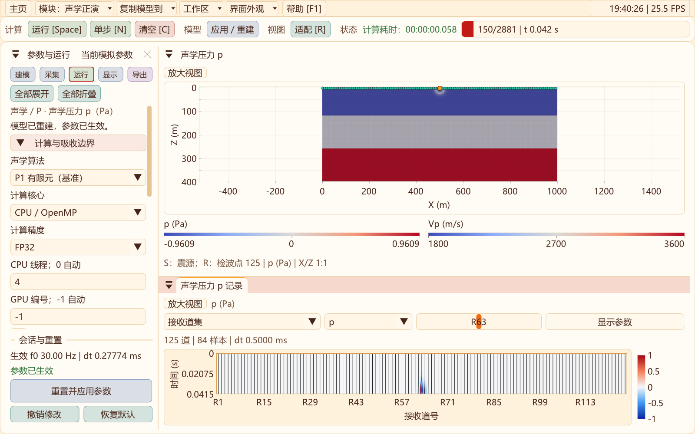
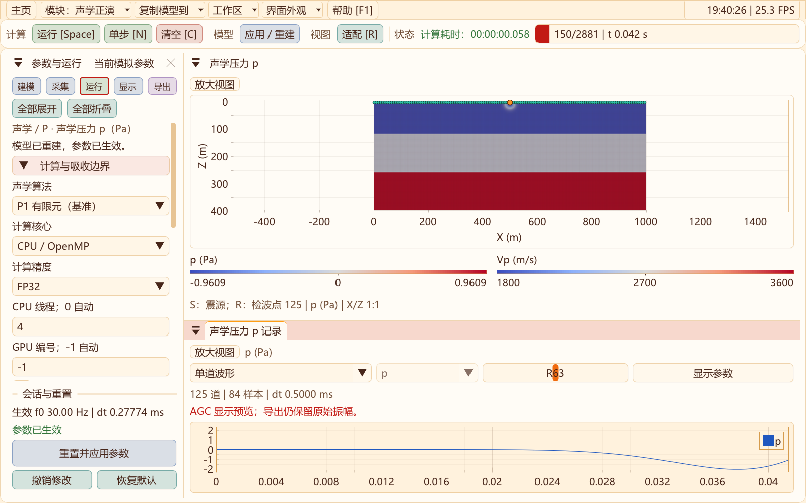
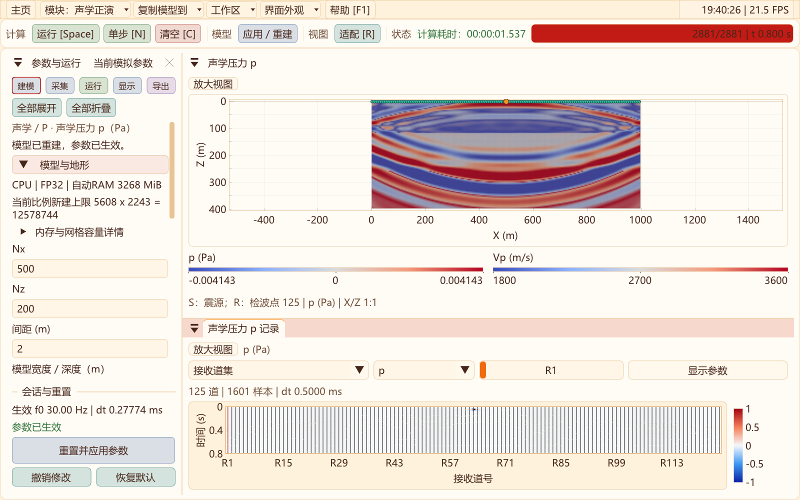
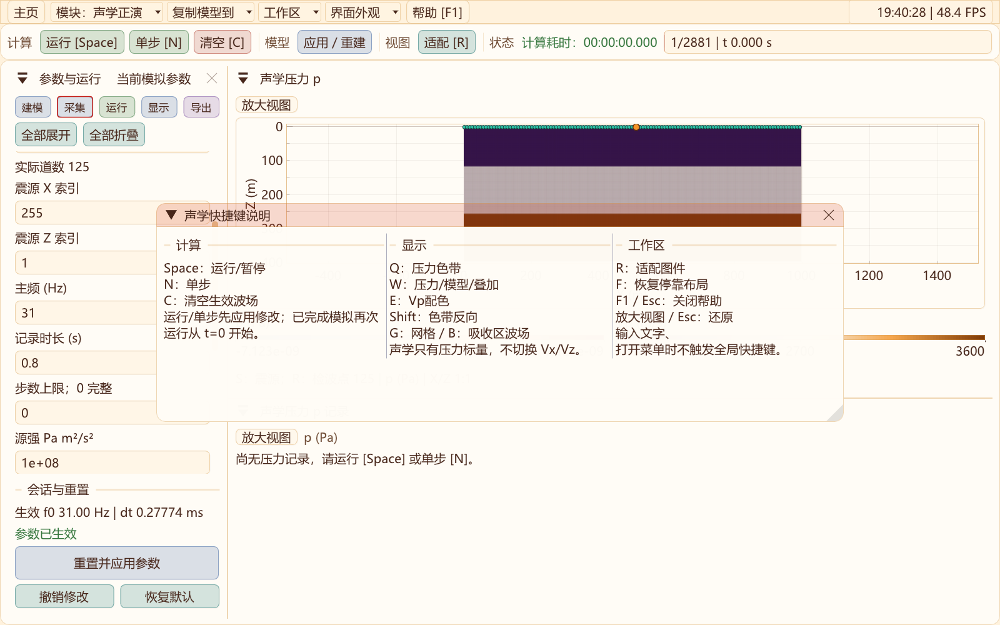
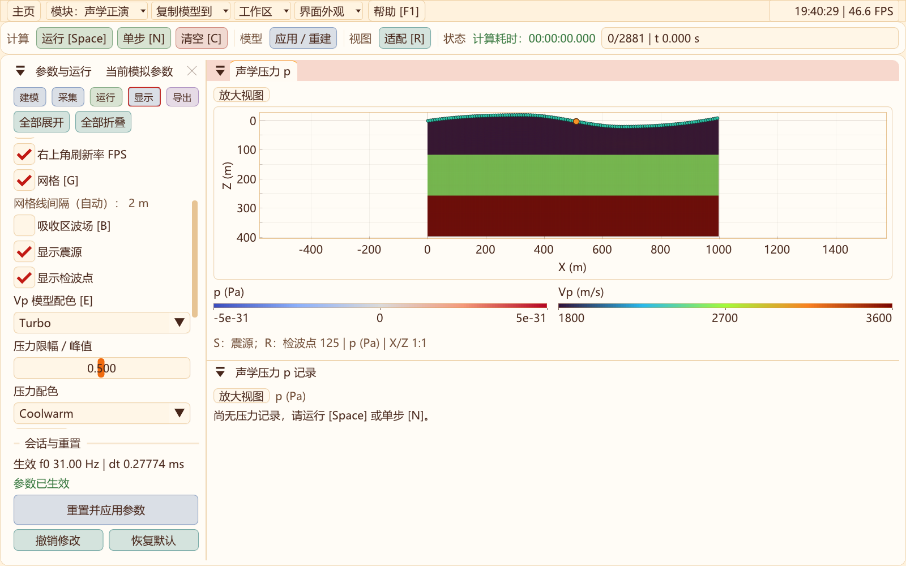
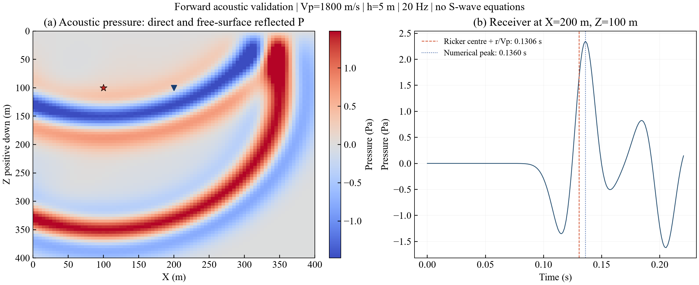

# 二维三种正演模式：声学、弹性与黏弹性

2026-10-31初始设置更新：二维声学与弹性默认500×200节点、h=2 m、30 Hz，模型/波场均为Coolwarm；弹性源在地表中点。新增右上角系统时间与FPS，可在显示页分别开关。[设置、截图与验证](DEFAULT_MODEL_AND_STATUS.md)。

2026-10-31界面更新：二维与三维波场/模型/高程色标横向并排；顶部菜单增加边框与间距，支持窄窗口更多菜单；二维正演初始模型统一为平地三层。[操作、截图与验证](COMPACT_FIELD_UI.md)。

2026-10-31正演采集更新：声学P1/DRP与弹性/黏弹性支持随模型自动沿地表均匀布设检波器，期望/实际道数分别保存；可切回手动，模型VTS保留设置，旧模型采集线保持兼容。[操作与验证](FORWARD_SURFACE_RECEIVERS_2D.md)。

2026-10-31高阶声学升级：新增独立CPU/CUDA、FP32/FP64曲网格DRP7–RK4试验核，含零压力自由面、外扩ADE-CPML、震源正则化及选择性数值耗散。解析/界面/吸收与八项回归通过；15/30 Hz局部对照未通过5%等误差门槛，P1继续默认，RTM保持P1。[实现、实测与下一阶段门槛](ACOUSTIC_DRP_2D.md)。

2026-10-31补充：声学默认自动RAM预算，切换CPU/CUDA及精度立即刷新容量，修复重建几何内存重复计数；真实界面CUDA FP32 5000×2000完成8步容量验收。新增“采集 → 地表均匀布设”，并补充有限元与高阶差分的取舍。[说明与验证](ACOUSTIC_CAPACITY_AND_METHOD.md)。

2026-10-31更新：二维功能工具栏分组留白；声学与弹性共用地形/分层编辑，按空闲内存与预算提示网格上限；压力增加SEG-Y rev2 IEEE32/64导出；RTM新增限速过程预览。[操作、截图与验证](WORKFLOW_UPGRADE_2D.md)。

本轮更新：默认模型＋波场叠加，W切换三种视图；记录复用弹性RecordView；默认外扩CFS-CPML（CPU/CUDA、FP32/FP64）。[吸收对照与复核说明](ACOUSTIC_CPML_2D.md)。





更新日期：2026-10-30。三种模式已接入二维程序，三维仍为原弹性模式。

## 模式选择及用途

首页与二维顶部菜单使用“声学 / P → 声学正演、声学 RTM 与照明”分组，弹性、黏弹性保持独立入口。顶部菜单均有下拉三角。新布局、独立参数草稿与显式复制规则见[二维模块组织](MODULE_ARCHITECTURE_2D.md)。

| 模式 | 介质参数 | 能描述的主要现象 | 推荐用途 |
| --- | --- | --- | --- |
| 声学 / P | Vp、密度 | P 型压力波的直达、反射、折射、绕射、散射和多次波 | 大范围 P 波传播、背景建模与成像方法初筛 |
| 弹性 / P–SV | Vp、Vs、密度 | P、SV、P–S 转换、起伏自由地表 Rayleigh 相关运动 | 黄土沟谷面波、低速层干扰及激发接收机理 |
| 黏弹性 / Qp–Qs | 弹性参数、Qp/Qs及拟合频带 | 弹性传播基础上的振幅耗散与频散 | 已标定近地表模型的衰减对照与资料频带研究 |



声学是把固体介质作无剪切响应的近似，**不是从原弹性 Vz 记录里滤掉 S 波**。它保留 P 型散射与反射，但不求解剪切波、弹性转换波或真正的弹性 Rayleigh 面波。相同 Vp、密度下，声学与弹性 P 波的斜入射反射振幅及地表响应也可能不同。研究黄土山地“面波为什么增强”不能仅使用声学模式。

声学近似广泛用于石油地震的速度建模、RTM和FWI。工业软件同时提供声学与弹性流程；强弹性反差、多分量、转换波和振幅研究需要更完整物理。这里没有文献数量统计，不作“声学研究占比更高”的定量结论。参见 [SLB FWI 方法说明](https://www.slb.com/products-and-services/innovating-in-oil-and-gas/reservoir-characterization/seismic/subsurface-imaging/full-waveform-inversion) 和 [Devito 声学建模教程](https://www.devitoproject.org/examples/seismic/tutorials/01_modelling.html)。

## 接入方式与操作

- 使用 `SeisWaveLab_Curvilinear.exe --acoustic-2d` 直接进入声学正演，或从首页/二维正演模式菜单进入。
- 普通菜单切换使用声学模块自己的待应用参数，不覆盖其他模式。需要沿用弹性模型时，显式选择“复制模型到 → 声学正演”，深拷贝尺寸、地形、材料、采样、设备与精度，并关闭 Q；Vs 不参与声学计算。
- 声学工作区支持模型 VTS、高程剖面 CSV、分层编辑、CPU线程与CUDA设备、FP32/FP64、单步、暂停、清空、应用重建和原始数据导出。修改参数会暂停推进；成功重建才替换旧会话，同配置重建直接清零复用数组。
- 计算在后台按时间预算推进，压力波场与道集同步发布。暂停不累计空闲时间；计时包括声学步进和接收采样，不包括模型构建、显示回传或导出。
- 默认同时显示Vp模型与压力波场，模型默认turbo、压力默认原有双极色带，不使用gray；也可单独查看压力或模型。记录改为与弹性波相同的RecordView面板，支持完整采样时间轴、道集/单道、波形/密度、增益与AGC预览。后台只增量发布新增记录；显示处理不修改原始压力或导出数据。
- “单步”和“运行”会先应用待修改参数；“清空”只重置当前生效模拟。导出依据当前生效模型，之后未应用的输入不会写进旧结果。
- 仅在显式复制到弹性/黏弹性时检查 Vs 和体积模量，并适配源边距和接收线；完整网格/内存检查由目标模块构建执行。普通导航不构建其他模块求解器。离开声学工作区结束其会话，重新进入从零时刻开始；切换前导出需要保留的波场和记录。

声学源和接收点须位于零压力顶面下方，Z节点索引至少1；接收深度0意味着压力自由表面零值，当前入口明确拒绝。声学单炮支持最多4096个接收点，转回弹性时适配其1024道上限。

## 快捷键、比例与采集位置

声学参数面板现与弹性工作区共用 `ParameterPanel2D.hpp` 的分类导航、展开/折叠和固定底部会话组件。字段在独立滚动区显示，底部始终保留“重置并应用参数”“撤销修改”“恢复默认”。重建从t=0开始；撤销恢复生效模型与设备参数；恢复默认只修改待应用输入，运行或重建后才生效。声学特有的源单位、Vp/密度、阻尼和预算仍由声学模块管理，不共用可变求解状态。

当前变量保留明确名称“声学压力 p（Pa）”。在当前无剪切声学近似、拉应力为正的约定下，等效应力为 $\boldsymbol{\sigma}=-p\mathbf I$，即 $\sigma_{xx}=\sigma_{zz}=-p$、$\sigma_{xz}=0$。应力视图需要明确转换符号，不能只改名称；声学标量也不等同于弹性P波的完整应力张量。压力与应力的界面关系可参见[MASTODON声学理论](https://mastodon.inl.gov/modules/fsi/fsi_acoustics.html)。原始导出仍为压力p，单位与符号保持兼容。

声学正演绑定与弹性工作区相同的主要操作键，按钮与快捷键调用同一套运行、单步和清空操作。

| 按键 | 声学工作区行为 |
| --- | --- |
| Space | 运行/暂停；完成后再次运行从 t=0 开始 |
| N / C | 单步 / 清空当前生效波场、记录和计算计时 |
| R / F | 适配图件 / 恢复左侧停靠布局 |
| Q / E | 压力色带 / Vp模型色带；Shift反向切换 |
| W | 在压力、Vp模型、模型＋波场叠加三种视图间循环；默认叠加 |
| G / B | 显示网格 / 显示目标域外吸收区真实波场 |
| F1 / Esc | 打开或关闭横向帮助 / 关闭帮助或还原放大视图 |

运行与单步先应用待修改输入；清空只作用于当前生效会话。输入框处于编辑状态、菜单打开或按住Ctrl/Alt/Super时，全局快捷键暂停响应；帮助窗口打开时也不触发计算。无效参数重建失败会保留原求解会话。



波场默认启用 **X/Z 1:1物理坐标**，同样长度的水平、垂直距离显示为相同像素长度。适配时同时包含完整地表与模型底部，窗口形状与模型形状不一致时保留边缘空白。可通过“显示 → X/Z等比例坐标”关闭等比例，或放大波场视图检查局部。接收道集的X轴为距离、时间轴为秒，独立设置显示比例。

橙色圆点为震源，绿色圆点为检波器；位置来自当前生效模型的真实X/Z坐标，随外部高程起伏。悬停显示震源节点或检波点编号及物理坐标；尚未应用的位置修改不会挪动现有标记。显示页可分别隐藏标记。网格显示改用X、Z共同的抽样步长，避免分别抽稀造成长方格；平直区域完整采样格为1:1，浅部贴体格按实际地形变形，边缘不足步长处保留真实边界。G仅改变抽样网格显示，B切换外扩吸收区的真实压力波场，左右及底部与目标域共用同一压力色标；细橙线标出目标域边界，恢复原浅橙色，以可调不透明度与真实波场叠加，默认0.14。切换显示不改变吸收设置、数值波场或原始记录。



小窗口保留侧栏可读宽度，道集压缩说明并调整刻度，避免坐标轴越出面板；波场和记录均提供“放大视图”。本轮通过真实键盘/鼠标事件检查运行暂停、单步、清空、输入/菜单保护、失败重建、完成后重跑、三尺寸等比例、方格像素比例、地形标记以及底部按钮在滚动时固定。验收原文见[交互与显示日志](data/module-ui-2026-10-30/acoustic-ui-interactions.txt)。

## 当前声学离散与源单位

默认P1声学核与首版RTM复用[同一声学组装](../src/two_d/acoustic/AcousticModel2D.hpp)和[CPU/CUDA递推](../src/two_d/acoustic/AcousticKernel2D.hpp)。它是变密度 P1 三角形有限元、集总质量和二阶时间递推，**不是弹性 MacCormack-DRP + RK4 的声学缩减**。顶面零压力，左右/底部默认使用目标模型外的CFS-CPML，保留旧海绵供历史实验复现。CPML仅增加外扩区的卷积状态，不占用目标模型；参数、推导及独立吸收验收见[声学CPML报告](ACOUSTIC_CPML_2D.md)。RTM继续使用原海绵及其已验证的伴随实现。

以压力加速度源表示：

$$
\partial_t^2p-\rho V_p^2\nabla\cdot(\rho^{-1}\nabla p)
=A\,\delta_{2D}(x-x_s,z-z_s)\,w(t),
$$

其中 A 的单位为 Pa·m²/s²，w 为延迟1.5/f的Ricker子波。每步注入包含dt²和节点集总面积归一化，输出为 Pa；它与原弹性体力/矩源单位不同。该源仍是节点源，比较不同网格的近源振幅需要额外收敛验证。

RTM首版使用“每步单位压力增量”源；本次正演没有改变既有RTM基准。因此两者共享基础离散实现，但当前边界分支也不同，**不能直接互换绝对振幅或将声学正演CSV直接送入现有RTM入口**，未来接入外部压力炮集时还需统一子波、源规范、采样和单位。

P1基准波场仅保存前一层、当前层和下一层三个标量数组，不分配弹性应力、剪切波、GSLS、RK4阶段、RTM检查点或伴随状态。源照明和成像仍在独立RTM工作区计算。

## P1基准大模型为什么更轻

原海绵分支的CUDA持久数组约为下表；CPML另增加仅覆盖外扩区的稀疏几何、滤波系数、索引、卷积历史和通量临时数组：

| 数组 | 标量数量 |
| --- | ---: |
| 三时间层声学场 | 3 |
| 九邻点质量归一化刚度系数 | 9 |
| 阻尼a/b、质量平方根 | 3 |
| 活动节点标志 | 1字节 |

合计为 `15×sizeof(Real)+1`：FP32约61 B/计算节点，FP64约121 B/计算节点；另加接收索引、采样缓冲及CUDA上下文。主机还保留模型、算子、索引及完整记录。**不能仅按“三个声学数组对五个弹性场”推算整机内存比**，也不能把RK/GSLS历史存储忽略。

本机5001×2001目标网格（10 km×4 km，h=2 m），24格外扩后为5049×2025；FP32、表层Vp=500 m/s、15 Hz、128接收点。旧海绵设备数组623,679,261 B（594.79 MiB）的[历史容量记录](data/acoustic-2d-2026-10-30/capacity.txt)保留。新CPML实际设备数组686,581,961 B（654.78 MiB），主机持久数组751,805,865 B，保守RAM预算2616.27 MiB。完成8步，压力有限且非零；新日志见[CPML容量记录](data/acoustic-cpml-2026-10-30/capacity-cpml.txt)。**这些都是短步容量验证，不是完整工区正演或大模型长时验收。**

同网格声学单步工作通常较少；若在同等误差要求下能放宽空间采样，还可能减少网格点与时间步数量。但声学h仍受最小Vp、频带与离散色散约束，dt受最大Vp、地形变形和离散谱界约束，不会仅因删除Vs自动增大。本声学入口要求主频P波至少12点/波长；这不等于原高阶DRP的准则，也不覆盖高频尾部。例如Vp=500 m/s、15 Hz时，2 m有约16.7点/主频波长；30 Hz同网格只有约8.3点，会触发当前声学入口检查。

161×81和401×201的FP32短时对照各重复3次，CPU为4线程，GPU为本机RTX4060 Laptop；同目标网格、h=5 m、15 Hz、记录时长0.15 s、24格外扩。声学109步、弹性113步，两套dt和物理模型不同。401×201的设备数组为声学约5.88 MiB、弹性约18.45 MiB，减少约68%。

原始[计时样本](data/acoustic-2d-2026-10-30/mode_cost.csv)和[汇总](data/acoustic-2d-2026-10-30/cost_summary.json)保留完整数据。该测试未统一预热/锁频/诊断开销、未做等误差网格和等价吸收指标验证，存在GPU短时频率波动；它只描述当前软件路径的短时成本，**不发布通用倍速，也不替代此前CPU32线程/GPU精度性能报告**。源码改动、完整时长与等误差基准仍需专门测量。

## 验证



| 检查 | 结果 |
| --- | --- |
| 均匀模型直达P波，Vp=1800 m/s、20 Hz、源检水平距100 m | 子波中心延迟加走时约0.130556 s，数值峰值0.136000 s；在15 ms门槛内 |
| 顶面零压力 | 所有地表节点为0 |
| Vs从0改到900 m/s | 压力场不变，验证声学不依赖Vs |
| 源幅度乘2 | 全场按比例变化 |
| CPU FP32 / FP64 | 全场相对L2约1.31859e−5；门槛0.001 |
| CPU / CUDA，两种精度分别对照 | 本机全场一致 |
| 清空、复跑、同配置重建 | 重复波场一致，计时清零，复用原数组 |
| 外部高程 | 高程基准、X方向及曲面传播检查通过 |
| 数据交换 | 声学模型VTS从t=0复现波场一致；快照拒绝作为模型；损坏文件校验拒绝并保留原输入 |
| 错误处理 | RAM预算超限保留旧模拟；Q开启明确拒绝 |
| 界面 | 后台压力发布、清空/单步、三尺寸完整窗口、弹性/黏弹性参数切换检查通过 |

早期基础验证见[validation.txt](data/acoustic-2d-2026-10-30/validation.txt)。新增声学CPML已单独完成六组大域参考对照、CPU/CUDA两种精度、低速干黄土及5秒尾波检查，详见[CPML验收](ACOUSTIC_CPML_2D.md)。仍需独立软件、系统网格收敛、更强起伏与长时大模型验收；声学不能直接引用原弹性CFS-PML的指标。

## 文件与后续工作

默认导出到外层 `out/acoustic-2d/experiment-*`：

- `model_acoustic.vts`：独立声学模型自动预算写schema 3、手动预算写schema 2，完整参数、地形样本、物性、设备/精度/源规范和CPML参数及校验；旧schema 1兼容读取并按海绵重放；可在声学工作区从t=0载入。
- `pressure.vts`：目标域原始压力快照及坐标，不是重启文件。
- `pressure_records.sgy`：SEG-Y rev2原始压力（Pa），默认IEEE32，可选IEEE64，不使用显示增益或AGC。
- `pressure_records.csv`、`receivers.csv`：完整单炮原始压力及坐标，含t=0，单位Pa；不应用显示限幅。
- `experiment.txt`、`COMPLETE.txt`：方法、实际步数、数组内存、计时及完成标志。

声学模型VTS与原弹性模型VTS有不同的物理标识，不能交叉当作同一种schema；声学工作区可以显式读取原弹性模型参数。声学正演现支持SEG-Y rev2压力导出（默认IEEE32，可选IEEE64）；仍没有弹性记录到声学压力的转换或状态续算接口。

建议后续补齐等误差性能/色散、更广的CPML参数及地形验收和源规范统一，再做声学RTM的数据衔接。若研究大范围P波Q效应，可增加Qp黏声学分支；它与目前Qp/Qs黏弹性不同。三维声学应单独扩展并验证，不因二维入口完成而宣称已经支持。

复核入口：

```powershell
cmake --build ../out/build/x64-Release --target seis2d_acoustic_validation SeisWaveLab_Curvilinear
ctest --test-dir ../out/build/x64-Release -R curvilinear_2d_acoustic --output-on-failure
../out/bin/Release/seis2d_acoustic_validation.exe --capacity
python -B tools/report_acoustic_validation.py --publish
```

源码：[声学接口](../include/Seis2D/AcousticSolver2D.hpp)、[正演会话](../src/two_d/acoustic/AcousticSolver2D.cpp)、[声学VTS](../src/two_d/acoustic/AcousticIo2D.cpp)、[验收](../src/two_d/acoustic/AcousticValidation2D.cpp)、[界面](../src/two_d/ui/acoustic/AcousticWorkbench2D.cpp)。
