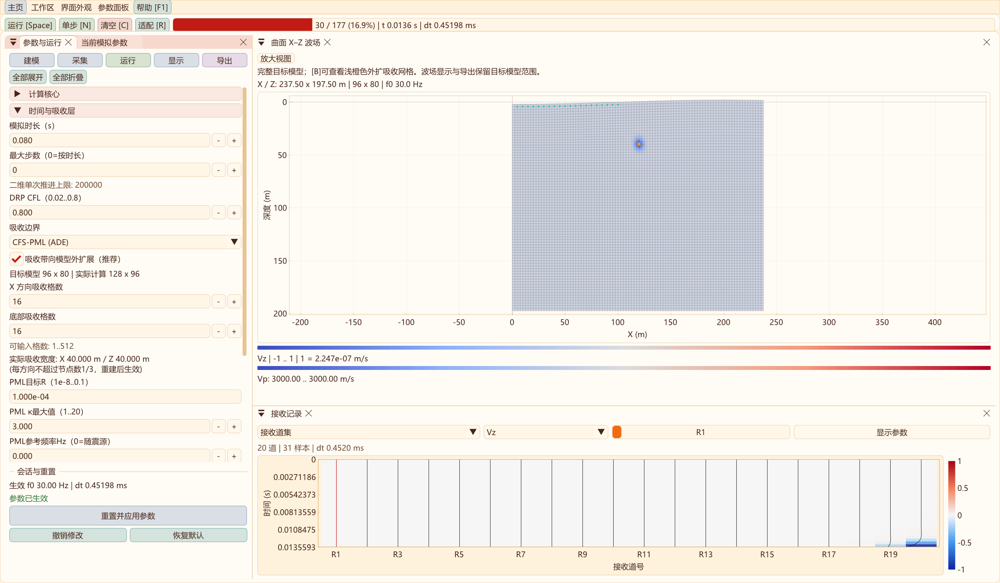
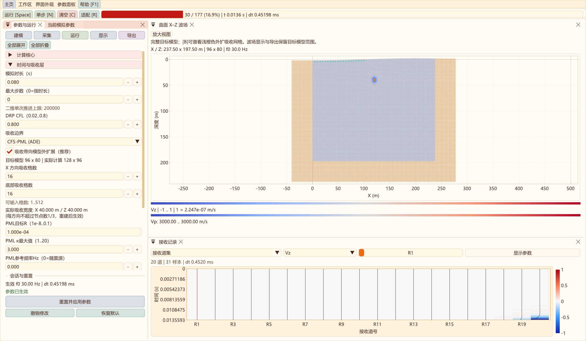
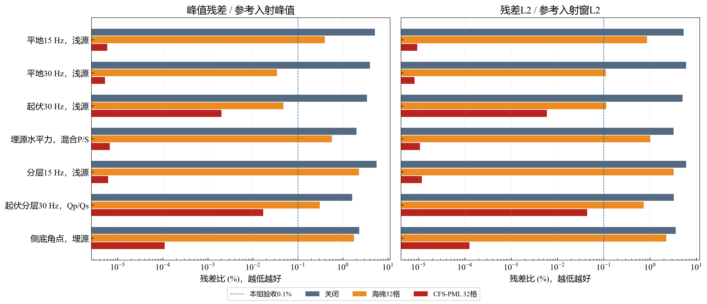
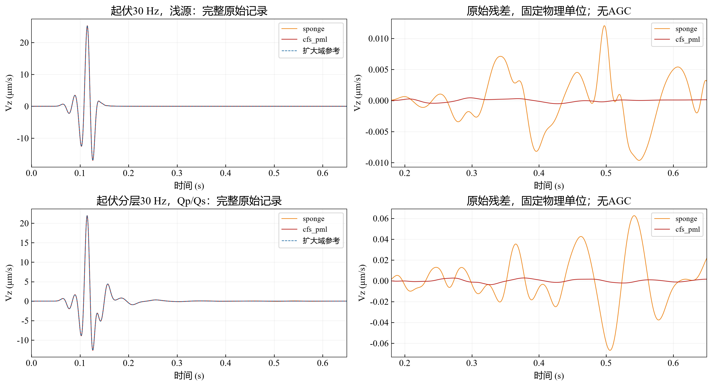

# 二维 CFS-PML 吸收边界与验证

2026-10-31：二维弹性/黏弹性及声学吸收区都可叠加真实波场，保留原浅橙色，新增“边界着色不透明度”（默认0.14）。[操作、截图与验证](ABSORBER_DISPLAY_2D.md)。

更新：2026-10-27。二维 CPU/OpenMP 与 CUDA 增加计算坐标 CFS-PML，采用辅助微分方程（ADE）随四阶段推进积分。可与现有 Qp/Qs GSLS 联用；三维仍使用海绵。默认吸收类型仍为海绵；新建二维工作台默认将吸收带向目标模型之外扩展，旧模型保留原来的内部吸收配置。

## 使用

进入二维工作区，在 **运行 → 时间与吸收层 → 吸收边界** 选择“关闭”“海绵（原有）”或“CFS-PML (ADE)”，然后应用并重建。修改前的模型仍使用原来已经生效的设置。边界类型、厚度和 PML 参数均随模型 VTS 保存；导入模型从零时刻开始。

| 参数 | 默认及范围 | 含义 |
| --- | --- | --- |
| X、底部吸收格数 | 复用原有厚度，输入 1..512 | X 同时作用于左右，Z 仅作用于底部；实际每方向不超过节点数的 1/3 |
| PML 目标 R | 1e-4，范围 1e-8..0.1 | 生成阻尼轮廓的参数，不是实测反射率保证；界面用科学计数法显示 |
| κ 最大值 | 3，范围 1..20 | 坐标伸缩轮廓的最大值 |
| PML 参考频率 | 0，范围 0..1e6 Hz | 0 表示随震源主频；正值用于生成复频移轮廓 |

顶部保持零牵引自由表面，侧向 PML 延伸到顶面边缘；侧底角点叠加两个计算方向。诊断窗口给出 PML 缓冲容量及时间步限制；增加厚度会增加内存。旧内部模式会缩小未吸收的有效观测域，震源和接收点应避开吸收区。



## 目标模型与外扩计算网格

推荐使用“吸收带向模型外扩展”。这与把检波器向内移动解决的问题不同：移动检波器可以避开带内的人工衰减，但边缘模型仍受到阻尼、有效覆盖范围也会变小。外扩模式在保留目标范围的同时增加计算带。物理域和吸收计算域分开也是 [Devito 正演教程](https://www.devitoproject.org/examples/seismic/tutorials/01_modelling.html)采用的组织方式。

| 项目 | 外扩模式 | 原内部模式 |
| --- | --- | --- |
| 用户输入 Nx×Nz | 目标模型节点数 | 包含吸收带的计算节点数 |
| 计算节点数（不含虚点） | (Nx+2wx)×(Nz+wz) | Nx×Nz |
| 顶部 | 自由表面，不增加上部吸收带 | 同左 |
| 炮点、检波器与 DEM | 保留原坐标；内部自动换算存储位置 | 带内点会受到人工吸收；界面提示 |
| 波场显示、VTS、接收记录 | 完整目标域；无吸收区裁切造成的长度损失 | 原有范围，可能包括吸收带内数据 |
| B / 吸收区显示 | 显示外扩区域真实波场，叠加可调透明度的原浅橙色；内外共用波场幅度范围，导出保留目标域 | 原有内部区域叠加 |

例如 200×200、h=2.5 m、左右/底部各 16 格，目标跨度仍为 497.5×497.5 m，计算增加为 232×216 节点，另加差分虚点。目标 X 坐标仍为 0..497.5 m；左右计算带分别在负 X 与目标右侧，底带位于目标底面之外。只增加吸收厚度不会压缩或重采样目标模型。网格预算包含实际外扩的物理状态、GSLS、PML 及记录容量；超预算或超过实际单轴节点上限时拒绝重建并保留旧会话。

目标区域内海绵阻尼为零，PML 的 d=α=0、κ=1。目标几何、展平深度、物性与 Q 保留原值。侧边地形从端点高程/斜率作连续延拓并逐渐展平斜率，不要求用户另提供吸收带 DEM；它是数值延拓，不是对工区外真实地形的测量。底部延用目标底部材料及 Q，不引入尚未进入目标模型的更深地层。有限宽度离散吸收仍可能有残余反射，不能将“目标域不施加阻尼”解释成严格零误差。



新建/恢复默认的二维工作台启用外扩。载入 schema 1..3 旧模型时仍按其原内部模式重建，避免改变历史实验；如需升级，应勾选外扩并重新应用。核心 API 的 `Parameters::externalAbsorption` 默认 false 也用于兼容已有脚本。三维尚未增加这一外扩功能。

外扩验收覆盖海绵/CFS-PML × 弹性/GSLS 四组合。80×72、h=2 m、16 格吸收扩为 112×88；80 个检波器保留 X=0..158 m。与独立手动扩大后的平地参考比较全部物理场、GSLS/PML 状态及原始 Vx/Vz 记录，CPU/CUDA、清空复跑和 schema 4 保存重建通过。另用只覆盖目标范围的 DEM 检查所有目标节点坐标、度量与自动展平深度不变，以及外扩 DEM+分层 Q 的两后端传播。导出的八份模型/波场文件仍为 80×72，坐标范围与逐数组长度经独立解析核对。见[外扩测试矩阵](data/cfs-pml-2d-2026-10-27/external_absorber_verification.csv)和[导出校验](data/cfs-pml-2d-2026-10-27/external-export-check.json)。

## 方法与内存

对计算方向 a 的离散导数或方向动量贡献 D_a，使用

```text
D̃_a = D_a / κ_a + ψ_a
∂t ψ_a = −(d_a / κ_a + α_a) ψ_a − d_a D_a / κ_a²
d = d0 t²; κ = 1 + (κmax − 1)t²; α = π fref (1 − t)
d0 = −3 Vp_max ln(R) / (2 w h)
```

t 是进入吸收带的归一化距离，入口为 0、外边界为 1；带外 d=α=0、κ=1。速度梯度及每个方向的动量贡献各有两个辅助量。辅助状态与物理场使用同一组 RK 阶段和时间，不在每个子阶段额外推进一次完整 dt。CFS/ADE 的方法背景见 [Martin 等（2010）原文](https://specfem.org/komatitsch.free.fr/published_papers/CMES_ADE_PML_2010.pdf)；本项目针对既有曲网格点核实现并单独验证，未声称完成该论文逐图复现。

自由表面法向速度导数用已修正的切向梯度闭合；近表面动量保留牵引镜像通量，按两个计算方向分别伸缩。GSLS 由修正后的速度梯度驱动，材料衰减记忆与外边界记忆分别保存。实际 dt 同时满足波动、源采样、GSLS 松弛及 `0.5 / max(d/κ+α)` 等保守限制。Vp_max 包括 GSLS 的未松弛高速极限。

仅左右、底部条带分配辅助状态。单套标量数为`4 × (2 wx Nz + wz Nx)`；七套RK/回退缓冲和`3(Nx+Nz)`个轮廓标量随二维所选FP32/FP64存储。CPU内存或CUDA显存预算均计入这些容量。清空、阶段更新、失败回退、有限性检查和销毁均涵盖边界辅助状态。241×161、宽度32格时FP64约3.858 MiB、FP32约1.929 MiB，不是整个求解器总内存。本页2026-10-27边界残差数据使用FP64；新增精度对照见[二维精度实测](PRECISION_2D.md)。

## 验收结果与适用范围

本机 RTX 4060 Laptop GPU（8188 MiB，驱动 591.74）完成七组扩大域对照，每组比较关闭、同宽海绵与 CFS-PML，共 21 次小域模拟、7 次参考模拟。本矩阵为保留可比性的**原内部模式**，外扩功能加入后仍通过回归；不能把该组反射数字直接作为任意外扩工区的实测结果。原始表见 [边界对照数据](data/cfs-pml-2d-2026-10-27/boundary_comparison.csv)，[验收摘要](data/cfs-pml-2d-2026-10-27/summary.json) 给出指标定义；单次计时只作溯源，不作性能倍速结论。

| 工况 | 海绵峰值残差% | CFS-PML峰值残差% | CFS-PML L2残差% |
| --- | ---: | ---: | ---: |
| 平地 15 Hz，浅源 | 0.393095 | 0.00000588 | 0.00000945 |
| 平地 30 Hz，浅源 | 0.0343585 | 0.00000521 | 0.00000820 |
| 起伏 30 Hz，浅源 | 0.0476748 | 0.00201837 | 0.00593164 |
| 埋源水平力，混合 P/S | 0.565423 | 0.00000670 | 0.00001080 |
| 分层 15 Hz，浅源 | 2.27695 | 0.00000615 | 0.00001182 |
| 起伏分层 30 Hz，Qp/Qs | 0.304659 | 0.0169794 | 0.0440967 |
| 侧底角点，埋源 | 1.75035 | 0.00011061 | 0.00012613 |



小域 241×161，h=0.5 m，名义跨度 120×80 m；参考域左右及底部各加 480 格，为 1201×641。固定展平深度 28 m，起伏振幅 2 m、波长 80 m；参考域的水平平移为完整三个周期，保留相同地形。参考外边界处于观测窗首个返回路径之外。吸收宽度统一 32 格（16 m），参考域宽度 64 格，R=1e-4、κmax=3、频率随源，C=0.6、时长 0.65 s、记录间隔 0.5 ms。

均匀介质 Vp/Vs/ρ=550/250/1550（m/s、m/s、kg/m³）。分层模型上部 10 m 沿用该参数，下伏为 900/450/2000；Q 工况上层 Qp/Qs=80/50、下层=120/70，3 机制、拟合频带 5–80 Hz、参考频率 30 Hz。一般源位于 (60 m, η=1 m)，接收 (75 m, η=0)；水平力工况二者深度均为 15 m；角点源 (95 m, η=50 m)、接收 (85 m, η=45 m)。η 为计算深度。

峰值指标为残差窗最大绝对 Vz 差 / 参考入射窗最大绝对 Vz；L2 指标为残差窗平方和开方 / 参考入射窗平方和开方。入射窗 0.04–0.22 s，残差窗一般 0.18–0.65 s，角点 0.08–0.65 s。使用原始物理振幅，无 AGC、逐道归一化或显示增益。指标包含混合波型、入口散射与离散误差，**不是单一 P、S 或 Rayleigh 波反射系数**。



七组均满足本次项目门槛：峰值和 L2 残差比各小于 0.1%，峰值残差较同宽海绵改善至少 4 倍。最差峰值约 0.017%、最差 L2 约 0.044%，最小峰值改善约 17.9 倍。该门槛属于本测试矩阵，未覆盖任意强坡度、所有入射角、模态分离、固定物理源宽度的网格收敛及 10 km 工区完整验收；三维尚未升级 PML。

默认回归还检查 CPU/CUDA 的物理场、Syy、GSLS 和 PML 辅助状态，曲面零牵引、清空复跑、无效重建保留旧会话、schema 3 模型往返、关闭 PML 不分配记忆。爆炸矩源的 160×128 工况还比较 CPU 单线程、4 线程与 CUDA，覆盖条带并行更新。两后端分别通过弹性与 Qp/Qs 的 5 s 长尾检查。界面用实际下拉控件检查待应用/生效分离、重建、推进及诊断；七项相关 CTest 通过，包含新增外扩测试，补充源/并行分支及最终界面重新验收通过，完整日志与 CSV 在外层 `out/validation/cfs-pml-2d`。

## 保存与复现

二维启用外扩时模型使用 schema 4，保存受校验的 `ExternalAbsorption` 和 `CfsPmlSettings`（类型、R、κ、参考频率）。不外扩时，选择 PML 或修改 PML 参数使用 schema 3；默认海绵继续写 schema 2。旧 schema 1/2/3 继续读取为原内部模式，旧程序不能读取 schema 4。波场 VTS、接收 CSV 附带吸收配置与实际计算节点数；普通模型/波场导出均不保存边界时间历史，不能中途续算。`Grid`/全量快照包含额外计算带，外扩接口调用者应使用 `Grid::modelIndex(i,k)` 访问目标节点；默认显示帧、模型和波场文件均按逻辑 Nx×Nz 输出。

从仓库根目录配置/构建，所有构建及结果仍在外层 out：

```powershell
cmake --preset x64-Release
cmake --build ../out/build/x64-Release --target SeisWaveLab_Curvilinear seis2d_cpml_validation seis2d_validation seis2d_viscoelastic_validation seis2d_model_io_validation
ctest --test-dir ../out/build/x64-Release -R curvilinear_2d_ --output-on-failure
python -B tools/analyze_cpml_validation.py
```

分析脚本只重绘既有原始 CSV，不自动重新运行模拟。输出图件、摘要和中文报告写入外层 out；仓库中发表证据经核对后更新。

## 参考

1. Martin, R., Komatitsch, D., Gedney, S. D., & Bruthiaux, E. (2010). *A High-Order Time and Space Formulation of the Unsplit Perfectly Matched Layer for the Seismic Wave Equation Using Auxiliary Differential Equations (ADE-PML).* [作者原文 PDF](https://specfem.org/komatitsch.free.fr/published_papers/CMES_ADE_PML_2010.pdf)。
2. [SEISMIC_CPML 官方说明](https://specfem.org/komatitsch.free.fr/README_seismic_cpml.html)：包含 C-PML/ADE-PML 与黏弹性扩展的文献和参考程序。
3. 仓库已有 [CGFD3D 曲网格源码](../third_party/cgfd3d_reference/sv_curv_col_el_iso.c)：用于核对计算方向 CFS-PML 与自由表面处理；许可见 [第三方说明](../THIRD_PARTY_NOTICES.md)。
