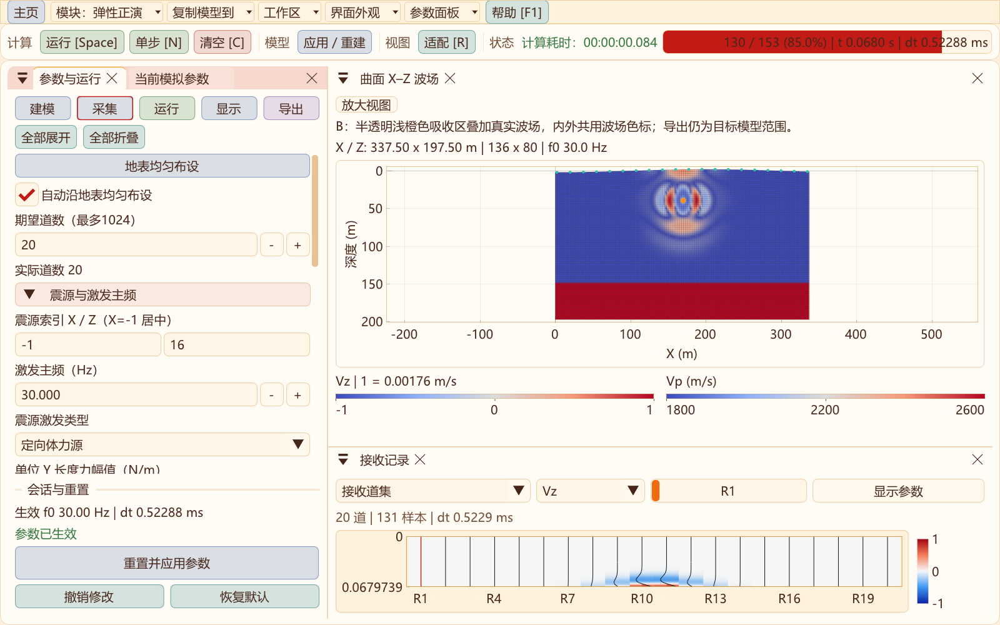
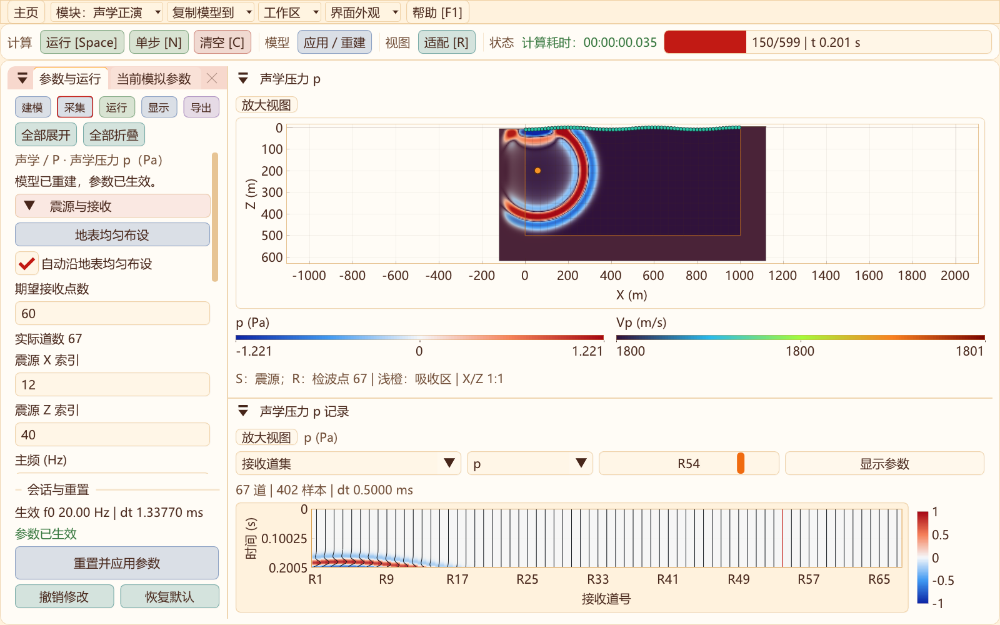
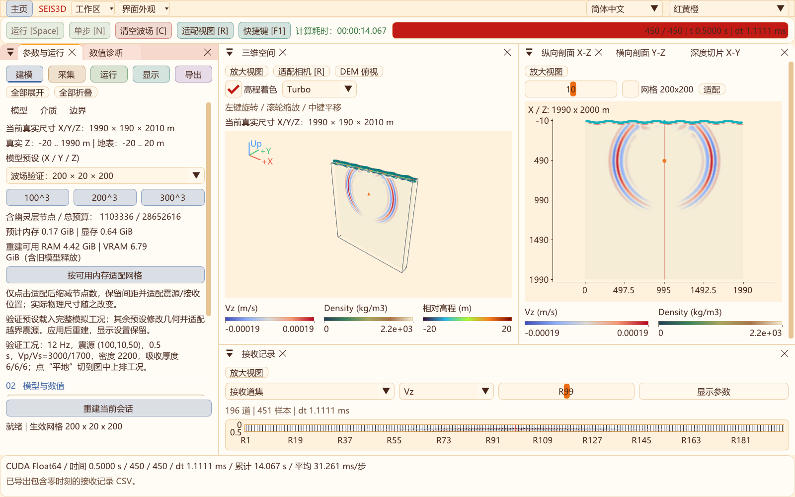

# 波场色标、顶部控件与二维初始模型

更新：2026-10-31。

二维弹性/黏弹性、二维声学和三维剖面/空间窗口统一使用紧凑横向色标。波场、模型与三维地表高程尽量并排，每条色标保留名称、单位、端点刻度；空间足够时显示中点刻度。归一化波场仍标明“1 = 物理幅度”。窄窗口按当前字体宽度换行，长标题及完整精度数值可悬停查看。

声学压力色标从图右侧移至下方，与Vp并排，释放绘图区宽度。仅显示模型或波场时，只显示对应色标。三维空间窗口可将波场、模型、Turbo高程三条色标同排；较矮窗口省略操作提示和长尺寸说明，为模型保留可视区域。

这次调整不改变数据色带、幅度归一化、原始地震记录或求解算法。程序波形继续使用既有波形/密度显示，界面主题仍与科学色带分开设置。

## 顶部控件

下拉菜单保留小三角，增加圆角边框、背景和控件间距，与主页/帮助按钮协调。窗口变窄或字体放大后，“工作区”“界面外观”等菜单可收进“更多”，避免移出窗口。二维声学与RTM的外观菜单也可调整字体。

新安装默认字体由20 px调至22 px；已保存的字体设置继续保留，可在“界面外观”选择16–28 px。

## 二维初始模型

新建二维弹性/黏弹性及声学正演工作区、点击“恢复默认”，均采用平地三层示例。两处界面复用同一份初始分层设计；声学仍只使用Vp和密度，Vs仅为共享模型表的兼容参数。

| 层 | 纵波速度 m/s | 横波速度 m/s（弹性） | 密度 kg/m³ | 厚度 |
| --- | --- | --- | --- | --- |
| 第一层 | 1800 | 900 | 1900 | 模型深度的30% |
| 第二层 | 2600 | 1400 | 2200 | 模型深度的35% |
| 第三层 | 3600 | 2050 | 2500 | 剩余深度，末层向下延伸 |

默认二维模型现统一为500×200节点、h=2 m、30 Hz，深度398 m，名义界面深度119.4/258.7 m，模型与波场均采用Coolwarm。弹性震源位于地表水平中间节点；详见[最新初始设置、系统时间与FPS](DEFAULT_MODEL_AND_STATUS.md)。物性最终按计算节点离散。这是便于观察传播与反射的示例，不能代替工区实测标定。

恢复默认仅修改待应用参数，点击“应用/重建”或运行后生效。载入保存模型、模块内返回及显式复制模型仍保留对应输入；历史数值API默认参数及RTM初始模型没有改写。

## 验证

- [二维界面回归](data/compact-ui-2026-10-31/regression.txt)：声学、RTM、弹性吸收边界及精度界面四项通过；含窗口缩放、快捷键、实际菜单、滚动参数与重建。
- [三维色标复核](data/compact-ui-2026-10-31/three-d.txt)：12组尺寸/字体/语言/主题布局，包含归一化与物理量、压力、模型和Turbo高程；检查显示调整不改模拟、相机及原始记录。
- [二维完整工作流](data/compact-ui-2026-10-31/elastic-full.txt)：键盘修改、重建、导出、地形与大模型显示；保留原均匀介质计时夹具。
- [三层示例实际出图](data/compact-ui-2026-10-31/layered-capture.txt)：二维分层模型推进、接收记录和完整窗口截图。

截图来自程序原生窗口，未裁切或改色；其中吸收与色标验证算例使用专门的测试参数，不等同于上表默认模型。
