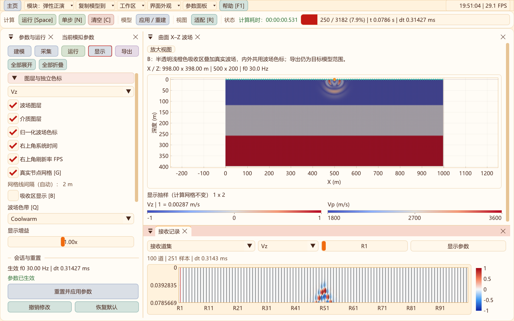
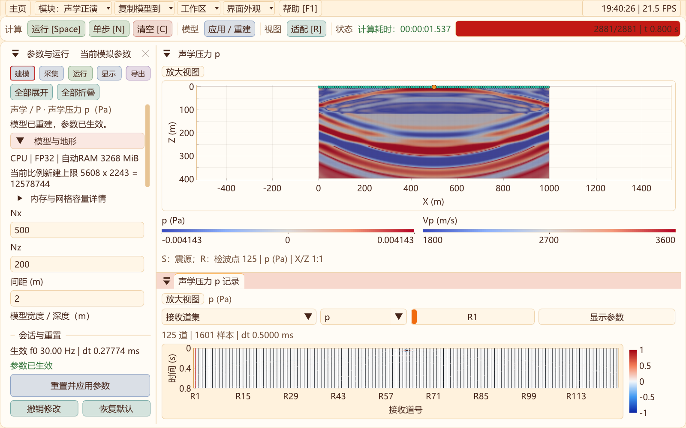

# 二维默认模型、网格线与系统状态

更新：2026-10-31。

新建二维声学、弹性/黏弹性正演会话，以及参数面板“恢复默认”，使用以下设置；已有保存模型和模块内的待应用输入继续按原值恢复。恢复默认后点击“应用/重建”或运行才生效。

| 项目 | 默认设置 |
| --- | --- |
| 网格节点数 | Nx=500，Nz=200 |
| 计算间距 | h=2 m |
| 物理跨度 | (Nx−1)h × (Nz−1)h = 998 m × 398 m |
| 激发主频 | 30 Hz |
| 介质 | 平地三层；Vp=1800/2600/3600 m/s，密度=1900/2200/2500 kg/m³ |
| 弹性Vs | 900/1400/2050 m/s |
| 层界面名义深度 | 119.4 m、258.7 m；末层向下延伸，按计算节点离散 |
| 模型与波场色带 | 均为Coolwarm，各自保留独立范围和单位 |
| 弹性震源 | 水平中间节点（X=-1自动居中），Z=0地表节点，竖直定向体力 |
| 声学震源 | 水平中间节点，Z=1，即地表下首层；自由面压力为零，不能将压力源放在Z=0 |

声学仍默认P1基准核，弹性仍使用原曲网格DRP/RK4；没有更改RTM默认模型、精度默认值、API默认参数或历史实验配置。

## 2 m网格线

声学和弹性共用显示抽样规则。默认模型每个原生节点间隔均画线，名义网格线间隔2 m。模型增大或缩小时，按屏幕像素和可绘制网格预算自动增大网格线间隔，避免密集线条和界面卡顿；X、Z采用同一索引步长，平地保持方格。曲网格线仍跟随地形，不是叠加一张虚构的直角网格。

“显示”页可查看实际网格线间隔。“显示抽样”提示是波场/模型着色的渲染采样，与网格线间隔分别计算；两者都不改变求解网格、接收点或导出数据。若用户另设h，网格线只能落在实际节点上，以不小于2 m的节点整数间隔为基础再自适应。

## 地表定向体力源

二维定向体力源现在允许中心位于Z=0或Z=1。原5×5高斯核在地表处截取到物理节点内，并按雅可比权重重新归一化；不向上方虚节点注入能量。波场和震源标记使用同一个地表节点。内部震源保留原算法。

这是**中心位于地表的正则化定向体力源**，不是另行实现的非零牵引边界震源。原自由面投影保持不变。各向同性矩源仍需完整内部差分支撑，源心至少离各边界五格；指定物理半径的体力核仍须完整位于域内。切换震源类型时界面会适配索引，核心再次校验。显式复制到声学/RTM时，将地表震源移到首层以下，满足声学自由面约束。

## 右上角时间与刷新率

二维正演、RTM及三维工作区共用右上角状态区。默认显示系统本地时间`HH:mm:ss`和实际界面绘制帧率`FPS`；悬停显示完整日期。FPS反映界面刷新，不是求解速度或显示器标称刷新频率。模拟计算耗时继续由第二行工具栏的“计算耗时”显示。

在“显示”页分别勾选“右上角系统时间”“右上角刷新率 FPS”。偏好写入外层`out/ui/preferences.cfg`，重启恢复；关闭两项后不保留空白占位。顶部菜单根据剩余空间缩进“更多”，三维语言/主题控件也避开状态区。

## 验证

- [十二项回归](data/defaults-status-2026-10-31/regression.txt)：声学P1/DRP/CPML、RTM、弹性采集、保存重载、模块隔离、实际界面与精度等全部通过。
- [地表震源专项](data/defaults-status-2026-10-31/surface-force.txt)：CPU/CUDA、FP32/FP64、弹性/GSLS、起伏自由面与CPML；检查源核归一化、有限传播、接收信号、自由面牵引残差、VTS往返与非法矩源拒绝。GPU/CPU波场相对L2误差均小于2×10⁻⁴。
- [真实界面及偏好复核](data/defaults-status-2026-10-31/ui.txt)：默认500×200、h=2、30 Hz、地表源、Coolwarm、2 m网格线，实际点击两个状态开关、保存重载、原模拟步数不变。
- [最终界面运行](data/defaults-status-2026-10-31/ui-final.txt)及[三维十二组布局](data/defaults-status-2026-10-31/three-d.txt)：检查不同尺寸、字体、语言和主题下的状态显示与布局。

这些短时验证确认实现与回归状态，不代表实际工区模型的参数标定或采集方案验收。
