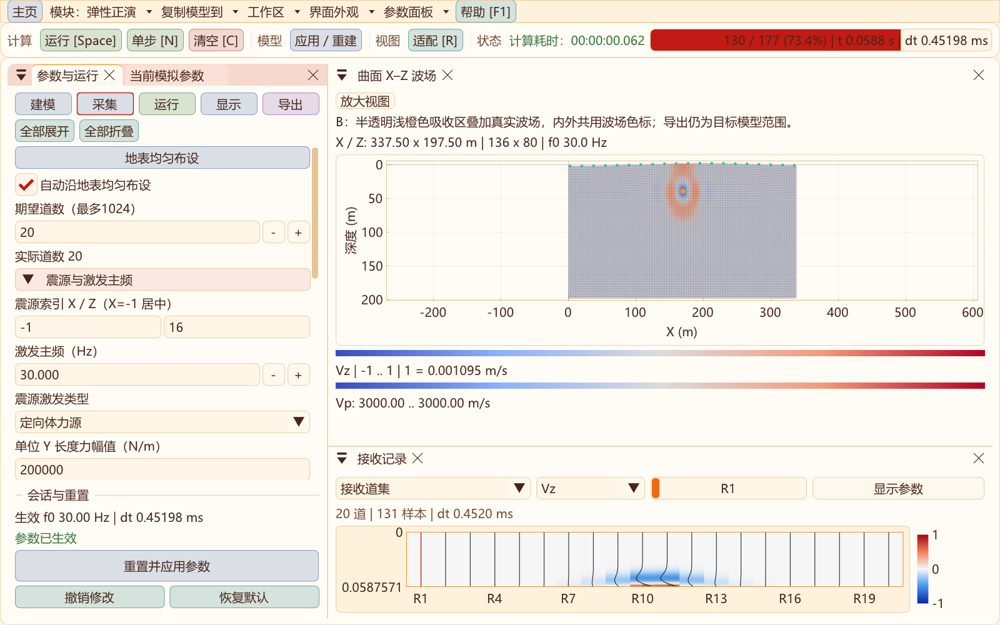
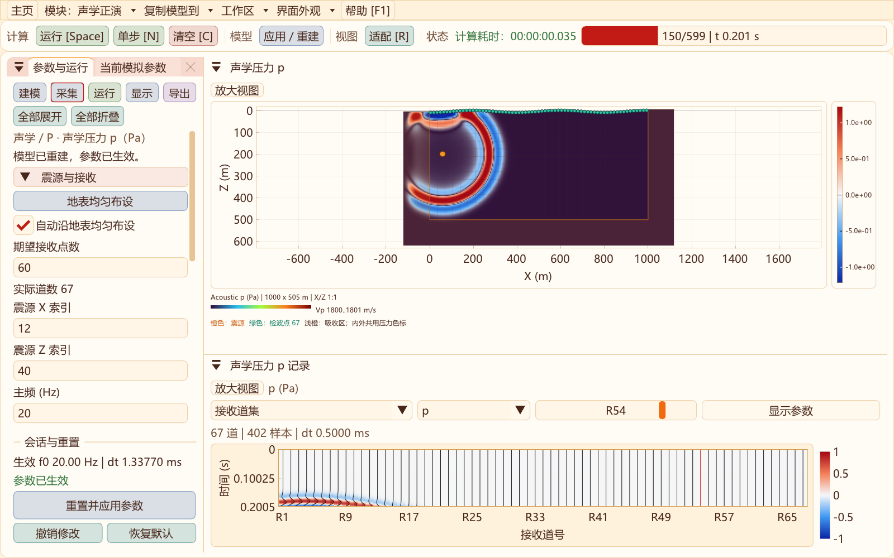

# 二维正演：随模型自动对齐地表检波器

更新：2026-10-31。声学P1/试验DRP与弹性/黏弹性正演均增加自动地表采集线；不改变传播方程、精度或吸收算法。RTM对应操作见[成像与重建](RTM_2D.md)。

## 操作

进入二维“采集”，勾选**自动沿地表均匀布设**，设置“期望道数/期望接收点数”。新建交互会话和恢复默认时开启自动模式；已有保存模型仍按其采集设置恢复，旧模型读取后保持手动，需勾选以启用自动。

模型节点数、间距、地形或吸收范围改变后，待应用的起点、实际道数、节点间隔和接收深度自动更新。**重建/应用或运行后**才替换实际求解坐标及记录；修改草稿不会挪动当前模拟检波器，也不会改写已有数据。外部高程仍必须覆盖模型全宽，否则拒绝重建并保留现有模拟。

- 弹性与黏弹性：沿真实地表节点，接收深度索引0。外扩吸收时覆盖完整目标地表；旧内部吸收模式避开两侧吸收带。
- 声学：沿地表下首层节点，深度索引1；避免p=0自由面上的恒零压力记录。适用于P1和试验DRP两种算法。
- 均匀指水平X等间距并跟随起伏地表，不是沿坡面弧长等距。实际坐标来自求解网格，模型变形后重新映射。
- 道数受整数节点间隔约束，“期望道数”与“实际道数”分别保留。反复刷新或重建不会用实际道数覆盖期望值，因此不会逐次减少道数；网格先缩小再恢复时仍使用原期望值。
- 弹性/黏弹性最多1024道，声学最多4096道；网格较小时受可用节点数限制。单道居中。
- 关闭自动开关后，起点、实际道数、间隔和深度恢复手动编辑，不再自动覆盖；“地表均匀布设”按钮可重新开启自动模式。布设操作不改震源。





## 保存、复现与模块隔离

自动开关和期望道数保存于二维模型VTS的`SurfaceReceiverLayout`，参与完整性校验。弹性/黏弹性使用schema 7；声学使用schema 5，并保存P1/DRP算法及数值耗散设置。新文件需用支持对应schema的程序读取。

旧弹性schema 1..6、旧声学schema 1..4继续兼容，默认读取为手动模式，保留原起点、道数、间隔和深度。关闭自动且没有保留期望值时，继续使用原有schema选择策略。数值API的默认参数仍为手动，以保持历史基准；界面的新建/恢复默认采用自动。

弹性和声学共用[布设规则](../include/Seis2D/SurfaceSurvey2D.hpp)，各求解器在初始化前独立规范化采集线，发布实际生效参数。不同工作区不共享可变求解状态，RTM依旧使用自己的采集控制；只有显式“复制模型到”传递设置。

自动模式会改变接收位置。研究旧实验时应载入旧模型以保留原观测系统；不能把不同接收深度的数据直接当作同一采集条件比较。

## 本轮验证

- [十一项回归](data/auto-surface-2026-10-31/regression.txt)：模型IO、声学P1、DRP、CPML、弹性界面、RTM、工作流与模块隔离等。
- [最终界面复核](data/auto-surface-2026-10-31/ui-final.txt)：声学、弹性采集界面和精度切换三项全部通过。
- [原生专项](data/auto-surface-2026-10-31/native.txt)及[外部高程复核](data/auto-surface-2026-10-31/dem-check.txt)：CPU/CUDA、FP32/FP64、弹性/GSLS、声学P1/DRP、内部/外扩吸收、过期索引修复、重复对齐、缩放、手动覆盖及新旧模型VTS往返。对FP32网格坐标使用1e−4 m检查容差。
- [声学实际交互](data/auto-surface-2026-10-31/acoustic-ui.txt)与[弹性实际交互](data/auto-surface-2026-10-31/elastic-ui.txt)：开关/快捷按钮、模型加宽后稳定对齐、应用前不改当前数据、应用后实际地形坐标、关闭后手动布设。
- [二维完整界面复核](data/auto-surface-2026-10-31/elastic-full.txt)：键盘、固定底部重建、SEG-Y、外部地形、八种预设和震源示例。

没有以这些检查替代采集道距论证；实际道距还须结合目标频带、最低传播速度和研究波型评估。

```powershell
# 源码目录；所有构建/测试输出位于外层out
cmake --build ../out/build/x64-Release --target SeisWaveLab_Curvilinear seis2d_surface_survey_validation seis2d_model_io_validation
ctest --test-dir ../out/build/x64-Release -R '^curvilinear_2d_(surface_survey|model_io_sampling|acoustic_ui|cfs_pml_ui)$' --output-on-failure
```
