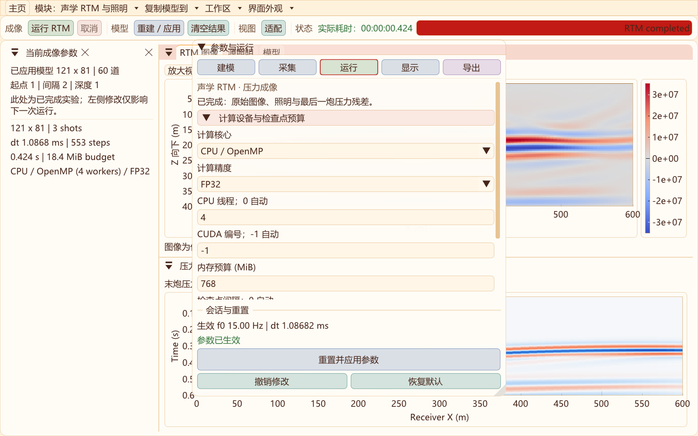

# 二维模块组织、界面与状态隔离

2026-10-31高阶声学升级：新增独立CPU/CUDA、FP32/FP64曲网格DRP7–RK4试验核，含零压力自由面、外扩ADE-CPML、震源正则化及选择性数值耗散。解析/界面/吸收与八项回归通过；15/30 Hz局部对照未通过5%等误差门槛，P1继续默认，RTM保持P1。[实现、实测与下一阶段门槛](ACOUSTIC_DRP_2D.md)。

2026-10-31更新：二维功能工具栏分组留白；声学与弹性共用地形/分层编辑，按空闲内存与预算提示网格上限；压力增加SEG-Y rev2 IEEE32/64导出；RTM新增限速过程预览。[操作、截图与验证](WORKFLOW_UPGRADE_2D.md)。

声学显示更新：记录复用公共RecordView，压力单位Pa、单分量p；后台按新增采样发布，UI持有独立完整记录缓存。默认模型＋压力叠加，色带各自设置。声学CPML的历史状态仅由声学正演会话持有；RTM沿用原海绵，不能共享或混用运行状态。详见[声学CPML](ACOUSTIC_CPML_2D.md)。

更新日期：2026-10-30，当前 Release 工作区。

## 模块如何归类

**声学是物理近似，RTM 是成像任务。** 两者适合归入同一个“声学 / P”入口，再分为“声学正演”和“声学 RTM 与照明”，不能当作两个互斥的物理方程。弹性正演与黏弹性正演保留独立入口；三维仍使用原有弹性工作区。

```text
模块 ▼
├─ 声学 / P ▶
│  ├─ 声学正演
│  └─ 声学 RTM 与照明
├─ 弹性正演
└─ 黏弹性正演
```

首页“声学 / P”下拉框也提供这两个任务。所有顶部菜单增加向下三角，子菜单沿用向右三角，普通选择框保留原生下拉箭头。

## 新工作区布局

声学正演和 RTM 采用与二维弹性工作区一致的操作顺序：顶部运行条、左侧分类参数与生效参数标签、右上图件、右下记录。

| 区域 | 声学正演 | RTM 与照明 |
| --- | --- | --- |
| 顶部运行条 | 运行/暂停、单步、清空、应用/重建、适配、计算耗时 | 运行、取消、清空结果、适配、流程实际耗时 |
| 左侧五类参数 | 建模、采集、运行、显示、导出 | 建模、采集、运行、显示、导出 |
| 生效参数标签 | 当前求解会话的参数 | 已完成成像实验的参数快照 |
| 右上图件 | 压力波场/模型显示 | RTM、模型、源照明；小于1800像素宽时合为标签页 |
| 右下记录 | 当前单炮原始压力 | 最后一炮的真实模型减背景模型压力残差 |

参数名称位于全宽输入框或下拉框上方，避免窄侧栏截断输入值和箭头。窗口缩放按当前停靠树的比例调整，不把已经拖出的图窗强行停靠回来。可在“工作区”选择左侧参数或居中悬浮参数；图件支持“放大视图”和 Esc 还原。声学与 RTM 的悬浮选择为各自窗口状态，不改写原二维/三维参数面板偏好。




声学工作区进一步补齐Space/N/C/R/F/Q/W/E/G/B及F1帮助、真实震源/检波点标记、默认X/Z等比例和窄窗口道集刻度；快捷键及本轮交互验收见[声学正演说明](ACOUSTIC_FORWARD_2D.md)。

界面主题与数据色带分开：压力和接收记录保持程序原有双极配色，模型和照明使用 turbo，成像默认 coolwarm；显示处理不修改原始结果。

## 普通切换与显式复制

- **模块菜单只负责导航。** 弹性、黏弹性、声学正演和 RTM 分别保存本次进程内的待应用参数。导航不会以来源模型覆盖目标参数，也不会提前构建另一模块的求解器。
- **“复制模型到”负责显式传递。** 深拷贝当前待应用的尺寸、材料、地形样本及设备设置。接收方只消费自己的输入一次；不共享向量、波场、记录、线程或 GPU 指针。
- 复制到声学时关闭 Q；复制到弹性/黏弹性时检查 Vs 和体积模量，适配源边距及接收道数，并按目标模式设置 Q 开关。该步骤是参数检查，完整网格/内存检查仍在目标模块构建时进行。
- 在弹性/黏弹性工作区显式载入另一种物理模式的模型VTS时，转交给匹配模块构建；“恢复默认”保持当前物理模式，避免先在错误模块中分配求解器。
- 普通导航不会恢复旧运行现场：离开前停止或取消本模块后台任务，进入目标后建立新会话；重新进入 RTM 需要重算结果。需要保留波场、记录或成像结果，应先导出。当前尚未实现多工作区同时保活或波场续算。
- 生效参数和待应用参数分开展示；已有结果导出使用其计算时的快照，不能将后来修改的输入写入旧实验。

主题、语言、设备发现和窗口运行时是有意共享的基础服务。物理参数、Q 开关、求解状态及成像结果不因普通导航而相互改写。

## 源码与目标边界

| 目录/目标 | 职责与依赖 |
| --- | --- |
| `src/two_d/acoustic` / `seis2d_acoustic_core` | 声学模型组装、CPU递推、压力会话与I/O；不依赖RTM配置 |
| 同目录 / `seis2d_acoustic_cuda` | 声学CUDA传播和伴随基础算子；不分配RTM检查点 |
| `src/two_d/imaging` / `seis2d_imaging_core` | 炮次、背景、伴随、检查点、照明和成像；单向依赖声学核 |
| `src/two_d` / `seis2d_curvilinear_core` | 原弹性/GSLS/PML实现；不依赖声学或成像核 |
| `src/two_d/ui/acoustic`、`ui/imaging` | 各自控制器、后台任务、结果缓存与参数草稿；互不调用对方UI |
| `src/common/ui/ModelTransfer2D.*` / `seis2d_model_exchange` | 应用层值对象交换与不同模型VTS的显式读取适配；不持有数值会话 |
| `ParameterPanel2D.hpp` | 声学/弹性共用分类、分组和固定会话按钮；不持有物理参数或求解器 |
| `ModuleNavigation2D.hpp`、`WorkspaceSidebar2D.hpp` | 共用菜单、参数导航、悬浮和缩放规则；状态由各工作区持有 |

弹性与黏弹性沿用同一套经过验证的传播实现，分别维护输入草稿；共享实现不等于共享运行实例。声学组装仅接收几何、材料、设备和预算配置，RTM 的炮次、接收、检查点与归一化设置留在成像层。公共接口保留在 `include/Seis2D`，便于现有调用方继续构建。

目前公共模型值类型仍沿用 `Curvilinear::Parameters` 名称；新界面的显式旧VTS导入适配会链接原模型I/O。这是兼容依赖，不会初始化弹性求解器。后续可继续提取独立的模型文档类型和版本化实验配置，避免一次性重写既有物理核心。

## 本轮验证

当前机器 Release 全目标构建通过。同步修正了震源验收程序对旧 `vector<double>` 网格类型的假定，改为读取当前精度数组接口，未改变震源算法。验证通过：

- 8项数值/数据/隔离CTest：声学、RTM、GSLS、模型读写、弹性后端、模块隔离、CFS-PML、FP32/FP64。
- 2项新界面CTest：1600×1000、1280×800、960×640；参数居中悬浮再停靠；原二维/三维面板偏好不变。
- 首页实际鼠标菜单选择、二维/三维往返、弹性模块到声学RTM的分级菜单路由。
- 震源机制CTest（二维/三维积分验收）。
- 原二维完整界面冒烟：键盘改参、重建、SEG-Y、地形和震源；首页双语、字号与窗口缩放。

隔离测试验证深拷贝和一次性收件、独立声学实例重建、声学连续步结果、弹性波场不被RTM改写、RTM结果不被声学清空改变。原始日志见[隔离验收](data/module-ui-2026-10-30/validation.txt)；截图来源和完整尺寸见[发布清单](data/module-ui-2026-10-30/screenshots.json)。这些是本轮回归范围，不代表全部38项CTest均已重跑。

在仓库根目录的开发者终端执行：

```powershell
cmake --build ../out/build/x64-Release --target seis2d_module_isolation_validation SeisWaveLab_Curvilinear
ctest --test-dir ../out/build/x64-Release -R 'curvilinear_2d_(module_isolation|acoustic_ui|rtm_ui)' --output-on-failure
../out/bin/Release/SeisWaveLab_Curvilinear.exe --smoke-router
python -B tools/publish_module_ui.py
```

更详细的物理适用范围分别见[声学正演](ACOUSTIC_FORWARD_2D.md)、[声学RTM](RTM_2D.md)和[二维弹性工作流](TWO_D_WORKFLOW.md)。
