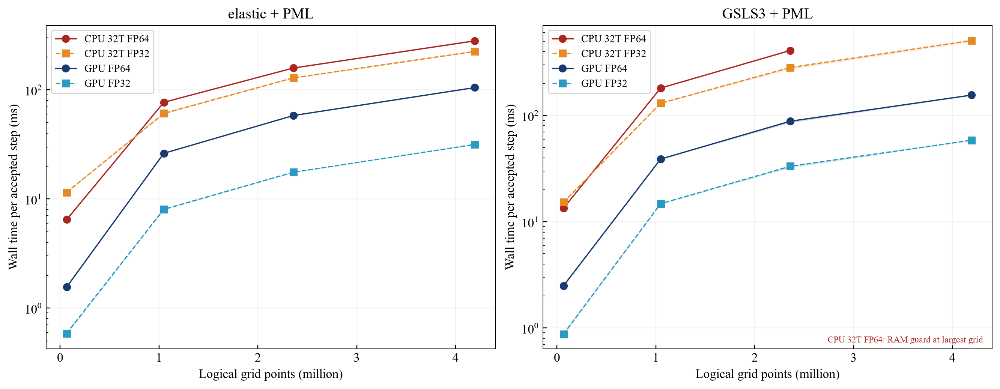
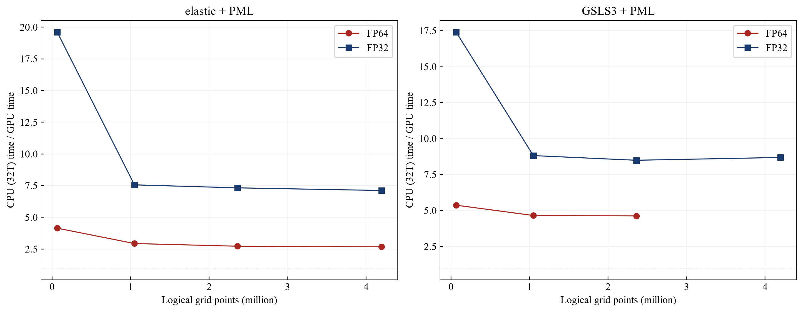
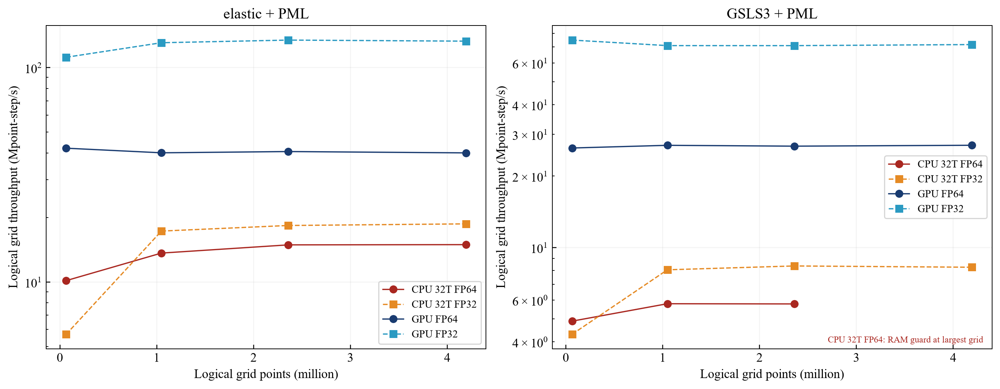
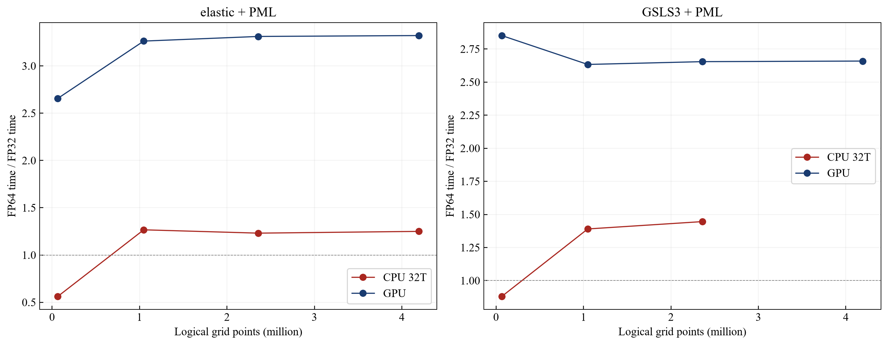
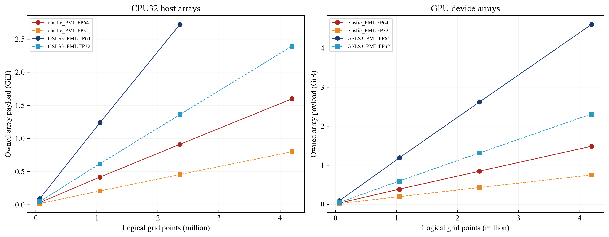
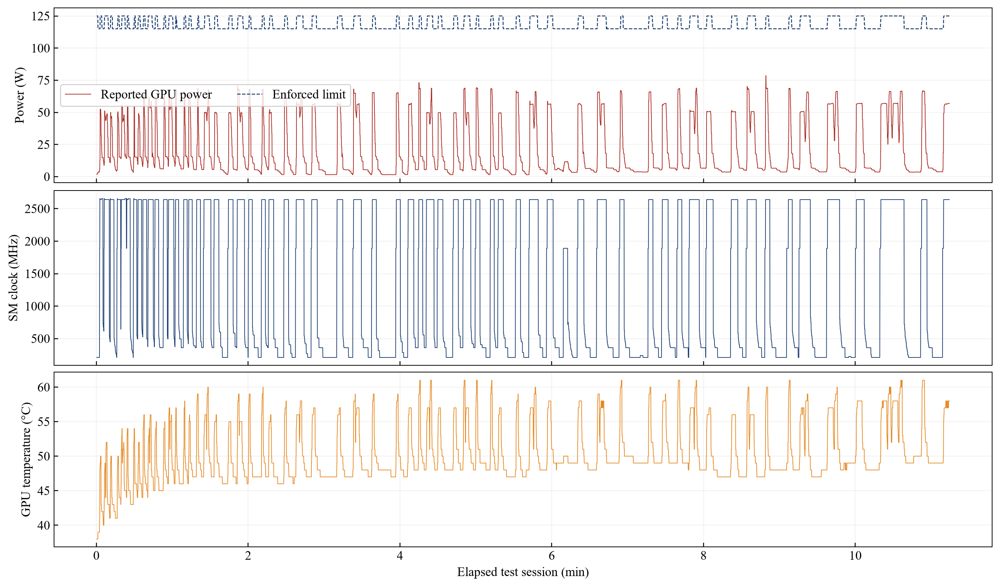

# 二维CPU 32线程／GPU：FP32与FP64规模性能实测

测试日期：2026-10-29。实测区间：2026-10-29 07:59:04 至 2026-10-29 08:10:19（北京时间）。本报告更新CPU32线程与GPU的性能证据；不改软件默认FP64，不修改求解器数值内核。原有精度与弱尾波限制仍见[二维精度验证](PRECISION_2D.md)。

## 测试条件与“最大功率”的实际含义

- CPU：13th Gen Intel(R) Core(TM) i9-13900HX，32个逻辑处理器。所有成功试验实际OpenMP团队均为32，CPU求解器报告32工作线程，进程可使用全部逻辑处理器；进程优先级Above Normal，`OMP_DYNAMIC=FALSE`、`OMP_WAIT_POLICY=PASSIVE`，CPU保留非正规数，不启用FTZ/DAZ。
- GPU：NVIDIA GeForce RTX 4060 Laptop GPU，驱动621.01；主机内存15.81 GiB。交流电状态由每个测试进程核验，用户确认已开启厂商性能／GPU高性能模式。
- 已尝试`nvidia-smi -pl 140`，驱动返回“不支持当前作用域修改功率”。本次GPU计时窗读到的实际强制上限为117–125 W；**不能将本结果称为已锁定140 W的满功率测试**。上限不是实际耗电，实际报告功耗约29.4–68.9 W，负载决定能否接近上限。
- Windows拒绝切换`SCHEME_MIN`，电源计划GUID保持原`381b4222-f694-41f0-9685-ff5bb260df2e`（平衡）；用户的厂商性能模式与Windows计划分开记录。测试后执行恢复原计划，命令和实测功率限制见[环境清单](data/precision-cpu32-2026-10-29/manifest-public.json)。测试脚本没有修改频率或启用超频，也没有并发其他求解器来人为拉高功耗。
- 100 ms一次NVML遥测覆盖整轮测试，计时窗单独匹配；功耗属于驱动报告值，部分读数本身有平均窗口，短试验不据此作高精度能耗积分。[NVIDIA官方说明](https://docs.nvidia.com/deploy/nvidia-smi/index.html)区分功率上限、当前强制上限和实际功耗。

本次共计划160次：155次成功、5次资源预检拒绝。每配置5次，不剔除离群值；正式比值要求至少3次成功。界面、模型初始化、清空、显式场下载和导出不进入计时。

## 模型矩阵与计时口径

四档逻辑网格256²、1024²、1536²、2048²；每档包含弹性+CFS-PML与三支路GSLS+CFS-PML。h=2 m，Vp/Vs=1500/700 m/s，ρ=1800 kg/m³；起伏5 m、波长500 m，15 Hz定向体力源，CFL=0.5；32检波器、输出间隔0.25 ms。Q组Qp/Qs=40/25、5–60 Hz拟合、参考20 Hz；两组均匀介质，便于区分增加GSLS状态的开销，不代表已标定黄土地层。

左右各外扩16格、底部外扩16格；另有每面3层虚点。逻辑N²对应无虚点计算域(N+32)×(N+16)，存储尺寸(N+38)×(N+22)。逻辑跨度为(N−1)×2 m。所有CPU/GPU、FP32/FP64组合采用同一输入和该工况的同一dt。FP32模型和传播/边界数组均为单精度，时间轴和能量归约保留双精度。

每次独立启动进程，先用相同生产求解器预热至少1 s，然后清空并推进固定预热步数；正式计时步数如下。每轮轮换CPU/GPU及精度顺序以减少固定顺序偏差。每个相同规模的四组合接受相同数量时间步。

| 逻辑网格 | 存储节点数（含外扩与虚点） | 清空后预热步 | 正式计时步／重复 |
| --- | ---: | ---: | ---: |
| 256² | 81,732 | 10 | 100 × 5 |
| 1024² | 1,110,852 | 5 | 40 × 5 |
| 1536² | 2,452,292 | 3 | 20 × 5 |
| 2048² | 4,318,020 | 3 | 20 × 5 |

单步耗时为生产`advance`的实际墙钟耗时/有效步数，包含四阶段RK、表面投影、GSLS/PML、每步诊断/回退保护及接收回传和插值。没有关闭同步来制造GPU倍速。图中带状区域是5次结果的25%–75%分位，不是置信区间。横轴吞吐以逻辑网格点数计算，初始化、工作集及设备数组容量另列。

名义时长10 s只是提供稳定的dt规划；试验实际止于上述步数，**没有完成每个模型的10 s物理正演**。这是计算效率测试，不把有限场值、短时一致性或粗网格容量当作工区波形精度保证。

## 计算效率结果

各列单位ms/有效步，取成功试验中位数。GPU加速比为同精度CPU32耗时/GPU耗时；无匹配数据的位置不计算比值。

### 弹性＋CFS-PML

| 规模 | CPU32 FP64 | CPU32 FP32 | GPU FP64 | GPU FP32 | GPU加速FP64 | GPU加速FP32 |
| --- | ---: | ---: | ---: | ---: | ---: | ---: |
| 256² | 6.461 | 11.497 | 1.558 | 0.586 | 4.15× | 19.61× |
| 1024² | 76.909 | 60.714 | 26.189 | 8.027 | 2.94× | 7.56× |
| 1536² | 158.431 | 128.647 | 58.141 | 17.556 | 2.72× | 7.33× |
| 2048² | 280.994 | 224.764 | 104.842 | 31.568 | 2.68× | 7.12× |

### 三支路GSLS＋CFS-PML

| 规模 | CPU32 FP64 | CPU32 FP32 | GPU FP64 | GPU FP32 | GPU加速FP64 | GPU加速FP32 |
| --- | ---: | ---: | ---: | ---: | ---: | ---: |
| 256² | 13.404 | 15.228 | 2.495 | 0.875 | 5.37× | 17.40× |
| 1024² | 181.136 | 130.288 | 38.897 | 14.771 | 4.66× | 8.82× |
| 1536² | 408.320 | 282.411 | 88.237 | 33.241 | 4.63× | 8.50× |
| 2048² | 资源预检拒绝 | 508.395 | 155.521 | 58.491 | — | 8.69× |







### 单精度收益单独比较

下表为同后端FP64耗时/FP32耗时，大于1才表示FP32更快；不能把GPU/CPU倍速与精度倍速混为一谈。

| 规模 | 方程 | CPU32中FP32倍速 | GPU中FP32倍速 |
| --- | --- | ---: | ---: |
| 256² | elastic_PML | 0.56× | 2.66× |
| 256² | GSLS3_PML | 0.88× | 2.85× |
| 1024² | elastic_PML | 1.27× | 3.26× |
| 1024² | GSLS3_PML | 1.39× | 2.63× |
| 1536² | elastic_PML | 1.23× | 3.31× |
| 1536² | GSLS3_PML | 1.45× | 2.65× |
| 2048² | elastic_PML | 1.25× | 3.32× |
| 2048² | GSLS3_PML | — | 2.66× |



CPU32小网格可能受并行调度、阶段同步和串行诊断限制，减半数组不保证更快；大网格还受缓存、带宽和内存压力影响。GPU的FP32收益也包含访存与寄存器变化，不能直接以芯片浮点峰值比代替程序实测。此处未做Nsight分析，不把这些可能因素当作已经定位的唯一瓶颈。

## 内存、显存与资源超限

表中为求解器实际拥有数组的容量，单位GiB；CPU列是CPU求解模式的主机模型/RK/PML数组，GPU列是实际设备分配请求总和，含显示、统计及接收缓冲。它们不是同一进程的主机/设备两部分。GPU模式另保留选定精度的主机模型，完整进程工作集、初始化峰值、WDDM可用显存见原始CSV。

| 规模 | 方程 | CPU FP64数组 | CPU FP32数组 | GPU FP64数组 | GPU FP32数组 |
| --- | --- | ---: | ---: | ---: | ---: |
| 256² | elastic_PML | 0.033 | 0.016 | 0.031 | 0.015 |
| 256² | GSLS3_PML | 0.093 | 0.046 | 0.090 | 0.045 |
| 1024² | elastic_PML | 0.416 | 0.208 | 0.387 | 0.196 |
| 1024² | GSLS3_PML | 1.235 | 0.618 | 1.190 | 0.597 |
| 1536² | elastic_PML | 0.911 | 0.455 | 0.847 | 0.429 |
| 1536² | GSLS3_PML | 2.720 | 1.360 | 2.620 | 1.315 |
| 2048² | elastic_PML | 1.597 | 0.799 | 1.486 | 0.751 |
| 2048² | GSLS3_PML | 预检拒绝 | 2.391 | 4.606 | 2.312 |



本轮超限记录如下，均未绕过资源保护，也未把拒绝写为零耗时或无限加速：

- FAIL: Insufficient RAM for a transactional 2D rebuild. Additional budget: 5.22 GiB; available: 5.66 GiB; required free with reserve: 6.52 GiB.
- FAIL: Insufficient RAM for a transactional 2D rebuild. Additional budget: 5.22 GiB; available: 5.73 GiB; required free with reserve: 6.52 GiB.
- FAIL: Insufficient RAM for a transactional 2D rebuild. Additional budget: 5.22 GiB; available: 5.74 GiB; required free with reserve: 6.52 GiB.
- FAIL: Insufficient RAM for a transactional 2D rebuild. Additional budget: 5.22 GiB; available: 5.76 GiB; required free with reserve: 6.52 GiB.

## 满线程、利用率与GPU性能状态

实际OpenMP团队均为32，并不意味着程序每个阶段都保持100% CPU利用率。按计时窗进程CPU秒数/墙钟秒数计算，CPU试验组的平均忙核数中位数约8.2–15.5；相对于32个逻辑处理器的利用率和完整原始值保留在CSV。没有额外运行占位线程伪造满载。CPU包功率和有效频率未直接测量，不宣称已锁定全部核心最高睿频。

GPU计时窗遥测最高温度61 °C，SM频率范围2640–2640 MHz。下表为同配置所有计时窗样本的均值及峰值；100 ms遥测可能让极短窗口只有少数样本，不能据此把“当前没跑到功率上限”解释为模式没有开启。原始时序另有P状态、显存利用率及限频原因原始mask；没有仅凭功耗推定瓶颈。

| 规模 | 方程 | 精度 | GPU平均/峰值W | 平均利用率% | 平均SM MHz | 最高温度°C | 遥测样本 |
| --- | --- | --- | ---: | ---: | ---: | ---: | ---: |
| 256² | elastic_PML | FP64 | 46.5 / 47.7 | 97.2 | 2640 | 52 | 9 |
| 256² | elastic_PML | FP32 | 53.0 / 54.9 | 94.0 | 2640 | 54 | 4 |
| 256² | GSLS3_PML | FP64 | 59.5 / 62.5 | 98.4 | 2640 | 56 | 11 |
| 256² | GSLS3_PML | FP32 | 62.3 / 67.1 | 96.3 | 2640 | 57 | 3 |
| 1024² | elastic_PML | FP64 | 49.6 / 52.2 | 99.0 | 2640 | 56 | 47 |
| 1024² | elastic_PML | FP32 | 64.6 / 68.8 | 98.0 | 2640 | 60 | 15 |
| 1024² | GSLS3_PML | FP64 | 56.3 / 56.9 | 99.3 | 2640 | 57 | 71 |
| 1024² | GSLS3_PML | FP32 | 65.1 / 65.4 | 98.8 | 2640 | 59 | 28 |
| 1536² | elastic_PML | FP64 | 49.8 / 49.9 | 99.6 | 2640 | 57 | 54 |
| 1536² | elastic_PML | FP32 | 67.3 / 68.9 | 98.7 | 2640 | 61 | 15 |
| 1536² | GSLS3_PML | FP64 | 56.5 / 57.1 | 99.9 | 2640 | 59 | 81 |
| 1536² | GSLS3_PML | FP32 | 66.0 / 67.1 | 99.0 | 2640 | 61 | 31 |
| 2048² | elastic_PML | FP64 | 50.7 / 50.9 | 99.8 | 2640 | 57 | 96 |
| 2048² | elastic_PML | FP32 | 68.3 / 68.9 | 99.0 | 2640 | 61 | 29 |
| 2048² | GSLS3_PML | FP64 | 56.9 / 57.3 | 99.9 | 2640 | 58 | 142 |
| 2048² | GSLS3_PML | FP32 | 66.0 / 66.7 | 99.2 | 2640 | 61 | 55 |



## 一致性与结论边界

同一后端、精度和工况内，5次的采样场和全部检波记录哈希一致。跨后端/精度另作误差比较：额外下载在计时结束后进行，五个物理场（Q组另有Syy）取1024个均匀存储索引及源周围25×25节点，另比较全部32位置的Vx/Vz样本。它是性能试验的一致性检查，不是完整GSLS/PML记忆状态的逐点验证。

采样场最大相对L2为1.2726e-07；按FP64同精度1e-8、涉及FP32为1e-3的L2门槛检查，峰值门槛为3倍。每道原始记录也单独比较；短记录可能在主波到达前，允许绝对误差小于源区速度峰值1e-5的极弱窗另行标识，本轮此分支使用16项。记录中最大逐道相对L2达到100.0%，这部分没有通过统一的相对误差门槛；这些弱窗的整体峰值绝对误差不超过5.47e-18 m/s。远偏移主波尚未到达，部分极小数值在FP32下归零，因此不能用本次短窗宣称远偏移反射振幅相对精度。详见[一致性原始表](data/precision-cpu32-2026-10-29/consistency.csv)。

新结果用于选择当前机器上的计算后端与精度。默认仍保留FP64，二维FP32可手动用于显存受限或常规试算；强衰减后极弱应力尾波的相对误差限制不因速度快而消失。h=2 m的本组1500/700 m/s均匀材料，不能直接替代干黄土500/150 m/s的网格精度论证。三维、本轮未完成的长时工区正演、更多设备和厂商模式，均不作推广保证。

与2026-10-28的CPU8线程结果、2026-10-19的二维/三维FP64旧基准分开保留；这些测试的线程数、模型、接收数、PML和驱动条件不同，不拼接成同一倍速曲线。当前说明中的二维CPU32/FP32/FP64性能结论以本页为准。

## 复现与文件

在x64 MSVC开发环境，从工作区外层构建：

```powershell
cmake --build out/build/x64-Release --target seis2d_precision_benchmark --parallel 4
```

从仓库根目录执行，接交流电并先开启厂商性能模式；使用新的外层out子目录可保留原始证据：

```powershell
python -B benchmarks/precision_suite.py --output <外层out下新的绝对目录>
python -B benchmarks/report_precision.py <该绝对目录>
```

`--resume`继续已保存试验，`--sizes`可限定规模；不应用于更改硬件模式后拼接数据。环境恢复由runner的finally执行，命令及核验值均记录。`--publish`将验收图文作为文档资源发布，默认分析只写外层out。

原始[逐次试验](data/precision-cpu32-2026-10-29/trials.csv)、[配置统计](data/precision-cpu32-2026-10-29/summary.csv)、[环境清单](data/precision-cpu32-2026-10-29/manifest-public.json)、[数值检查](data/precision-cpu32-2026-10-29/consistency.csv)、[完整遥测压缩文件](data/precision-cpu32-2026-10-29/telemetry.csv.gz)、[统计JSON](data/precision-cpu32-2026-10-29/summary.json)。源程序：[C++基准](../benchmarks/PrecisionBenchmark2D.cpp)、[运行和遥测](../benchmarks/precision_suite.py)、[报告生成](../benchmarks/report_precision.py)。EXE SHA-256：`7ac22409f5c96501504272550ebce706db286256c5118013ce72e36bffd1f950`。本工作区保留既有未提交改动，未自动提交或推送。
