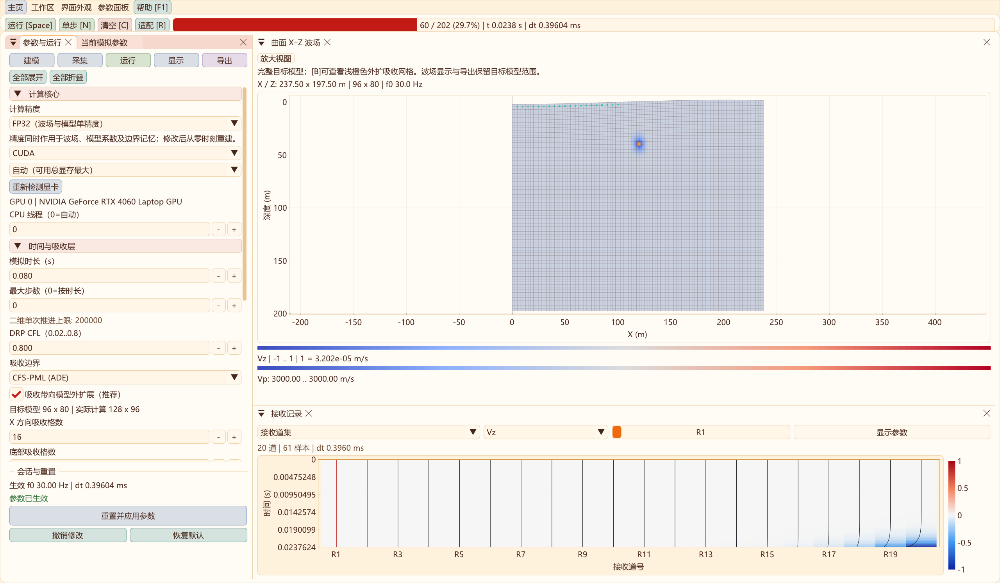
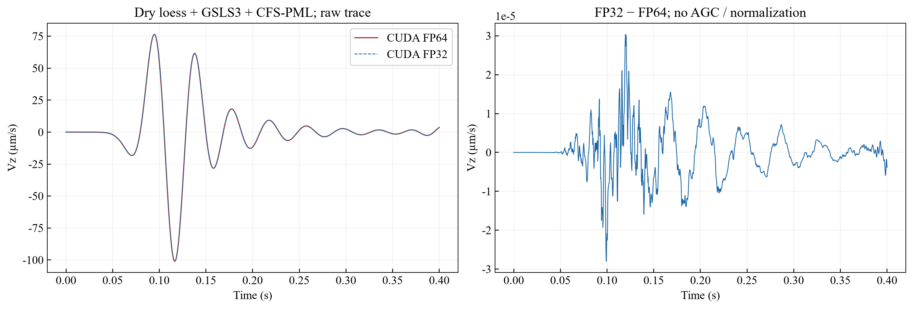
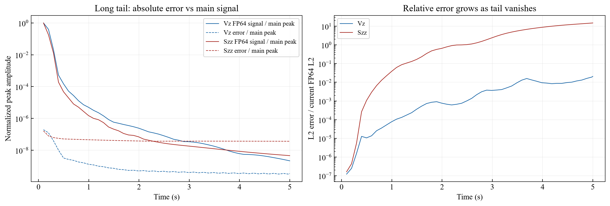
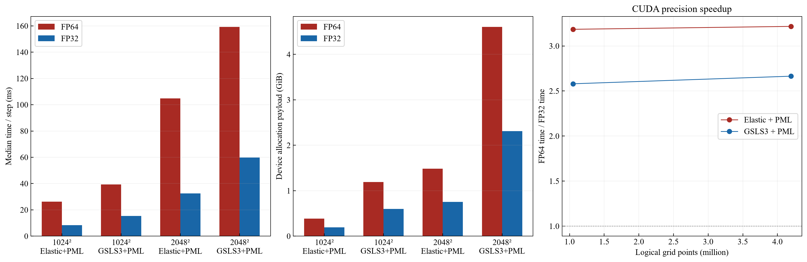

# 二维FP32/FP64实现、精度与资源实测

2026-10-29更新：当前CPU32线程与GPU性能模式、四档模型规模及两种精度的正式性能比较见[最新二维性能报告](PERFORMANCE_PRECISION_2D.md)。下文保留2026-10-28的精度资格、CPU8性能和5001×2001容量证据，不能与新测试混合计算倍速；默认仍为FP64。

2026-10-28，Windows Release；CPU：13th Gen Intel(R) Core(TM) i9-13900HX，固定8线程性能对照；GPU：RTX 4060 Laptop，8188 MiB，驱动621.01。主机内存15.81 GiB。**默认仍为FP64**，本轮不自动改变历史模型精度。只实现二维，三维仍为FP64。

最终Release相关CTest 10/10通过：弹性/后端、GSLS、模型IO、后台发布、PML状态、外扩吸收、七组反射审计、PML界面、精度数值及精度界面。性能计时另以固定步数运行。

## 实现与操作

二维“运行 → 计算核心 → 计算精度”选择FP32或FP64，然后应用/重建。切换清空当前波场和记录，从t=0开始；待应用值与已生效值分开显示。模型数组没有必须永久使用FP64的理由，本轮让坐标、法向、度量、Vp/Vs/密度/Q、弹性模量、源权重、GSLS系数、波场、RK暂存及PML记忆全部随选定精度存储和计算，不保留完整双精度镜像。

几何构建、GSLS拟合、时间轴及能量/牵引诊断保留FP64；完成构建后逐数组转换并释放临时double数组，再分配所选精度的工作区。少量参数表、原始高程剖面、接收坐标和CSV记录仍以double保存，不是逐网格模型镜像。FP32采样值转换为double不会恢复丢失的有效位。预算同时考虑构建瞬时FP64占用，溢出、失去正值的量化物性/几何拒绝初始化。

模型保存FP32时采用二维schema 5：点数组和坐标为Float32，`CalculationPrecision=1`参加完整性校验。FP64继续按原schema 2/3/4写出；旧schema 1..4读入FP64。载入仍从零重建。波场VTS保留所选精度，CSV带计算/模型精度注释，显示色带和增益不进入原始导出。没有开启fast-math或FP16。



## 小模型逐级验证

80×72逻辑网格；外扩左右/底部12格，另有3层虚点。CPU单线程及CUDA，依次比较平地弹性、曲面爆炸矩源、曲面PML、1支路GSLS+PML、3支路GSLS+PML、分层干黄土+3支路GSLS+PML。普通组h=1 m、20 Hz、0.35 s；干黄土组h=0.25 m、15 Hz、0.4 s，上层厚3 m、Vp/Vs=500/150 m/s、ρ=1450、Qp/Qs=40/25，下层1200/600 m/s、ρ=1900、Qp/Qs=80/50。干黄土源深索引5，起伏0.15 m、波长20 m，记录间隔0.25 ms。普通材料550/250 m/s、ρ=1550；Q拟合5–60 Hz、参考20 Hz。此处小尺寸用于舍入误差资格验证，不是靖边工区地质复现。

比较全部五场、独立Syy、各GSLS记忆、紧凑PML状态、原始Vx/Vz及前后半窗记录。预设门槛：相对L2≤0.1%、相对峰值≤0.3%；牵引相对误差FP32≤5×10⁻⁶、FP64≤10⁻⁹。未使用AGC或逐道归一化。

结果：全部比较中最大L2为0.01718%；原始接收记录最大L2为0.000214%，后半窗最大0.000340%。本机构建下CPU32/CUDA32最大L2为0，不承诺其他编译器逐位一致。主机模型、RK状态和边界数组分别恰好减半；GPU还保留固定大小的显示/FP64归约和接收缓冲，总量略大于一半。清空复跑、无效重建保留旧状态、schema 5校验及模型往返、后台发布与双向界面切换均已验收。



### 极弱长尾的限制

48×40、GSLS3+PML、5 s、每约0.1 s检查一次，共51个快照。全时段误差峰值低于主信号峰值的0.01%，无不稳定能量增长；但不能据此宣称消失尾波的相对精度合格。5 s末FP64/FP32能量相对各自峰值为4.48e-17/3.58e-15。Vz相对L2约2.05%，Szz约1485%；Szz绝对误差峰值仅3.45e-07 Pa，Vz为3.45e-15 m/s。**强衰减后极弱尾波、微小残余应力或差分信号研究仍优先FP64**；能量代理也不是GSLS全部记忆的严格储能。



## 中、大网格速度与显存

性能模型保持相同物理设置与dt，仅切换精度：h=2 m，15 Hz，Vp/Vs=1500/700 m/s、ρ=1800，起伏5 m、波长500 m，CFL=0.5；外扩16格CFS-PML，32检波器，0.25 ms输出。Q组3支路、Qp/Qs=40/25、5–60 Hz、参考20 Hz。名义时长10 s、步数上限1000，**本测试仅推进指定步数，未完成10 s正演**。这些物性不代表500/150 m/s干黄土在2 m网格上的空间精度。

每配置预热20步；CUDA计时60步、CPU计时20步，各交错重复3次，取中位数。计时包含4阶段RK、表面投影、PML/GSLS更新、每步诊断和接收回传；排除初始化、OpenGL显示、导出及全场下载。每次仅保留一个求解器。`device_payload_bytes`直接累加实际cudaMalloc请求，包括设备模型/RK/PML、显示、统计和接收数组；不是整进程显存或CUDA上下文占用。另记录预热前后的可用显存，受WDDM和其他应用影响；主机数组统计不含所有容器、记录及驱动开销。

| 后端 / 逻辑网格 | 方程 | FP64 ms/步 | FP32 ms/步 | FP32倍速 | FP64 / FP32设备数组 GiB |
| --- | --- | ---: | ---: | ---: | ---: |
| CUDA / 1024² | 弹性+PML | 26.31 | 8.26 | 3.18× | 0.387 / 0.196 |
| CUDA / 1024² | 3支路GSLS+PML | 39.40 | 15.27 | 2.58× | 1.190 / 0.597 |
| CUDA / 2048² | 弹性+PML | 104.74 | 32.56 | 3.22× | 1.486 / 0.751 |
| CUDA / 2048² | 3支路GSLS+PML | 159.26 | 59.78 | 2.66× | 4.606 / 2.312 |
| CPU8 / 512² | 弹性+PML | 85.76 | 90.36 | 0.95× | —（主机数组减半） |
| CPU8 / 512² | 3支路GSLS+PML | 153.98 | 146.24 | 1.05× | —（主机数组减半） |



FP32对GPU的收益已实测，不能以理论浮点峰值比直接预测整程序。CPU弹性没有加速，GSLS仅小幅改善；本实现每步仍有双精度能量归约、内存遍历、边界与同步，主机循环也未另做SIMD优化。CUDA RHS元数据报告FP64/FP32分别163/140寄存器、localSizeBytes 368/240字节每线程；这不是完整的Nsight瓶颈分析，也不能把local字节全部解释为寄存器溢出。

## 5001×2001容量实测

逻辑10,007,001点；外扩16格和虚点后实际5039×2023＝10,193,897点。各配置预热8步、计时20步，仅一次容量试运行；不与重复3次的中大网格统计混同。

| 配置 | 实际设备数组 | ms/步 | 结果 |
| --- | ---: | ---: | --- |
| elastic_PML / FP64 | 3.488 GiB | 240.53 | 运行通过 |
| elastic_PML / FP32 | 1.764 GiB | 73.68 | 运行通过 |
| GSLS3_PML / FP64 | — | — | 显存预检拒绝，未运行 |
| GSLS3_PML / FP32 | 5.448 GiB | 135.60 | 运行通过 |

GSLS3/PML的FP32实际设备数组5.44788 GiB，GPU模式主机模型数组约0.836 GiB；预热后可用显存约1.35 GiB。对应FP64保守预算11.04 GiB，预留后需空闲12.99 GiB，本机当时仅6.94 GiB，故拒绝；没有这个组合的实测FP64耗时和直接倍速。两种精度的弹性容量测试均运行，但属于单次短测试。

均匀体力源、3机制Q的主要逐点存储：CPU模型22+七套状态126＝148个所选精度标量，FP64/FP32为1184/592字节；GPU静态16+状态126＝142标量，1136/568字节，另加紧凑PML、显示与统计缓冲；GPU主机保留22个模型标量。无Q时CPU49、GPU45标量；爆炸矩源另加2个梯度标量。PML七套记忆用`7×4×(2wxNz+wzNx)`个所选精度标量，Nx/Nz为含吸收带、不含虚点的计算尺寸。以上不是总进程容量公式。

## 默认精度决定与后续验收

保留FP64默认。FP32可手动用于已验证范围的常规二维弹性/GSLS和显存受限试算，尤其本机5001×2001的Q模型。大模型容量通过不等于完整3–10 s工区正演、所有低Q/陡地形或弱反射振幅分析都已合格。调整默认前，应使用目标5/10 km DEM、实际干黄土速度及相应更细网格，完整对照主频、相位、弱反射、面波频散和采集评价窗口；采用未归一化数据与网格收敛结果。FP32不会解决h过大导致的数值频散。

本机中大GPU实测支持单精度节省资源；极弱长尾和CPU实测又说明全局强制替换FP64不合适。三维精度、低存储RK、稀疏诊断/异步回传和混合精度优化留待单独验证。切换大模型仍需为候选会话留出空间；重建失败保留旧结果，必要时先导出并返回主页释放旧会话。

## 复现与原始证据

在VS x64开发环境构建外层`out/build/x64-Release`的`seis2d_precision_validation`及主程序，然后运行：

```powershell
../out/bin/Release/seis2d_precision_validation.exe
../out/bin/Release/SeisWaveLab_Curvilinear.exe --smoke-2d-precision
../out/bin/Release/seis2d_precision_validation.exe --benchmark
../out/bin/Release/seis2d_precision_validation.exe --capacity
ctest --test-dir ../out/build/x64-Release -R "curvilinear_2d_|curvilinear_background_publication" --output-on-failure > ../out/build/precision-final-tests.log
python -B tools/analyze_precision_validation.py
```

运行测试前关闭其他模拟会话。默认数据输出外层`out/validation/precision-2d`；脚本不自动更改默认精度。`--publish`仅发布当前验收的说明资源。

证据：[逐分量误差](data/precision-2d-2026-10-28/accuracy.csv)、[存储和牵引](data/precision-2d-2026-10-28/storage.csv)、[重复性能测试](data/precision-2d-2026-10-28/benchmark.csv)、[大模型容量](data/precision-2d-2026-10-28/capacity.csv)、[51时刻长尾](data/precision-2d-2026-10-28/long_tail.csv)、[摘要](data/precision-2d-2026-10-28/summary.json)。[测试源码](../src/two_d/PrecisionValidation2D.cpp)、[分析脚本](../tools/analyze_precision_validation.py)。
