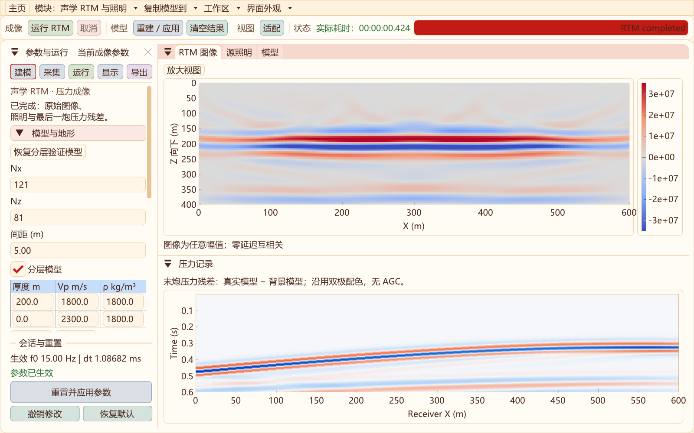
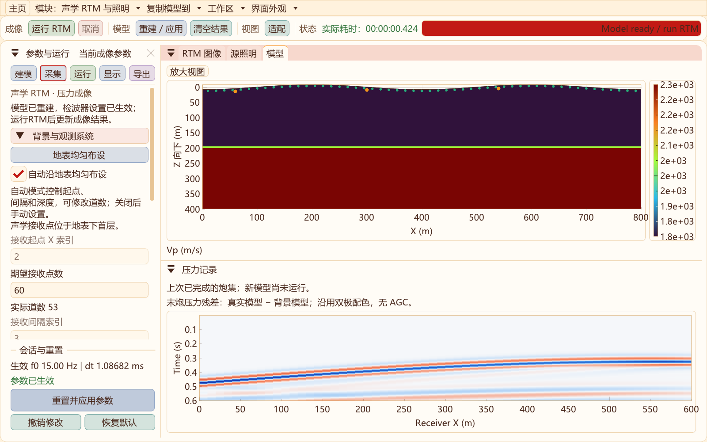
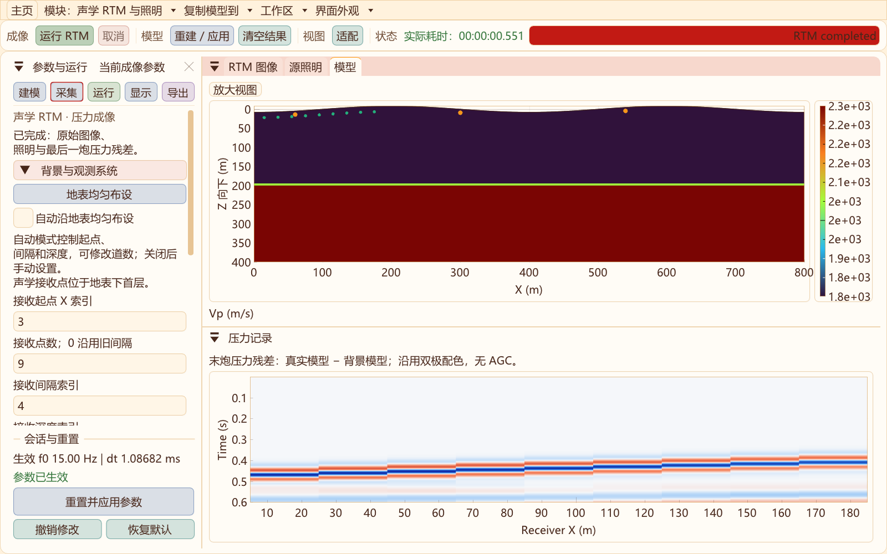
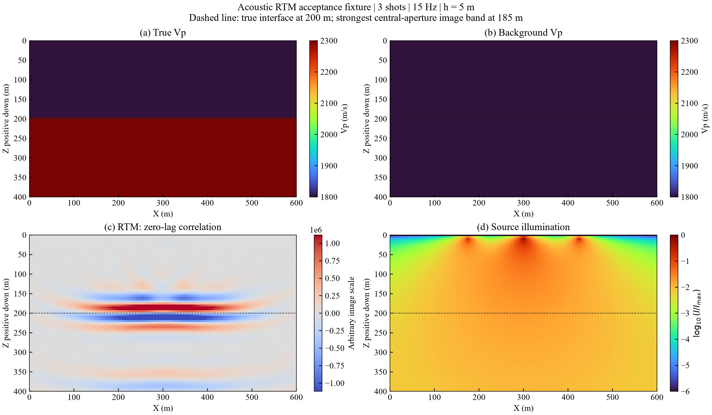

# 二维成像：声学 RTM 与源照明

2026-10-31重建与采集更新：新增顶部“重建 / 应用”和参数面板固定底部“重置并应用参数”，完成一次成像后仍可重建、再运行。支持接收起点、道数、节点间隔、深度；默认自动沿起伏地表下首层均匀布设，修改模型后自动更新。旧成像结果与新模型分别保留并明确标注。[本轮回归](data/rtm-survey-2026-10-31/regression.txt)。

2026-10-31更新：二维功能工具栏分组留白；声学与弹性共用地形/分层编辑，按空闲内存与预算提示网格上限；压力增加SEG-Y rev2 IEEE32/64导出；RTM新增限速过程预览。[操作、截图与验证](WORKFLOW_UPGRADE_2D.md)。

边界隔离说明：声学正演现默认[独立验证的CFS-CPML](ACOUSTIC_CPML_2D.md)，本页RTM仍使用原海绵、检查点及离散伴随。CPML包含额外卷积状态，不能直接替换RTM正传而保留旧伴随；未来接入必须重新验证全状态伴随点积与检查点回放。

更新日期：2026-10-30。第一阶段为可复核的合成数据成像基准。

现已新增[独立声学正演工作区](ACOUSTIC_FORWARD_2D.md)，与RTM共用声学基础组装/递推实现，但选择独立边界分支，但只保留一个传播会话，不保留成像历史。正演源采用dt²与面积归一化，和本页既有RTM基准的单位增量源不同；绝对振幅及导出数据接口尚不能直接互换。

程序新增独立的“二维成像 / RTM”工作区，复用二维模型参数、外部高程解析、CPU/CUDA 设备管理、主题及输出目录。**成像核为新建的变密度声学压力方程 P1 有限元基准，不是已有弹性 MacCormack-DRP + RK4 求解器的逆传播版本。**正演工作区的弹性、GSLS 和 CFS-PML 实现不因进入成像而改变。



## 如何使用

1. 首页选择“声学 / P → RTM 成像与照明”，或在二维顶部“模块 → 声学 / P → 声学 RTM 与照明”进入；也可使用主程序参数 `--imaging-2d`。
2. 初次使用可直接运行默认分层验证模型。普通导航保留各模块自己的待应用参数；要沿用正演模型，选择“复制模型到 → 声学 RTM 与照明”，显式深拷贝模型、地形、精度、线程和设备选择。也可在建模页载入本软件保存的二维模型 VTS。
3. 检查背景速度：`背景 Vp > 0` 为常速背景；`0` 对真实 Vp 进行平滑。背景密度沿用真实密度，不做密度反演。图像取决于背景模型，不能用“已知真实模型”替代实际资料的速度建模。
4. 设置炮数、首末炮 X 节点、震源深度、接收系统、主频和完整记录时长。炮点在首末炮之间均匀分布并取整，单炮置于两者中点；首末炮可以相同。接收点默认按期望道数沿地表下首层均匀布设；关闭自动模式后，可设置起点、道数、间隔及深度。
5. 选择 CPU/OpenMP 或 CUDA、FP32 或 FP64，检查 RAM 预算，再点击“运行 RTM”。后台任务显示实际耗时和进度，可以取消；成功完成才替换前一结果。原正演的 `maxSteps` 不截断成像记录。
6. 上部查看 RTM / 模型及源照明，下部查看最后一炮压力残差。宽度小于 1800 像素时，图像、模型和照明自动合并为标签页。支持图窗拖出、缩放、重新停靠以及恢复布局。
7. 点击“导出实验结果”。每次创建新的外层 `out/imaging/experiment-*` 目录，避免覆盖已有实验。导出依据**完成计算时的参数快照**，不会把之后编辑的参数误写进旧结果。

普通导航不会把当前模型带回其他模块；各模块保存独立的待应用参数。只有“复制模型到”会传递输入，并按接收方源边距、接收道数和物理范围适配。离开前取消当前任务，重新进入需要重算；波场和结果不会自动保活，切换前应导出。左侧分类、生效参数、悬浮面板及代码边界见[二维模块组织](MODULE_ARCHITECTURE_2D.md)。

外部高程 CSV 使用原二维 `SurfaceProfile` 的 PCHIP 插值，要求 X 覆盖目标宽度。载入高程时以平均高程设置初始基准，可继续修改；`z = datum - elevation`，Z 向下为正。沿计算深度使用与正演相同的九次平滑函数向水平展平。成像的外扩条带沿横向保持边缘地表高度；这一延拓与弹性核的 C1 条带延拓不同。

## 模型重建、自动对齐与再次运行

- 进入工作区先在后台准备模型。顶部或固定底部的重建按钮只做几何、真实/背景Vp、采集坐标和完整任务预算检查，不传播波场、不运行成像，也不创建检查点历史。
- 修改模型尺寸、间距、地形或导入模型后，自动模式立即重新计算待应用的检波器起点和间隔。点击重建更新模型预览；直接点击“运行RTM”则先应用待修改模型，再启动任务。橙色为炮点、绿色为检波点，位置来自实际求解坐标。
- 自动模式沿水平X均匀分布，并跟随起伏地表下首层节点（索引1）；不是按坡面弧长等距，也不将检波点放在p=0自由面上。自动线覆盖目标内侧节点1..Nx−2，不包含外扩吸收条带。
- “期望接收点数”和“实际道数”分别显示。整数网格间距会调整实际道数，但期望道数单独保存，反复刷新、缩放或重建不会逐次减少道数。最多4096道；目标网格更小时受可用节点数约束。
- 关闭“自动沿地表均匀布设”后，可手动修改接收起点、道数、间隔、深度；越界会拒绝重建。手动道数0保留旧接口按当前起点/间隔延伸至倒数第二节点的行为，正数表示明确道数。单道记录具有非零X显示范围。
- 底部复用弹性/声学正演的固定会话栏，包含“重置并应用参数”“撤销修改”“恢复默认”。运行/重建期间禁用这些输入，允许取消；窗口停靠、悬浮与小尺寸布局保留。
- 新模型准备成功后，上次RTM图像和炮集仍可查看/导出，并标明“上次已完成”；新任务成功后才替换。失败或取消不破坏旧模型/结果。“清空结果”只清空成像数据，保留已应用模型。撤销恢复已应用参数，恢复默认只修改草稿。





实际[鼠标/键盘交互日志](data/rtm-survey-2026-10-31/ui-interactions.txt)覆盖Nx编辑、自动对齐、完成后两处重建按钮、地形坐标、手动线、失败保留、撤销、第二次成像、单道及默认值；[原生验证](data/rtm-survey-2026-10-31/native-validation.txt)另覆盖重建/运行坐标一致、手动与自动采集伴随点积、CPU/CUDA、预算/取消事务及旧基准采集线不变。

核心接口新增`prepareModel`，与`run`使用相同模型和预算检查。`Options.receiverStart/receiverCount/receiverStride/receiverDepth`定义采集线，`receiverTargetCount`保存自动布设期望值，`autoSurfaceReceivers`选择自动模式。开发者默认选项仍保持原采集线以复现旧数值基准；界面默认开启自动模式。导出的`experiment.txt`包含上述设置及实际道数，`receivers.csv`保留物理坐标。

## 当前物理范围

| 项目 | 第一阶段实现 |
| --- | --- |
| 方程 | 二维各向同性变密度声学压力方程 |
| 共享模型内容 | 地形、目标尺寸、间距、地层厚度、Vp、密度；不使用 Vs |
| 数据 | 每炮现场合成真实模型压力，再减去背景模型压力 |
| 顶边界 | 沿起伏地表的零压力自由表面 |
| 其他边界 | 目标域外的阻尼条带，最外层零值；不是弹性核 CFS-PML |
| 成像 | 正向背景波场与离散伴随波场的零延迟互相关、多炮求和 |
| 照明 | 背景压力平方的时间积分，逐炮求和 |
| 显示 | 模型和照明复用 turbo，成像默认 coolwarm，压力记录默认原有双极色带；显示可换色 |
| GPU | 单张选定 CUDA 设备；传播留在 GPU，回放和成像累计使用主机数组 |
| 未接入 | 外部实测炮集输入、弹性 PP/PS 分离、Q/GSLS、Q 补偿、LSRTM、FWI |

载入的模型若开启 GSLS，会明确拒绝开始成像，需用户在成像面板显式关闭。不能把已有弹性 Vx/Vz 道集当作声学压力，也不能把这里的照明图称为完整炮检联合照明或 Hessian 对角线。本阶段源机制固定为节点上的单位压力增量 Ricker 子波；不沿用弹性体力/矩源振幅和方向，图像没有经过反射率振幅标定。

## 离散与伴随关系

声学方程写为：

$$
\frac{1}{\rho V_p^2}\partial_t^2p-\nabla\cdot\left(\frac1\rho\nabla p\right)=f.
$$

贴体四边形按交替对角线剖为线性三角形，组装对称刚度矩阵 K 与集总质量 M；每个节点最多使用九个相邻位置。令 $w=M^{1/2}p$，则 $H=M^{-1/2}KM^{-1/2}$ 对称。边界约束后保持该对称性。

采用二阶时间递推及梯形离散阻尼：

$$
w_{n+1}=A w_n+B w_{n-1}+S q_n,
\quad A=\operatorname{diag}(a)(2I-\Delta t^2 H),
\quad a_i=(1+\sigma_i\Delta t/2)^{-1}.
$$

其中 $B_{ii}=-(1-\sigma_i\Delta t/2)/(1+\sigma_i\Delta t/2)$。**伴随使用 $A^*=(2I-\Delta t^2H)\operatorname{diag}(a)$**，与阻尼区正传 A 的乘法顺序不同，不能简单令 dt 为负。

接收算子在每步完成后读取 $p=w/\sqrt M$；其转置按同一质量因子回注入。伴随终端条件使用最后一个接收样本，随后逐样本逆序推进。测试比较完整源序列到接收记录算子的内积，而非只比较一个空间矩阵。

dt 使用真实/背景两套算子的最大绝对行和给出的谱界，取 $0.8\times2/\sqrt{\lambda_{bound}}$。输入要求主频 P 波每波长至少 12 个节点，且完整时长不超过 20000 步；这只是当前声学基准的入口条件，不能替代高频尾部和网格收敛分析。不能套用弹性 DRP 求解器的 PPW 或稳定步长结论。

零延迟互相关和源照明为：

$$
I(x,z)=\sum_s\sum_n p_s(x,z,t_n)v_s(x,z,t_n)\Delta t,
\qquad E_s(x,z)=\sum_s\sum_n p_s^2(x,z,t_n)\Delta t.
$$

显示用照明归一化图像为 $I/(E_s+\epsilon\max E_s)$，默认 $\epsilon=0.005$。源照明显示为 $\log_{10}(E_s/\max E_s)$，色标范围 −6..0；更弱值仅在显示时截断。该归一化会改变振幅解释，不等价于最小二乘反演。

## 检查点与内存

每个检查点保存两层完整计算域 w；反传前恢复检查点，向前精确重算一个分段，再逐时刻关联成像。默认分段长度约为 $\lceil\sqrt{2N_t}\rceil$，保存量约为：

$$
N_{compute}\left(2\left\lceil N_t/B\right\rceil+B\right)\operatorname{sizeof}(Real).
$$

另外还需模型、两套传播系数、三个传播会话、图像和记录。程序使用保守峰值预算检查用户 RAM 上限及可用 RAM 的 70%，GPU 另留显存余量；图中“RAM”是预算估计，不是操作系统采样的实测峰值。预算不足不会自动改变网格或物理范围，也不会删除旧结果。

FP32/FP64 用于波场、传播系数和检查点；几何组装、谱界、时间、图像与照明累计保留 FP64。当前 GPU 回放有主机传输，不能把原弹性正演的 CPU/GPU 倍速直接当作 RTM 倍速；本阶段没有发布 RTM 性能结论。

## 验证条件与结果



基准目标 121×81 节点，h=5 m，宽 600 m、深 400 m；15 Hz，0.6 s；顶部 Vp=1800 m/s，200 m 以下 Vp=2300 m/s，密度均为 1800 kg/m³；背景 Vp=1800 m/s。3 炮位于 X 索引 35、60、85，震源和接收深度索引 2，接收间隔 2，外扩阻尼层 24 格。使用完整 553 步，dt≈1.086816 ms。

| 检查 | 实测结果 / 门槛 |
| --- | --- |
| 曲面、变密度、阻尼、压力采样的完整传播点积，CPU FP64 | 1.18714e−15；要求 <1e−10 |
| 同上 CPU FP32 | 1.45155e−6；要求 <5e−4 |
| CUDA FP64 / FP32 点积 | 本机分别与 CPU 数值相同，通过各精度门槛 |
| 水平反射界面位置 | 中部孔径 X=200..400 m，Z=100..320 m 的逐深度绝对图像和主峰在185 m；距200 m为15 m，门槛20 m |
| 自动检查点间隔与17步分段 | 原始 RTM 图像相对 L2 =0 |
| 真实/背景模型相同 | 压力残差与 RTM 图像为0 |
| CPU FP32 与 FP64 原始图像 | 相对 L2≈1.02612e−5；要求 <0.002 |
| CPU/CUDA 原始图像 | 本机 FP32、FP64 的相对 L2 均为0 |
| 实际外部高程样本 | 正负高程、X方向和基准转换检查通过，曲面成像完成 |
| 失败与取消 | 小预算、GSLS拒绝、预先及计算中取消均保留前一结果 |
| 界面 | 后台求解、红黄橙主题、1600×1000 / 1280×800 / 960×640布局和完整窗口截图通过 |

原始数值日志见[validation.txt](data/rtm-2d-2026-10-30/validation.txt)，完整算例配置见[experiment.txt](data/rtm-2d-2026-10-30/experiment.txt)。未舍入数组与 VTS 留在外层 `out/validation/rtm-2d/experiment-*`。

这是一项已知背景、同离散合成资料的自洽验收。带限互相关图像存在旁瓣与深度展宽，本例不能宣称5 m定位精度；图中还可见晚时能量和边界相关成像伪影。点积一致与后端一致不代表连续物理精度已充分验证。尚未完成独立软件对照、系统网格收敛、阻尼反射率验收、多炮实测资料及黄土强低速层成像验证，因此不能据此宣称达到生产 RTM 的成像精度或边界指标。源照明只描述震源侧传播能量，不足以单独判断接收系统优劣。

## 导出内容与复核

- `rtm.vts`：真实/背景 Vp、原始图像、照明归一化图像、源照明及物理坐标；只包含目标域。
- `model.csv`：精确到节点的 X、Z、真实/背景 Vp、密度，可用于复核曲面几何和模型定义。
- `last_shot_pressure_residual.csv`：最后一炮压力残差，时间为 $(n+1)dt$，单位 Pa，不使用显示增益和 AGC。
- `receivers.csv`：接收位置及编号。
- `experiment.txt`：方法、设备、精度、炮点、子波、dt、实际步数、检查点、预算和限制。源子波每步添加1 Pa峰值尺度的 Ricker 压力增量，延迟1.5/f。

图像由全部炮叠加，**当前只导出末炮压力残差，未导出所有炮的原始压力**。文件足以复核该受控实验的定义，但尚无导出目录的一键重启/重新导入接口。不能把该导出 VTS 当作弹性模型 VTS 或波场重启文件。

从仓库根目录构建和复验：

```powershell
cmake --build ../out/build/x64-Release --target seis2d_imaging_validation SeisWaveLab_Curvilinear
ctest --test-dir ../out/build/x64-Release -R curvilinear_2d_rtm --output-on-failure
python -B tools/report_rtm_validation.py --publish
```

源码入口：[公共接口](../include/Seis2D/Imaging2D.hpp)、[组装与成像](../src/two_d/imaging/Imaging2D.cpp)、[CPU递推](../src/two_d/acoustic/AcousticKernel2D.hpp)、[CUDA递推](../src/two_d/acoustic/AcousticCuda2D.cu)、[验证程序](../src/two_d/imaging/ImagingValidation2D.cpp)、[工作区](../src/two_d/ui/imaging/ImagingWorkbench2D.cpp)。

## 后续顺序

先做独立声学参考、点散射体和网格收敛、扩大域吸收对照，再接入显式压力炮集输入及坐标/子波/采样校验。随后研究四组地形与低速层的成像差异，再建立与弹性 DRP/RK4 匹配的伴随、PP/PS 成像。Born 算子与伴随配对验证通过后才进入 LSRTM，Q/GSLS 成像另行验证。

成像概念可参考 [Devito RTM 教程](https://www.devitoproject.org/examples/seismic/tutorials/02_rtm.html) 和 [LSRTM 教程](https://www.devitoproject.org/examples/seismic/tutorials/13_LSRTM_acoustic.html)。这些教程不使用本项目这套三角形有限元离散，不能作为本实现已通过外部对照的证据。
