# 当前完整窗口截图

全部界面图于2026-10-27从当前Release重新采集，统一红黄橙主题，2560×1494原生完整窗口，无裁剪、缩放或重着色。二维参数、波场与道集并列；三维记录页扩大高度。波场及记录使用程序原有配色与叠加样式，不使用gray；单道三分量为1倍增益，地表高程使用turbo。

这些界面图用于操作说明；静态地形图不证明传播精度，AGC与自动色限不能用于跨图绝对振幅比较。性能曲线及数值对照图具有各自独立的原始数据和实验日期。

## 1. 3D · 建模与三维曲网格

2560×1494 | 红黄橙 | 2026-10-27 | CUDA | t=0.000000 s

## 2. 3D · 震源与采样设置

2560×1494 | 红黄橙 | 2026-10-27 | CUDA | t=0.000000 s

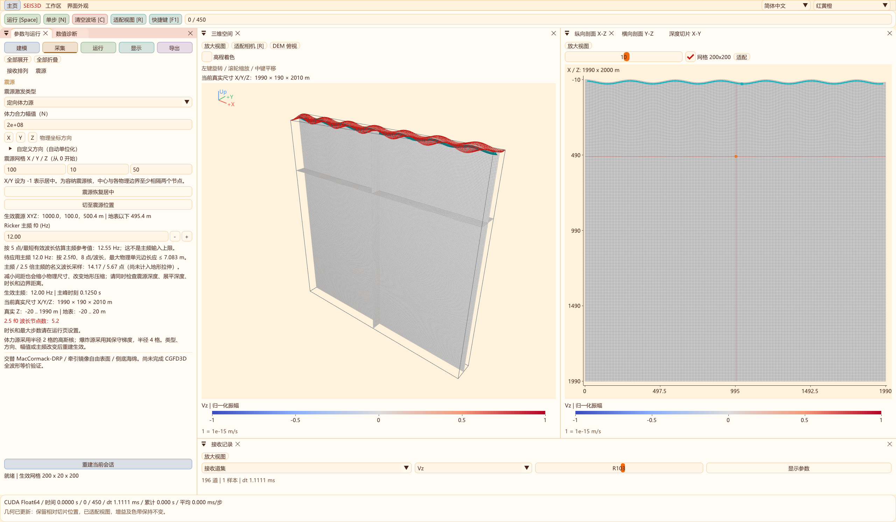

## 3. 3D · 接收测线配置

2560×1494 | 红黄橙 | 2026-10-27 | CUDA | t=0.000000 s

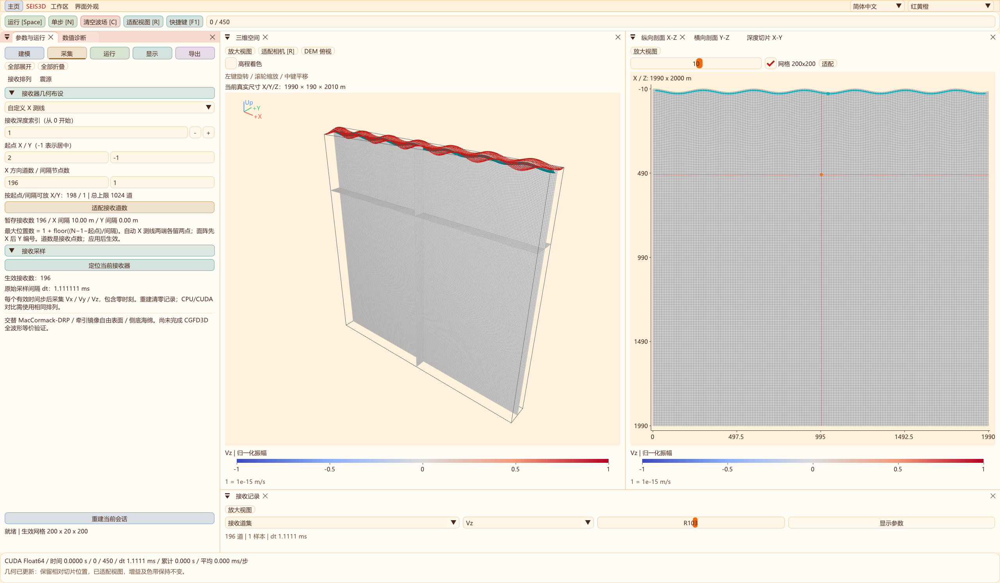

## 4. 3D · 运行参数与时间步

2560×1494 | 红黄橙 | 2026-10-27 | CUDA | t=0.000000 s

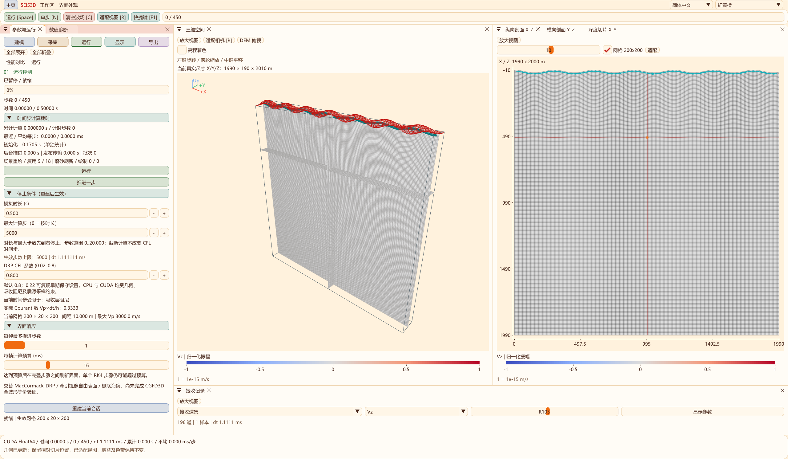

## 5. 3D · 0.10 s波场

2560×1494 | 红黄橙 | 2026-10-27 | CUDA | t=0.100000 s

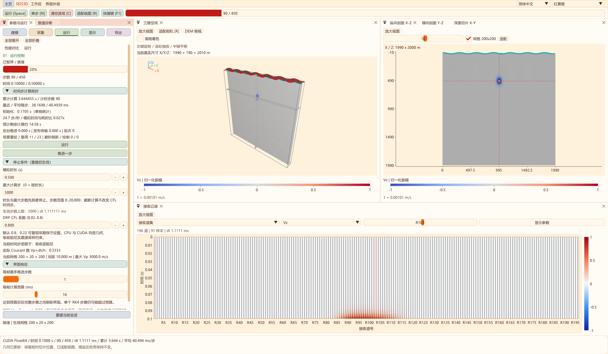

## 6. 3D · 0.25 s波场

2560×1494 | 红黄橙 | 2026-10-27 | CUDA | t=0.250000 s

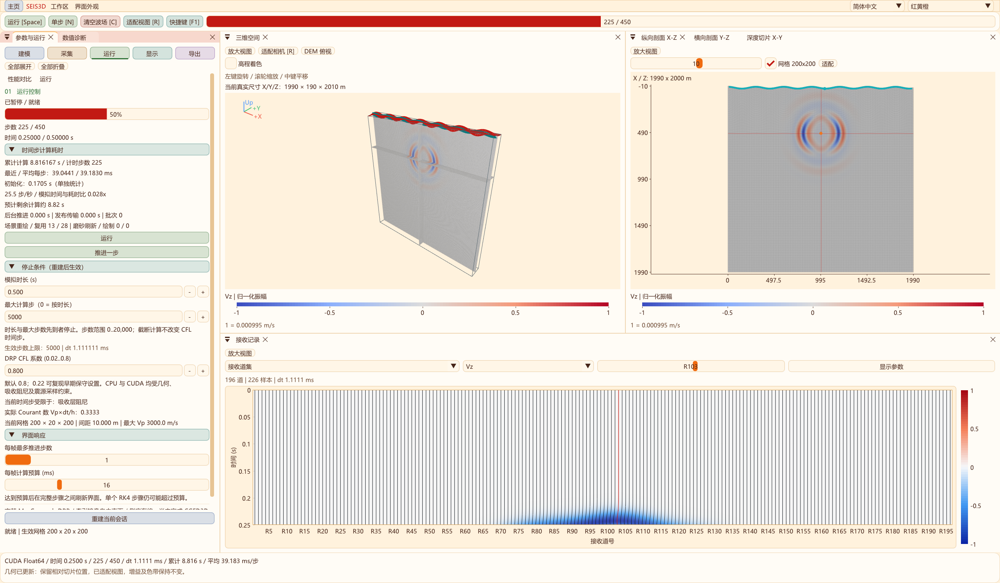

## 7. 3D · 0.40 s波场

2560×1494 | 红黄橙 | 2026-10-27 | CUDA | t=0.400000 s

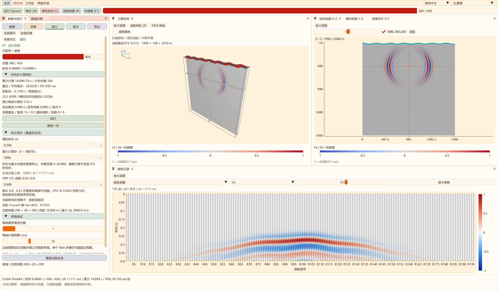

## 8. 3D · 原始地震道集

2560×1494 | 红黄橙 | 2026-10-27 | CUDA | t=0.500000 s

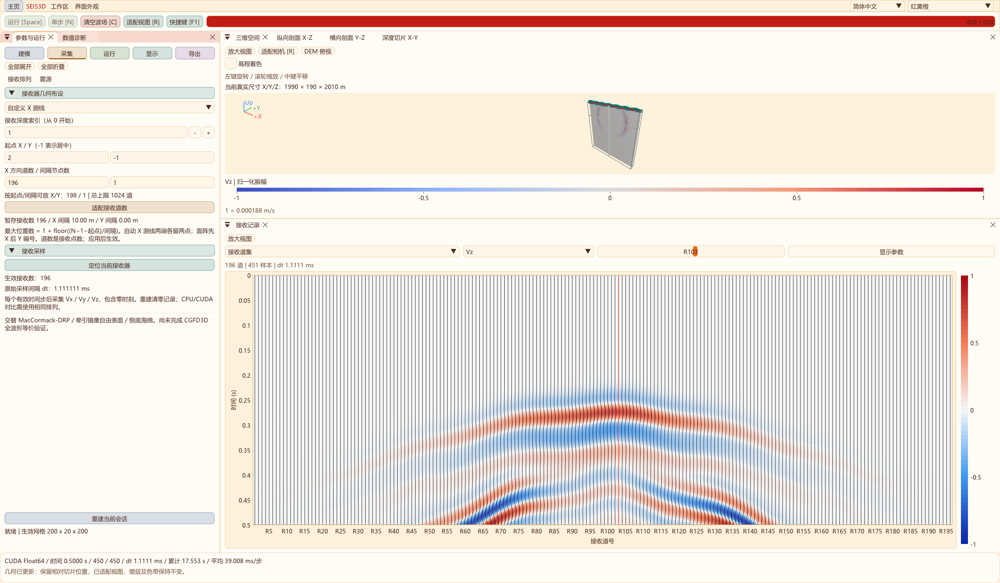

## 9. 3D · 同一记录的AGC预览

2560×1494 | 红黄橙 | 2026-10-27 | CUDA | t=0.500000 s

## 10. 3D · 1倍增益单道三分量

2560×1494 | 红黄橙 | 2026-10-27 | CUDA | t=0.500000 s

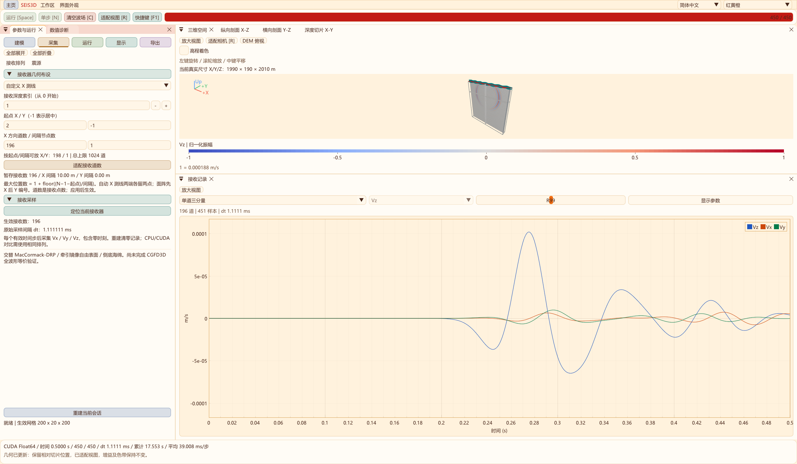

## 11. 3D · 网格与吸收层显示

2560×1494 | 红黄橙 | 2026-10-27 | CUDA | t=0.500000 s

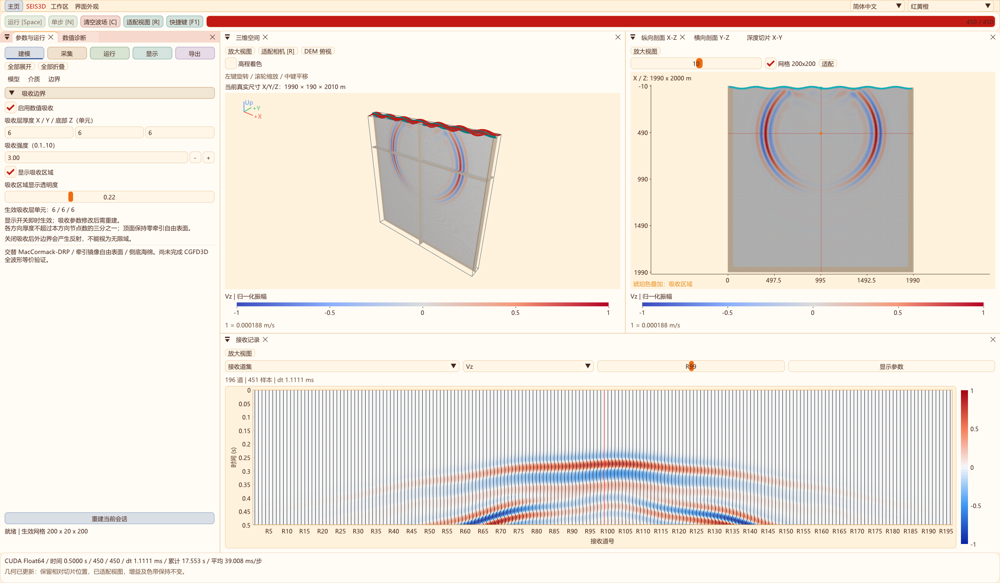

## 12. 3D · 快捷键帮助

2560×1494 | 红黄橙 | 2026-10-27 | CUDA | t=0.500000 s

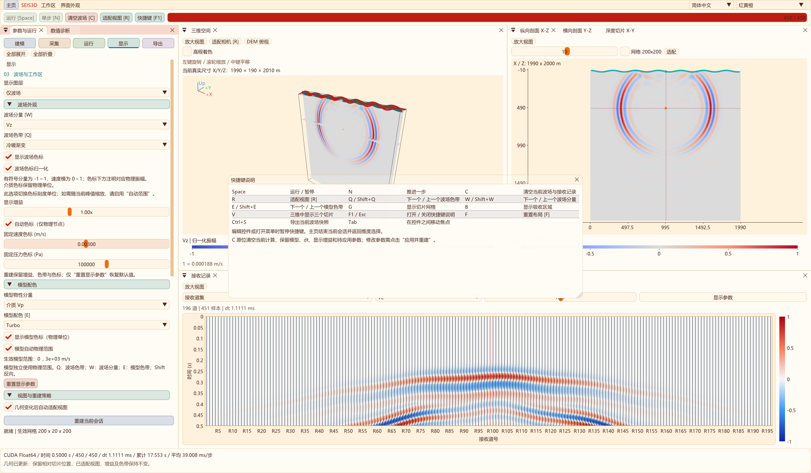

## 13. 3D · 模型与记录导出

2560×1494 | 红黄橙 | 2026-10-27 | CUDA | t=0.500000 s

## 14. 3D · 分层地层模型

2560×1494 | 红黄橙 | 2026-10-27 | CUDA | t=0.000000 s

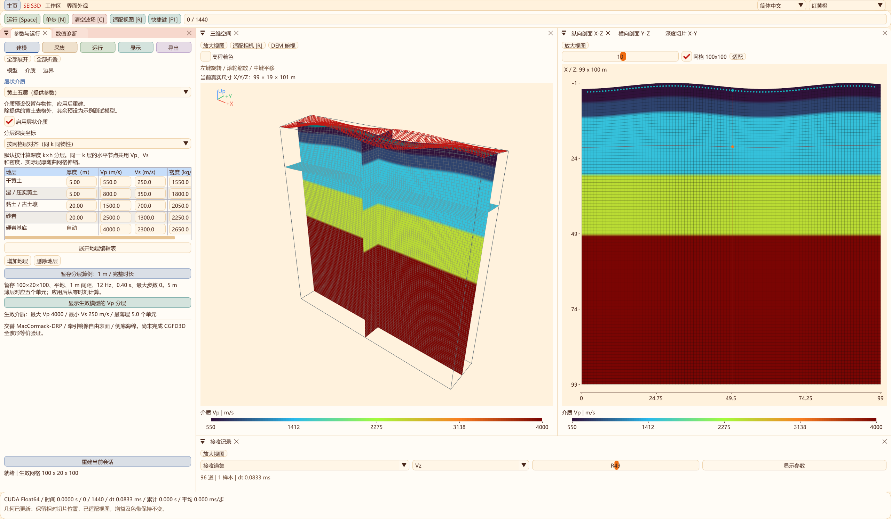

## 15. 3D · 30 Hz加密网格

2560×1494 | 红黄橙 | 2026-10-27 | CUDA | t=0.120000 s

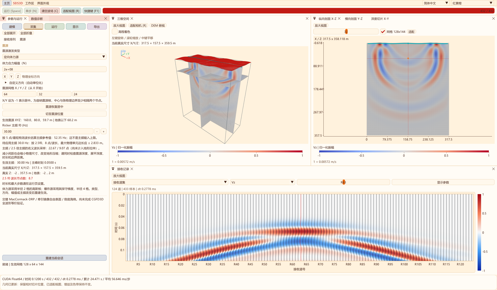

## 16. 3D · 50 Hz加密网格

2560×1494 | 红黄橙 | 2026-10-27 | CUDA | t=0.120000 s

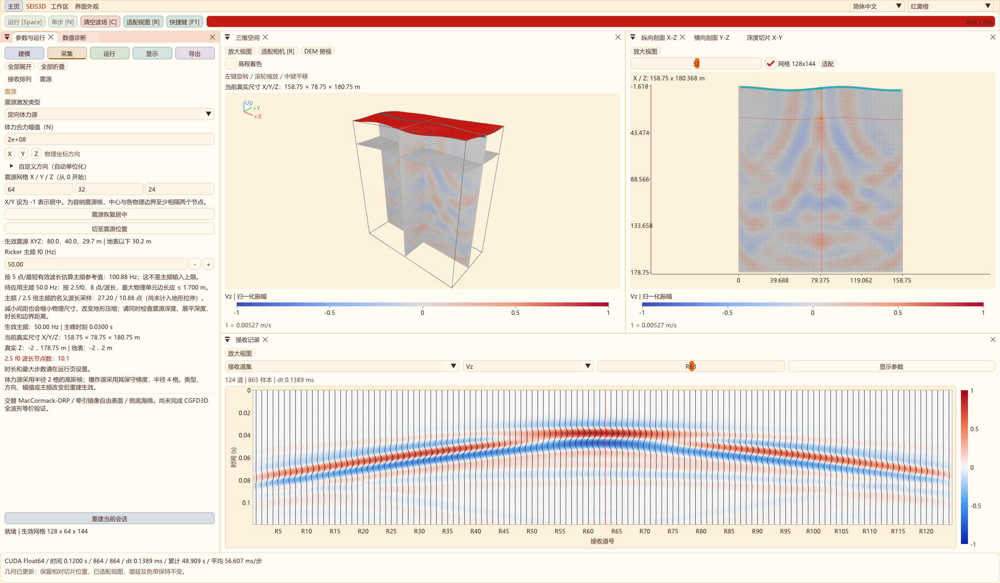

## 17. 3D · 60 Hz加密网格

2560×1494 | 红黄橙 | 2026-10-27 | CUDA | t=0.120000 s

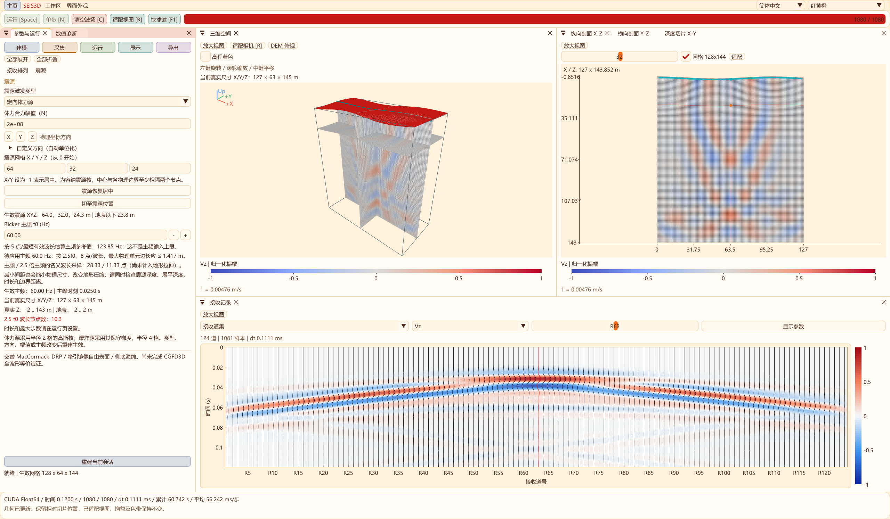

## 18. 3D · 1024位置接收面阵

2560×1494 | 红黄橙 | 2026-10-27 | CUDA | t=0.000000 s

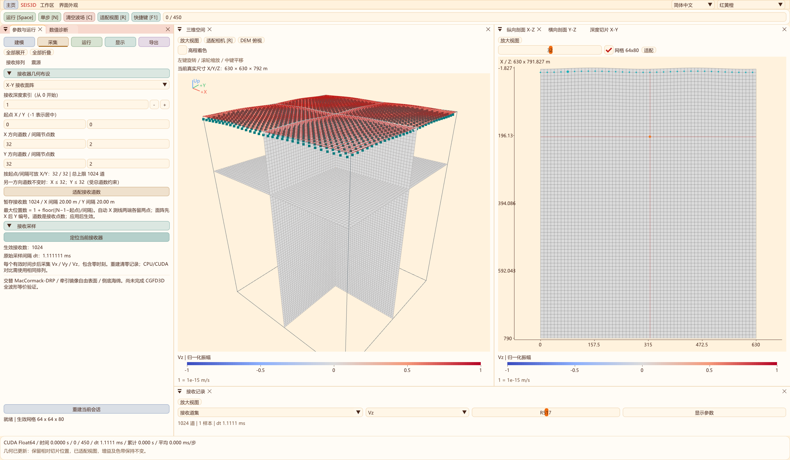

## 19. 3D · 默认DEM的turbo空间地表

2560×1494 | 红黄橙 | 2026-10-27 | CUDA | t=0.000000 s

## 20. 3D · 默认DEM的turbo俯视

2560×1494 | 红黄橙 | 2026-10-27 | CUDA | t=0.000000 s

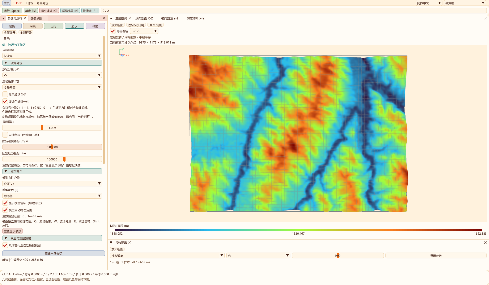

## 21. 2D · 二维建模

2560×1494 | 红黄橙 | 2026-10-27 | CUDA | t=0.000000 s

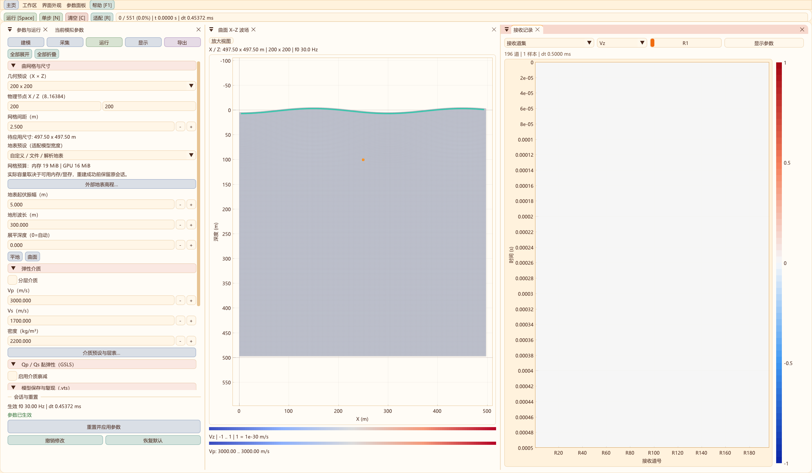

## 22. 2D · 二维运行工作台

2560×1494 | 红黄橙 | 2026-10-27 | CUDA | t=0.099819 s

## 23. 2D · 二维完成与完整接收记录

2560×1494 | 红黄橙 | 2026-10-27 | CUDA | t=0.250000 s

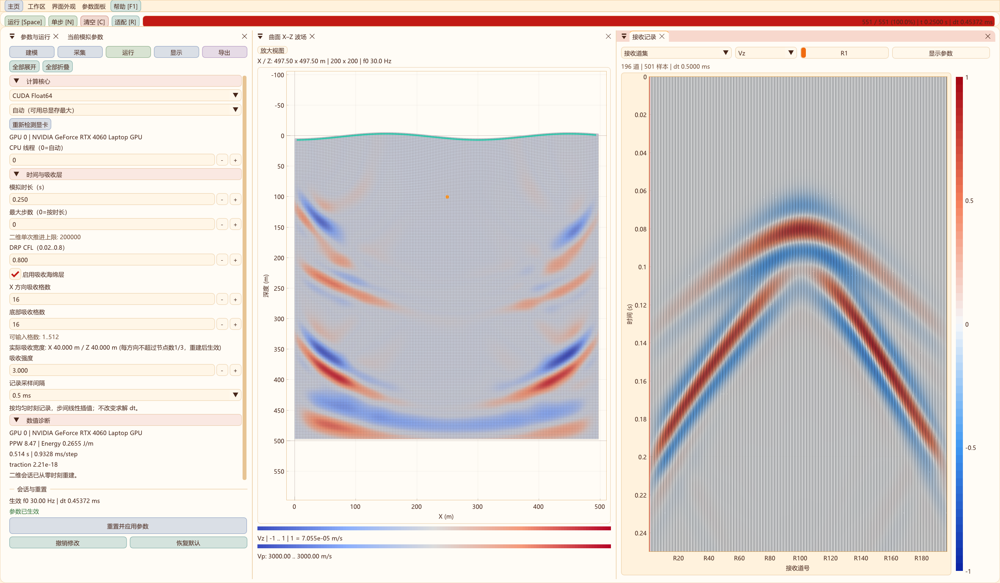

## 24. 2D · 模型保存与载入

2560×1494 | 红黄橙 | 2026-10-27 | CUDA | t=0.250000 s

## 25. 2D · 波场与CSV导出

2560×1494 | 红黄橙 | 2026-10-27 | CUDA | t=0.250000 s

## 26. 2D · SEG-Y导出

2560×1494 | 红黄橙 | 2026-10-27 | CUDA | t=0.250000 s

## 27. 2D · 快捷键说明

2560×1494 | 红黄橙 | 2026-10-27 | CUDA | t=0.250000 s

## 28. 2D · 图层与配色

2560×1494 | 红黄橙 | 2026-10-27 | CUDA | t=0.250000 s

## 29. 2D · 记录显示设置

2560×1494 | 红黄橙 | 2026-10-27 | CUDA | t=0.250000 s

## 30. 2D · 分层介质表

2560×1494 | 红黄橙 | 2026-10-27 | CUDA | t=0.250000 s

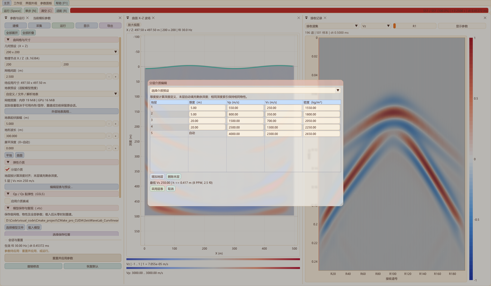

## 31. 2D · 外部高程剖面

2560×1494 | 红黄橙 | 2026-10-27 | CUDA | t=0.250000 s

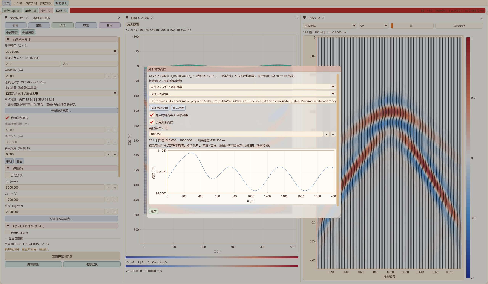

## 32. 2D · 爆炸矩源与波场

2560×1494 | 红黄橙 | 2026-10-27 | CUDA | t=0.099819 s

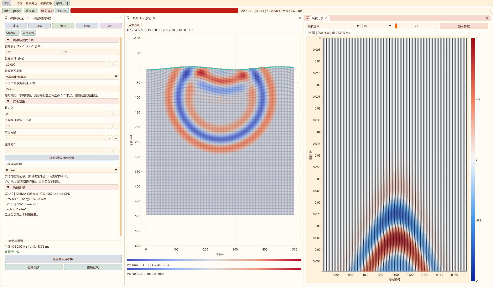

## 33. 2D · 高程示例预设

2560×1494 | 红黄橙 | 2026-10-27 | CUDA | t=0.099819 s

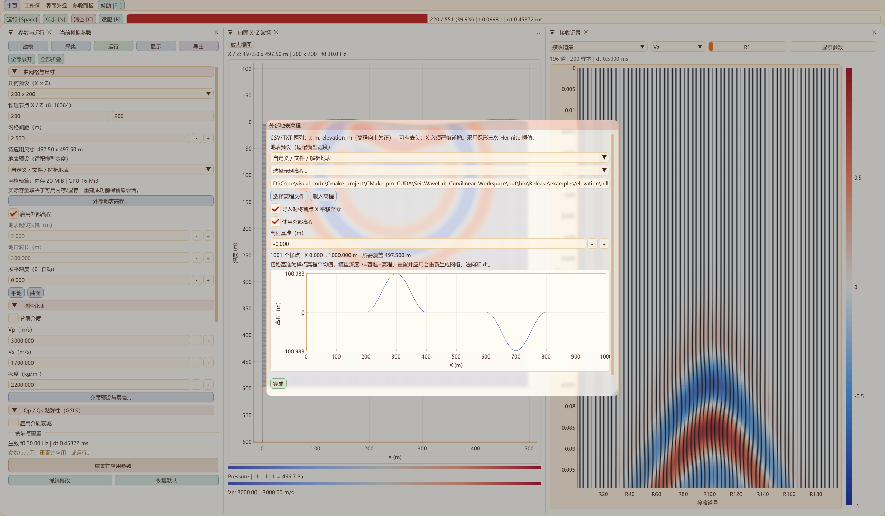

## 34. Home · 二维/三维主页

2560×1494 | 红黄橙 | 2026-10-27

