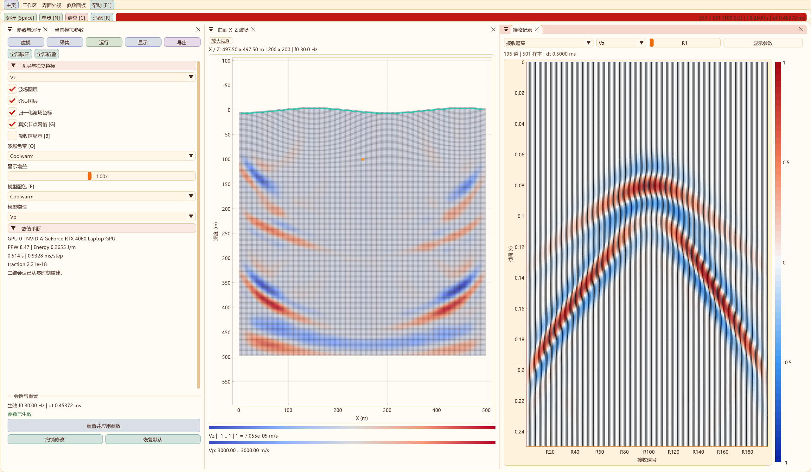
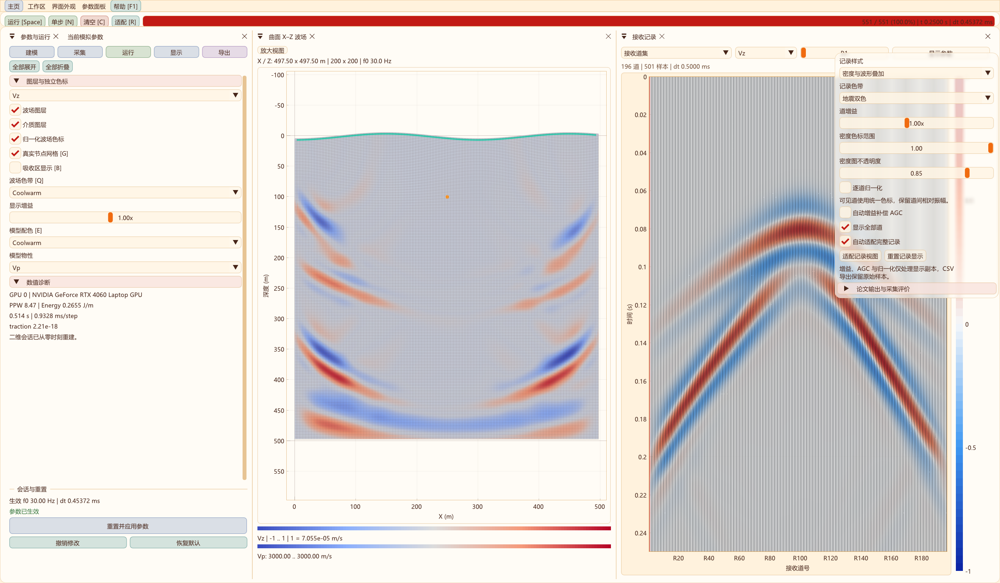
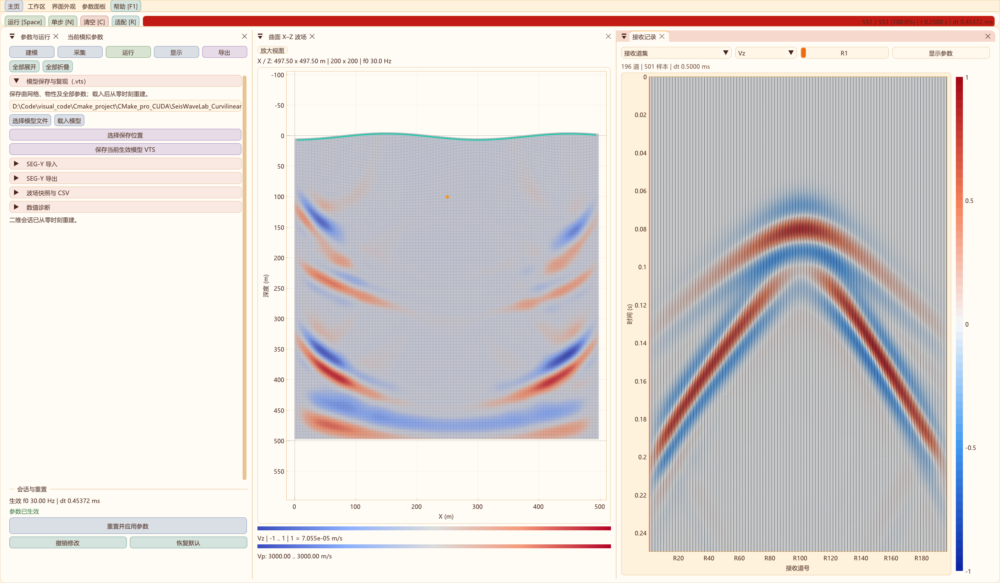
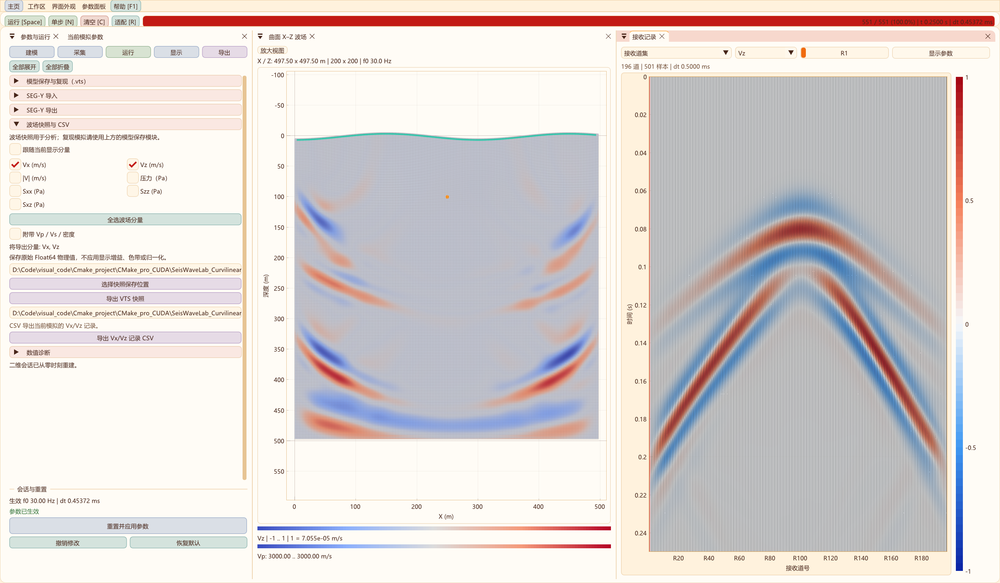
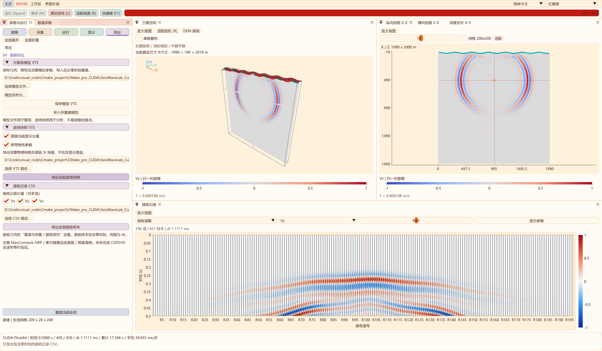
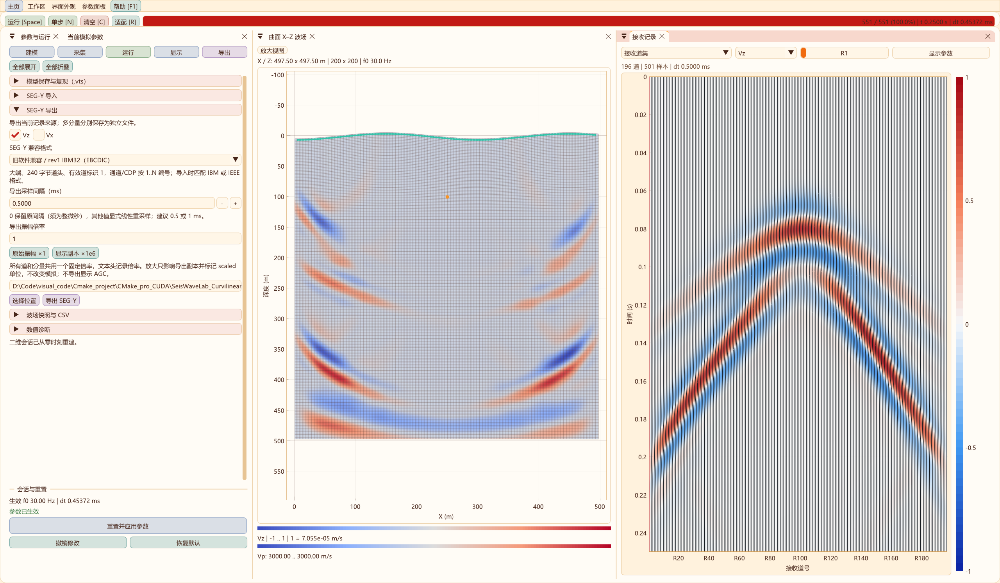
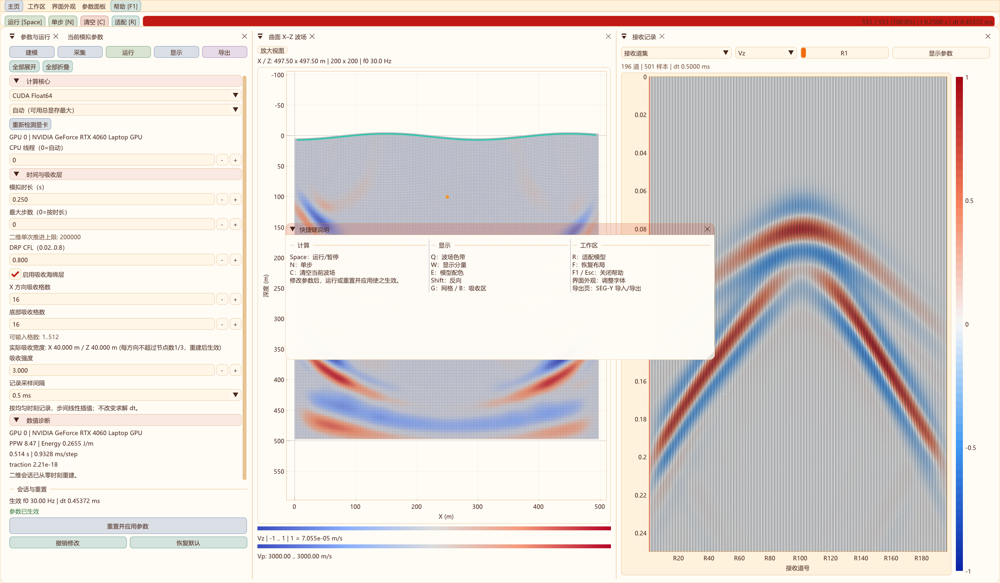

# SeisWave Lab 用户手册

2026-10-31正演采集更新：声学P1/DRP与弹性/黏弹性支持随模型自动沿地表均匀布设检波器，期望/实际道数分别保存；可切回手动，模型VTS保留设置，旧模型采集线保持兼容。[操作与验证](FORWARD_SURFACE_RECEIVERS_2D.md)。

2026-10-31 RTM交互更新：新增顶部及固定底部重建按钮，接收起点/道数/间隔/深度设置，默认随模型修改自动沿地表均匀布设；旧成像结果与新模型分开显示，支持再次运行。[操作、截图与验证](RTM_2D.md)。

2026-10-31高阶声学升级：新增独立CPU/CUDA、FP32/FP64曲网格DRP7–RK4试验核，含零压力自由面、外扩ADE-CPML、震源正则化及选择性数值耗散。解析/界面/吸收与八项回归通过；15/30 Hz局部对照未通过5%等误差门槛，P1继续默认，RTM保持P1。[实现、实测与下一阶段门槛](ACOUSTIC_DRP_2D.md)。

2026-10-31补充：声学默认自动RAM预算，切换CPU/CUDA及精度立即刷新容量，修复重建几何内存重复计数；真实界面CUDA FP32 5000×2000完成8步容量验收。新增“采集 → 地表均匀布设”，并补充有限元与高阶差分的取舍。[说明与验证](ACOUSTIC_CAPACITY_AND_METHOD.md)。

2026-10-31更新：二维功能工具栏分组留白；声学与弹性共用地形/分层编辑，按空闲内存与预算提示网格上限；压力增加SEG-Y rev2 IEEE32/64导出；RTM新增限速过程预览。[操作、截图与验证](WORKFLOW_UPGRADE_2D.md)。

2026-10-31：二维弹性/黏弹性及声学吸收区都可叠加真实波场，保留原浅橙色，新增“边界着色不透明度”（默认0.14）。[操作、截图与验证](ABSORBER_DISPLAY_2D.md)。

声学工作区按B或勾选“显示 → 吸收区波场”，可观察波进入左右/底部CPML后的真实压力。内外共用同一色标，细橙线为目标模型边界；默认导出范围不变。截图及当前自动限幅的含义见[声学CPML](ACOUSTIC_CPML_2D.md)。

声学正演默认同时显示Vp模型和压力波场，W循环压力/模型/叠加；下方记录使用与弹性波一致的显示面板，可切换单道与道集、波形与密度、调整增益和AGC。运行页默认选CFS-CPML，吸收带向左右及底部外扩，顶面保持零压力；详情见[声学CPML](ACOUSTIC_CPML_2D.md)。

二维正演顶部可选择声学 / P、弹性 / P–SV、黏弹性 / Qp–Qs。首页新增声学入口，声学压力工作区支持共享模型、地形和设备，实时压力波场与单炮记录；导出使用声学模型VTS、压力VTS及CSV。声学与弹性记录、源单位及离散方法不同，使用前见[二维三种正演模式](ACOUSTIC_FORWARD_2D.md)。

二维成像入口位于首页或顶部模块菜单的“声学 / P”分组内，与声学正演分开。普通导航不复制输入；“复制模型到”显式传递模型、地形及设备参数。可运行背景/真实压力模拟、RTM与源照明，再导出到外层 `out/imaging`。菜单箭头、统一布局、悬浮参数及隔离规则见[二维模块组织](MODULE_ARCHITECTURE_2D.md)。它采用独立声学核，不能把现有弹性 Vx/Vz 记录直接输入。操作、声学近似及验证范围见[二维 RTM 与源照明](RTM_2D.md)。

修订日期：2026 年 10 月 30 日。理论背景、离散方程及验证边界见[完整学术说明](PROJECT_MANUAL.md)。本手册说明当前二维与三维程序的实际操作。

二维“运行 → 计算核心 → 计算精度”提供FP32/FP64，默认FP64。模型数组、波场、RK暂存和GSLS/PML状态随选择切换；应用后从t=0重建。FP32模型保存为schema 5，旧模型仍按FP64读取。常规波场可用FP32降低显存；极弱尾波和残余应力研究优先FP64。操作、实测和限制见[二维精度说明](PRECISION_2D.md)，三维精度暂未修改。

四档二维模型在CPU32线程和GPU性能模式下的FP32/FP64效率见[2026-10-29测试报告](PERFORMANCE_PRECISION_2D.md)。线程数、实际利用率和GPU功率上限分别记录；大模型仍需通过当前空闲RAM/VRAM预检，不能根据网格轴上限认定一定可运行。

二维“建模 → Qp / Qs 黏弹性（GSLS）”现可开启材料衰减，设置均匀或逐层 Qp/Qs、拟合频带、参考频率及机制数，应用后从零时刻计算；默认关闭。Vp/Vs 为参考频率处相速度，拟合误差在实际参数/诊断中显示。操作、论文目录、复现命令及证据边界见[二维 Qp/Qs 模块](QP_QS_VISCOELASTIC_2D.md)。

## 1 启动与工作区

运行外层 `out/bin/Release/SeisWaveLab_Curvilinear.exe`。首次启动自动最大化；直接点击左侧二维或右侧三维示意区域即可进入模拟，下方按钮也可进入。主页几何网格与底部动画由程序绘制，属于功能示意，不是正演结果。姓名与技术栈显示在主页中。

2026-10-27全部界面截图使用红黄橙主题和2560×1494完整窗口。波场和接收记录沿用程序原有配色与显示样式，不使用gray。二维采用参数、波场、道集并排显示，三维记录页扩大高度；截图采用调整后的展示布局，首次进入仍可使用默认上下停靠；可自行拖动停靠分隔线调整比例。

“主页”结束当前会话并返回维度选择。重新进入会创建新会话；需要复现时先保存模型，需要保留结果时另行导出波场和接收记录。切换维度保留窗口最大化状态、位置和还原尺寸。

二维默认将“参数与运行”和“当前模拟参数”放在左侧同一停靠区域，用并排标签切换；右侧上方显示波场，下方显示接收记录。进入工作区即使用该布局，减少两个参数窗口分列造成的占用。仍可拖动停靠、调整字号或关闭面板；通过工作区菜单重新打开，F 恢复默认标签布局。

三维参数区包含“参数与运行／数值诊断”页签，绘图区提供三维空间、X–Z、Y–Z、X–Y 和接收记录。支持均衡、空间优先、页签和记录优先布局；三维小窗口可合并视图页签。两维均有固定横向的建模、采集、运行、显示、导出入口。

三维默认进入“运行 → 性能对比”，仅展开“计算核心”，其他参数分组首次访问时折叠。三维工作区支持多个显示器：在 Windows 显示设置中选择“扩展这些显示器”，按住面板顶部的标签或标题栏，将其拖出主窗口并移至副屏，即可作为独立窗口移动、缩放。拖回主窗口的停靠指示区并松开即可重新停靠；可将三维空间留在主屏，将剖面、接收记录、参数与运行、数值诊断分配到副屏。

所有独立窗口共用当前模拟会话、时间步和接收记录；窗口分离不会复制求解器或重新计算。已有独立窗口时，调整主窗口大小不会自动重新排列这些窗口；主窗口最小化时，独立窗口仍可继续显示和控制模拟。独立窗口右上角关闭按钮只隐藏对应面板，可通过“工作区”菜单重新打开；F 或菜单恢复默认布局会将面板重新停靠到主窗口。正常退出时布局保存在外层 `out/ui/workspace.ini`；点击“主页”会结束当前模拟并关闭其独立窗口。

顶部提供运行/暂停、单步、清空C、适配R和帮助F1。二维、三维运行栏均显示**计算耗时：时:分:秒.毫秒**，直接累计已完成时间步的实测用时，包含求解、诊断和接收采样；不计初始化、显示、暂停及导出。暂停时当前步结束后停止累计，继续运行或单步时累加；计算完成后保留读数，清空或成功重建后归零。悬停可查看计时口径。

进度条中的`t`为模拟物理时间，`dt`为物理时间步，与实际计算耗时分别显示；二维另有进度百分比。窗口变窄或字号增大时，按钮、计时及进度自动换行，参数面板和波场布局保持原有操作方式。计时随已完成步/后台批次发布更新，不对尚未结束的一步预估用时。

“参数与运行”的全部展开/全部折叠控制功能页内各分组，切换到其他功能页后也保持该次展开/折叠选择；单个分组仍可手动展开。操作按钮和底部重建区始终位于参数滚动区之外。

界面外观支持中英文、12 种主题与 16–28 px 字号。主题包括 Process 新版十种配色、MATLAB 浅灰蓝和红黄橙，材质可选液态 / 磨砂。参数面板可选择左侧停靠、居中悬浮或两者并存；悬浮面板可最大化、还原与居中，两套面板可以分别显示不同参数页并共用同一份参数。三维入口为“工作区 → 参数面板显示”，二维入口为顶部“参数面板”。详细行为及副屏材质边界见[主题与悬浮参数面板](APPEARANCE_AND_PANELS.md)。功能颜色分别标识建模、运行、显示和导出。主题与语言不修改物理状态；正常退出保存界面偏好。

## 2 建模与参数生效

建议按以下顺序建立会话：

1. 在建模页选择节点数、网格间距、起伏或外部高程，核对真实尺寸。
2. 选择均匀或分层材料，输入 Vp、Vs、密度和层厚。
3. 在采集页设置震源机制、位置、主频、幅值、接收排列和输出采样间隔。
4. 在运行页选择 CPU/CUDA、设备、时长、步数上限、CFL 与吸收参数。
5. 点击面板底部“重置并应用参数／应用修改并重建”，检查生效参数和 dt，再运行。

二维运行和单步也会先应用待修改参数；编辑运行中的参数会暂停推进。三维修改后需应用重建。初始化成功才替换原会话，错误输入不会丢弃旧结果。C 只清空当前生效模型的场、记录和计时，不应用尚未生效的参数；“撤销修改”恢复当前参数，“恢复默认”恢复默认输入。

二维“当前模拟参数”直接读取实际求解器，列出生效/待应用值、dt、记录间隔、尺寸、震源、接收数量和实际终止时间。存在待修改项时，旧 dt 仍属于原模型；请以成功重建后的 dt 为准。

二维每方向允许 8–16384 个物理节点，预设包括 200×200 至 4000×2000；实际大小受可用 RAM/VRAM 限制。三维每方向允许 8–300，含 100³、200³、300³ 预设；最大值并不保证显存足够。导出和物理尺寸都排除三层虚点，名义轴长为 `(N−1)h`；起伏曲网格的真实 Z 包围盒可能更大。

分层编辑使用独立表格弹窗，提供均匀、冲积层、黄土五层、风化岩和盆地示例。末层填充剩余深度，默认按计算深度索引归层。三维另可按当地埋深或基准深度归层，物理意义不同。

二维外部高程为两列 `x_m,elevation_m` 的 CSV/TXT：X 严格递增，覆盖完整模型跨度；高程向上为正，模型 Z 向下为正，满足 `z=datum−elevation`。三维支持单层、米制、等距规则高程 VTI/VTS，默认载入靖边南沟谷 400×288、25 m 数据。二维与三维的原始高程样点均可保存在模型 VTS 内。外部数据载入为待应用参数，核对实际求解网格后应用重建；支持格式及预算见[三维外部 DEM](EXTERNAL_DEM_3D.md)。

## 3 震源、时间步和运行

两维均支持定向体力源和各向同性爆炸矩源。体力方向可选坐标轴或自定义，二维限制在 X–Z 平面。三维幅值单位分别为 N、N·m；二维为单位 Y 长度的 N/m、N。二维线源和三维点源的几何扩散与振幅不能直接比较。

程序自动选择可用 CUDA，检测失败时默认 CPU。运行页可重新检测所有显卡并选定计算卡；自动模式选总显存最大的可用 CUDA 卡。后端、设备或线程设置在重建后生效，一次会话使用一块计算卡。手动选择 CUDA 后初始化失败保留原会话，不暗中改用 CPU。

默认时长为 1 s、最大 5000 步，先到者停止；上限 0 表示仅按时长停止。总有效步数还受 20,000 步实现上限约束。最大步数不会放大 CFL 时间步，提前停止可能未覆盖完整震源窗口。

CFL 默认 0.8，范围 0.02–0.8。程序同时考虑波传播/几何、阻尼和震源时间采样，再按完整时长确定实际 dt。曲面压缩、较大逆度量或强阻尼可能使步长小于规则网格；不能只凭相同 CFL 输入判断两种程序的步长相同。

空间采样与时间稳定性应分开检查。Vp/Vs=3000/1700 m/s、h=10 m、60 Hz 时，S 波主频波长仅 2.83 个节点；不发散不能证明无频散。可从 `h_max≤Vs_min/(8×2.5f0)` 估计空间采样，再做加密、源宽度和边界距离对照。曲网格实际最大物理边长可能大于名义 h。

二维在“运行 → 时间与吸收层 → 吸收边界”选择关闭、海绵（原有）或 CFS-PML (ADE)。选择 PML 后设置左右/底部厚度、目标 R、κ 最大值及参考频率，应用并重建生效；默认 R=1e-4、κ=3、频率 0 随震源。目标 R 是轮廓输入，不是实测反射率。诊断给出额外容量及时间步限制，具体见[二维 CFS-PML](CFS_PML_2D.md)。三维仍为侧面/底部可配置海绵。“吸收区显示”仅控制图层，B 可即时开关。关闭数值吸收会增加外边界反射。

新建二维工作台默认勾选“吸收带向模型外扩展（推荐）”。输入尺寸表示完整目标模型，左右及底部额外分配吸收网格，炮点、检波器、地形与导出范围保持原坐标。界面同时显示目标与实际计算节点数，内存预算包括外扩。B 可显示外部吸收区真实波场，保留原浅橙色并以可调不透明度叠加，内外共用色标。载入旧模型仍保持原内部模式；要升级需勾选外扩并重建。未外扩时若震源支撑或检波器进入吸收带，会显示提示。三维尚未加入外扩功能。

累计计算时间和平均 ms/步来自完整有效步推进，涵盖阶段、边界、诊断、采样及必要 CUDA 同步；不包含绘图、暂停、初始化和导出。比较 CPU/CUDA 时应统一模型、实际 dt、步数、源、精度、接收数量和采样设置，报告设备和线程数。

## 4 采样、显示与接收记录

二维可选每个求解步、0.5 ms、1 ms、2 ms 和自定义记录间隔；改变后重建。独立采样在相邻已接受步之间做线性插值，不改变求解器 dt。更密采样不增加物理时间分辨率，较疏采样需检查频谱及抗混叠需求。模拟结束时刻和记录末样时刻可能略有不同。

三维当前接收记录按每个有效步采样，含 t=0，因此 N 步有 N+1 样本。二维固定记录间隔时，样点号直接确定时间，不追加偏离均匀轴的末样。

接收位置最多 1024，实际单轴容量为 `1+floor((N−1−start)/stride)`，面阵还受总位置数限制。一个接收位置的多个分量不计为多个物理位置。三维面阵按 X 最快变化展平，应结合导出的接收坐标解释道号。

二维网格显示默认开启，模型默认 Coolwarm；模型和波场使用独立配色、范围与图例。波场色标默认归一化，有符号量为 −1..1、速度幅值为 0..1，同时给出对应物理尺度。自动范围图不能用于跨时刻绝对振幅比较。大网格只对绘图做抽样，导出保留全部物理节点。

记录区共用二维/三维显示模块，支持波形、变面积、密度及其组合、色带、增益、范围、透明度、逐道归一化与 AGC。显示只处理副本；定量分析应使用原始导出。

## 5 模型保存与分量导出

模型 VTS、波场 VTS 和接收记录是三种不同数据。详细字段与复现约定见[模型与波场数据交换](MODEL_AND_WAVEFIELD_IO.md)。

| 目的 | 操作 | 保存内容 |
| --- | --- | --- |
| 复现二维模型 | 建模/导出 → 模型保存与复现 | 几何、物性、全部参数、层表及外部高程样点 |
| 复现三维模型 | 导出 → 可复现模型 VTS | 三维几何、物性、层表、震源、接收及求解参数 |
| 分析某时刻波场 | 导出 → 波场快照 | 当前有效步的所选分量及可选物性 |
| 分析接收时间序列 | 接收 CSV 或二维 SEG-Y | 各接收位置的采样历史及时间/几何信息 |

模型有未应用修改时禁止保存。导入本程序保存的版本化模型后，从 t=0 重新计算几何、dt、源权重和记录；不是从保存时刻续算。损坏、截断或版本不支持时保留旧会话。CUDA 设备在当前机器重新选择；所保存 CUDA 后端不可用时明确提示使用 CPU。

波场默认跟随当前显示分量。关闭跟随后可多选速度、幅值、压力和应力，三维还可附带三分量速度矢量；未选择任何波场量时不能有效导出。三维 CSV 可独立勾选 Vx、Vy、Vz，按接收位置、再按 Vx/Vy/Vz 顺序列出。二维按当前FP32/FP64计算精度导出原始场值，三维仍为Float64，不包含显示增益、归一化、AGC、调色或绘图抽样。

二维 SEG-Y 支持按 Vx/Vz 导出为独立文件，并可导入受支持的 SEG-Y 查看。默认 rev 2 IEEE32 保留原始振幅和精确间隔。VISTA 等旧软件可选 rev 1 IBM32（EBCDIC）或 IEEE32（ASCII），显式选择 0.5/1 ms 等整微秒输出间隔；格式兼容与显示振幅是不同问题。需要放大副本时可设置全道统一倍率，文本头注明 scaled 单位及倍率，原始模拟不变。详见[地震记录与 SEG-Y](SEGY_AND_RECORDS.md)。

## 6 快捷键与文件位置

| 按键 | 功能 |
| --- | --- |
| Space / N | 运行暂停 / 单步 |
| C | 清空当前生效模型的波场、接收记录和推进计时 |
| R / F | 适配视图 / 恢复默认工作区 |
| Q / W / E | 波场色带 / 显示分量 / 模型色带；Shift 反向 |
| G / B | 网格 / 吸收区叠加 |
| F1 / Esc | 帮助 / 关闭帮助 |
| V / Ctrl+S | 三维切片开关 / 三维波场 VTS 快照 |

输入框编辑时抑制相关工作区快捷键。二维 F1 为横向三栏帮助。

所有生成文件位于源码仓库外的 `../out`。程序和运行依赖在 `bin/Release`，偏好在 `ui`，二维默认模拟输出在 `2d`，三维模型默认 `curvilinear_model.vts`、波场默认 `curvilinear_snapshot.vts`、接收默认 `receiver_traces.csv`。文档使用仓库中的 `docs/images` PNG，保留完整原生 2560×1494 像素；网页预览可缩放，下载文件本身没有裁剪或重采样。

模型保存用于复现实验条件，不承诺不同编译器或硬件的逐位一致；CPU/CUDA 一致性也不能代替解析解、边界反射率和网格收敛验证。

## 八种二维地表预设与宽度适配

在“二维 → 建模 → 曲网格与尺寸 → 地表预设”选择地形，点击 1 / 2 / 4 km，再“重置并应用参数”。h=2.5 m 时 Nx 分别为 401 / 801 / 1601；快捷宽度保持间距和 Nz，实际跨度以待应用尺寸为准。预设高程保持原值，横向伸缩改变地形宽度和坡度；后续修改 Nx 或 h 自动重新适配，首次选择预设将高程基准设为 0 m。详见 [外部高程与预设](SURFACE_PROFILES.md)。

手动导入文件或载入已保存模型时按显式坐标工作，不自动拉伸。模型保存的是已适配的样点；重新载入后如需继续随宽度适配，应重新选择预设。
