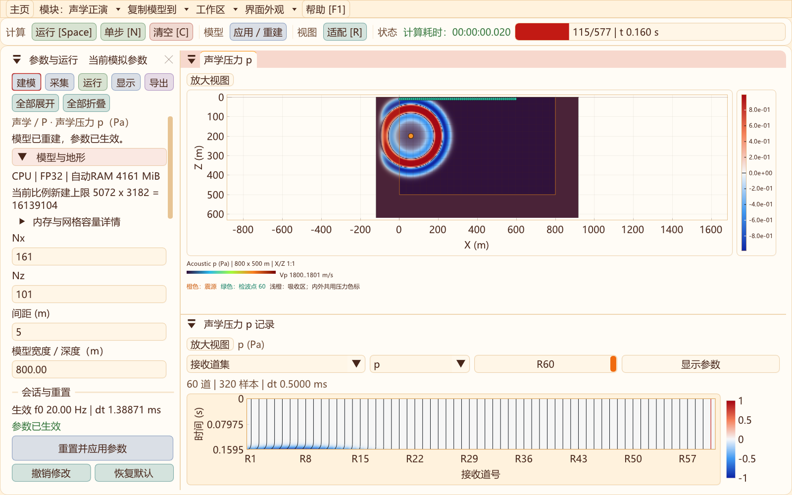
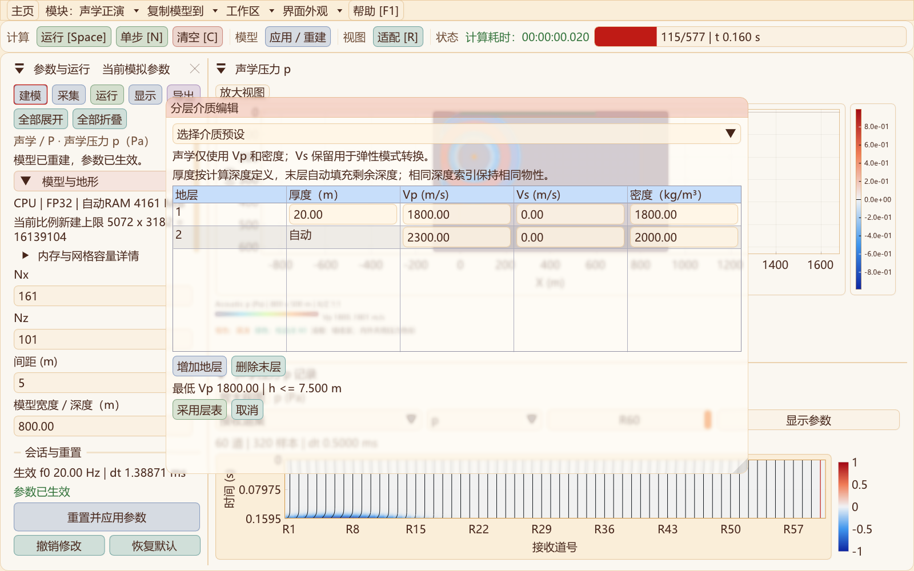
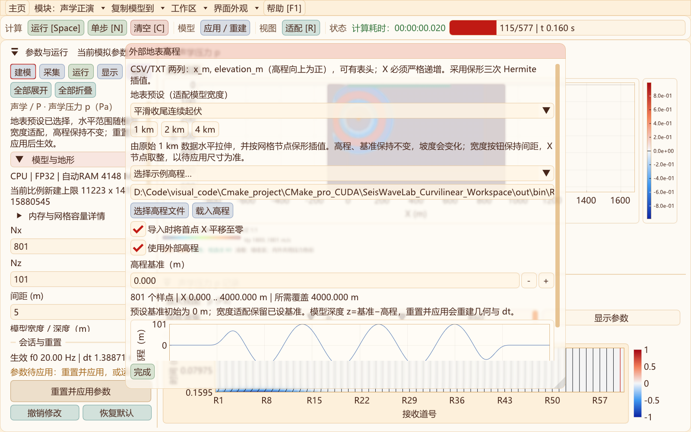
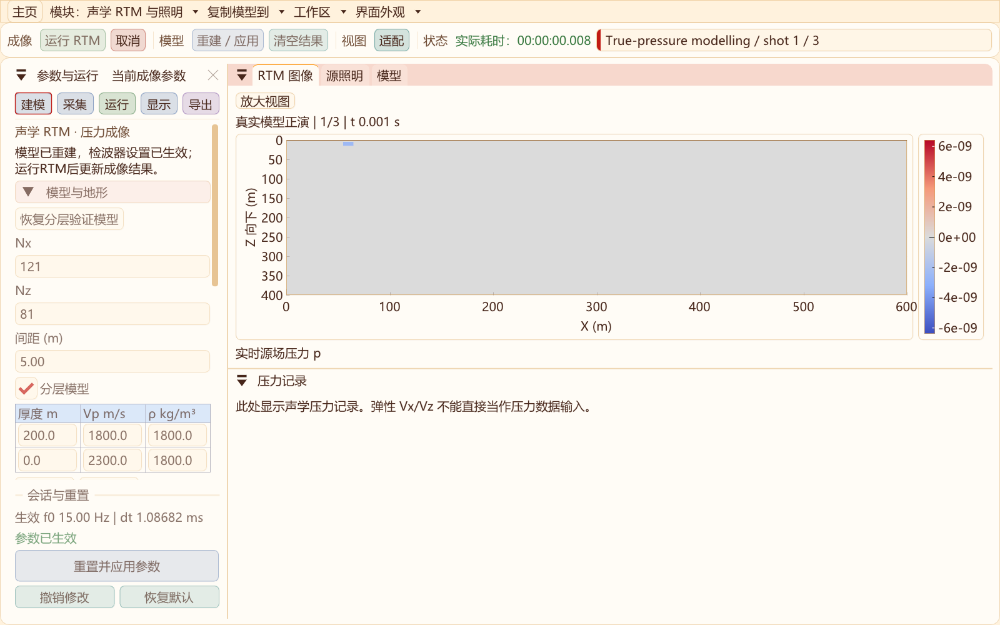

# 二维工作区：功能工具栏、统一建模、容量提示与RTM过程预览

2026-10-31补充：声学默认自动RAM预算，切换CPU/CUDA及精度立即刷新容量，修复重建几何内存重复计数；真实界面CUDA FP32 5000×2000完成8步容量验收。新增“采集 → 地表均匀布设”，并补充有限元与高阶差分的取舍。[说明与验证](ACOUSTIC_CAPACITY_AND_METHOD.md)。

更新：2026-10-31。本轮更新二维声学、弹性/黏弹性和RTM界面，保持原红黄橙主题、浮动/停靠、快捷键及物理求解设置。

## 工具栏

声学和弹性正演的顶部命令按“计算 → 模型 → 视图 → 状态”分组。组内控件保持8 px间距，组间增加分隔线与留白；窄窗口优先按组换行，并按当前字体重新计算高度。弹性新增顶部“应用/重建”，与侧栏相同操作共用控制器。RTM按“成像 → 视图 → 状态”分组，计算时保留取消和进度显示。



这借鉴VS的功能分组方式，没有改变原快捷键与模拟状态；运行、暂停、单步、清空和适配仍使用原有按键。窗口越窄或字号越大时会增加工具栏行数，记录与波场继续在下方布局。

## 声学模型尺寸与动态容量

模型页可按Nx/Nz设置节点数，也可编辑物理宽度、深度和采样间距；物理尺寸按间距换算为整数节点，至少16点。顶部持续显示**当前长宽比下的预算网格上限和总目标点数**。“内存与网格容量详情”给出固定Nz下的最大Nx、固定Nx下的最大Nz、当前估算内存/显存及可用内存。

设备/精度及预算输入改变时立即刷新，空闲资源每0.75秒刷新；默认使用自动RAM预算。估算考虑当前CPU/CUDA、FP32/FP64、左右/底部外扩、CPML稀疏状态、重建临时数组及完整原始记录。RAM受可选手动上限和系统空闲内存保留量约束，CUDA另检查空闲显存；当前会话已占用的资源不被当作新建模型的空闲内存。同参数重置可以复用已生效数组，显示当前可复用网格。超预算可先按当前比例缩减待应用网格，再重建。

这是**保守的内存预算估算**，不是显卡可运行完整实验的精确保证，也不是空间采样、地形Jacobian、CFL或时长检查的替代。重建仍会重新查询内存并执行物理有效性检查，失败保留旧会话。当前每轴实现上限16384；单轴最大值不能同时组合使用，应参考长宽比对应的总网格上限。

## 与弹性波共用地形和分层设计

声学“分层设计/介质预设”与“地形/高程设置”直接使用共用的[ModelEditor2D](../src/common/ui/ModelEditor2D.hpp)，弹性与声学各自持有草稿、路径、预设与运行状态。



分层支持现有五类介质预设、增加/删除地层、末层自动填满剩余深度、厚度/Vp/Vs/密度编辑。声学只使用Vp和密度，Vs可以为0并只为模式转换保留；弹性仍检查正Vs、正体积模量，黏弹性仍执行原Q拟合校验。不能因为界面共用而放宽弹性的物理条件。



地形沿用现有CSV/TXT导入、首点X归零选项、平均高程初始基准、PCHIP插值、剖面预览和八组地表预设。1/2/4 km预设适配保持高程、水平拉伸形态；导入实测文件不会被自动当作可拉伸预设。调整待应用尺寸不会移动已生效模型的炮检位置，重建后才生效；撤销恢复当前模型及其预设来源。

## SEG-Y导出

声学正演导出目录现包含`pressure_records.sgy`，采用**SEG-Y rev2**，单分量`Pressure`、单位Pa、增益1，包含原始采样、源检坐标与采样间隔；不采用显示AGC、限幅或归一化。

| 文件 | 用途 |
| --- | --- |
| `pressure_records.sgy` | 压力道集；默认IEEE32，导出页可选IEEE64保留双精度样本 |
| `pressure_records.csv`、`receivers.csv` | 原始压力、时间轴与检波点坐标 |
| `model_acoustic.vts` | 从t=0复现声学模型 |
| `pressure.vts` | 目标域压力快照，不能当作重启文件 |
| `experiment.txt`、`COMPLETE.txt` | 单位、方法、导出精度、配置与完成状态 |

IEEE32会按32位浮点量化原始样本；IEEE64保持双精度。第三方软件的SEG-Y rev2/IEEE64支持程度应单独核对。弹性仍沿用原有Vx/Vz SEG-Y导出，不能把压力道集当作速度分量。RTM本轮仍沿用原图像、照明和末炮残差导出，未增加实测炮集输入或声学正演到RTM的直接导入。

## RTM运行过程画面

RTM异步计算期间实时发布三阶段画面：真实模型压力正演、背景压力与照明累积、源场回放与成像累积。主图在前两阶段显示压力，逆传阶段显示累计图像；照明和真/背景速度模型也可同步查看。阶段、炮次及模拟时间随画面标注。



预览最多256×192节点，通常每100 ms发布一次，并在阶段边缘发布关键帧。UI只接收最新的独立快照，不直接读取求解线程的可变状态；降采样仅影响显示，完整成像结果不降采样。小实验可能很快完成，预览帧较少；完成后自动切换至完整结果。

取消或失败不会覆盖上一次完成结果。过程图像为未完成的累计量，自动色标随计算变化，不应当作最终反射率或振幅结果。RTM仍使用原海绵和经过点积验证的离散伴随，本轮不替换其边界物理。

## 验证

- [八项回归](data/workflow-upgrade-2026-10-31/regression-final.txt)：声学、RTM、模块隔离、两种界面、PML/精度界面和本轮专用验证通过。
- [原生验证](data/workflow-upgrade-2026-10-31/native.txt)：容量随预算、精度和空闲显存变化；IEEE32/64 SEG-Y样本、单位、坐标、采样间隔往返正确；CPU/CUDA上开启/关闭RTM预览时图像、照明及记录逐点一致，预览三个阶段均发布，取消保留旧结果。
- [弹性完整工作区](data/workflow-upgrade-2026-10-31/elastic-workspace.txt)与[声学交互](data/workflow-upgrade-2026-10-31/acoustic-ui.txt)：真实输入、快捷键、字体/尺寸、共用分层弹窗、八组地形1/2/4 km适配、撤销和记录显示通过。
- [预览与界面复核](data/workflow-upgrade-2026-10-31/preview-final.txt)及[极端尺寸预算保护](data/workflow-upgrade-2026-10-31/capacity-guard.txt)通过。

```powershell
# 源码目录，开发者终端；所有输出仍在外层out
cmake --build ../out/build/x64-Release --target SeisWaveLab_Curvilinear seis2d_workflow_upgrade_validation
ctest --test-dir ../out/build/x64-Release -R '^curvilinear_2d_(workflow_upgrade|acoustic_ui|rtm_ui)$' --output-on-failure
```

未据此发布新的求解性能倍速、生产资料适用性或吸收反射率结论。
